# Business「Social Atelier」デザイン方針と実装記録

Business（NAKAMA）のログイン後画面を「Social Atelier」という方針で統一したときの設計資料です。
見た目だけでなく、情報の配置・ナビゲーション・操作の分かりやすさを揃えました。
権限・料金プラン・参加承認・データ・業務ロジックは変えていません。

- ブランチ: `feature/business-social-atelier-redesign`（2026-10-29 作業）
- 対象: Business のログイン後画面
- 対象外: ログイン前の紹介ページ（`/business` 未ログイン）、Business 認証画面（`shared/domain_auth`）、音楽側、システム管理画面、Stripe 側の画面

---

## 1. デザイン方針

| 観点 | 方針 |
|------|------|
| 雰囲気 | 写真・アイコンで「誰が・何をしているか」が伝わる、親しみやすい SNS 的な構成。特定サービスの画面・ロゴは複製しない |
| 色 | 白を基調に、ページ背景（`#F8F8FB`）とカード（白）を薄く区別する。アクセントは落ち着いたバイオレット、補助に淡いピーチ・ラベンダー |
| グラデーション | 画像がないときの頭文字の背景と、カバー画像がないときの細い帯だけに使う |
| 文字 | 本文 16px・行間 1.6〜1.75。本文は濃いグレー（`#25252D`）でコントラストを確保する |
| 形 | コミュニティは丸い画像、プロジェクトは画像付きカード。角丸・線・影はトークンの値に揃える |
| 画像なし | 名前の頭文字（`business_monogram`）で代替する。ダミー画像は追加しない |
| 装飾 | 意味のない英語コピー、大きなヒーロー、装飾目的のアニメーションは入れない |
| 状態表示 | 色だけで伝えない。「参加中」「承認待ち」「停止中」などの文字と記号を必ず付ける |
| 操作 | タップ領域は原則 44px 以上。hover だけに頼らず、フォーカスリングを表示する |
| 動き | 状態変化の短いトランジションのみ。`prefers-reduced-motion: reduce` では無効にする |

---

## 2. デザイントークン（最終値）

定義場所: `app/assets/stylesheets/business/atelier/tokens.scss`（`.ba-body` の CSS カスタムプロパティ）

### 色

| トークン | 値 | 用途 | コントラスト（白背景） |
|----------|----|------|------------------------|
| `--ba-accent` | `#7856B8` | リンク・主ボタン・現在地 | 約 5.5:1 |
| `--ba-accent-strong` | `#5F3F9C` | hover・淡い背景上の文字 | 約 7.6:1 |
| `--ba-accent-soft` | `#F2EDFA` | 現在地の背景・補助ボタン | — |
| `--ba-accent-line` | `#D9CDEF` | 丸画像の輪・淡い枠線 | — |
| `--ba-lavender` | `#EBE4F7` | 補助色（帯・hover） | — |
| `--ba-peach` / `--ba-peach-text` | `#FDE9DD` / `#8A4A2B` | 種別ラベル・お試し表示 | 約 5.8:1（ピーチ背景上） |
| `--ba-text` | `#25252D` | 本文 | 約 15:1 |
| `--ba-text-muted` | `#5C5C6B` | 補助文字 | 約 6.5:1 |
| `--ba-text-subtle` | `#6B6B7B` | さらに弱い補助（区切り記号など） | 約 5.2:1（ページ背景上 4.9:1） |
| `--ba-bg` | `#F8F8FB` | ページ背景 | — |
| `--ba-surface` / `--ba-surface-muted` | `#FFFFFF` / `#F3F3F7` | カード / 静的な値・hover | — |
| `--ba-border` / `--ba-border-strong` | `#E6E6EE` / `#D2D2DE` | 区切り線 / 入力欄・副ボタンの枠 | — |
| `--ba-success` / `-soft` | `#1D6F48` / `#E5F3EC` | 参加中・承認 | 約 5.6:1（淡背景上） |
| `--ba-warning` / `-soft` | `#855300` / `#FFF3D6` | 承認待ち | 約 5.9:1（淡背景上） |
| `--ba-danger` / `-soft` | `#B42335` / `#FDECEE` | 停止中・削除・未読バッジ | 約 5.6:1（淡背景上） |

出発点（`#7856B8` / `#25252D` / `#F8F8FB` / `#FFFFFF`）はそのまま採用しました。
補助文字は、ページ背景上でも 4.5:1 を下回らないよう `#6B6B7B` まで濃くしています。

### 余白・角丸・影・寸法

| 種類 | 値 |
|------|----|
| 余白 | `--ba-space-1〜6` = 4 / 8 / 12 / 16 / 24 / 32px |
| 角丸 | カード 16px、ボタン・入力欄 12px、小さい部品 8px、ピル 999px |
| 影 | カード: `0 1px 2px rgba(37,37,45,.05), 0 2px 10px rgba(37,37,45,.04)`、浮き上がり（メニュー・hover）: `0 4px 18px rgba(37,37,45,.1)` |
| フォーカス | `0 0 0 3px rgba(120,86,184,.35)` |
| タップ領域 | 44px（`--ba-tap`）。小ボタンは 40px、通知・状態チップ以外の操作は 36px を下限にする |
| 本文幅 | 投稿本文・フォーム・説明は 720px まで（`--ba-reading-width`）。ページ全体は 1040px まで |
| ナビ | 上部バー 56px、下部ナビ 64px + セーフエリア、左ナビ 240px（縮約時 96px） |

### 文字

| 用途 | 大きさ | 太さ |
|------|--------|------|
| ページ見出し（h1） | 24px（プロジェクト名は 22px） | 700 |
| セクション見出し（h2） | 19px | 700 |
| 本文・入力欄 | 16px（iOS の自動ズームを避けるため入力欄も 16px） | 400 |
| 補助・メタ情報 | 13〜14px | 400〜600 |
| 状態チップ・ナビのラベル | 11〜12px | 600〜700 |

フォントは既に読み込んでいる Noto Sans JP を使い、新しい外部フォント・CDN は追加していません。

---

## 3. コンポーネント規約

| 部品 | クラス | 使い方 |
|------|--------|--------|
| カード | `.ba-card` | 画面内のまとまり。中の見出しは `.ba-section-title` |
| ページ見出し | `.ba-page-header` / `.ba-page-title` / `.ba-page-lead` / `.ba-page-actions` | 画面ごとに1つの h1。ページ固有の操作（作成など）は右側に置く |
| パンくず | `nav.ba-breadcrumb > ol > li` | 最後の項目は `aria-current="page"`。長い名前でも文章として折り返す |
| ボタン | `.ba-btn` + `--primary` / `--secondary` / `--soft` / `--success` / `--danger`、`--sm` | 主操作は1画面1つを目安に `--primary`。重大操作（停止・削除）は `--danger`（赤枠） |
| 状態 | `.ba-status` + `--member` / `--manager` / `--owner` / `--pending` / `--suspended` / `--kind` | 必ず文字と記号を一緒に出す |
| アバター | `.ba-avatar`、`business_community_avatar` | コミュニティは丸。画像がなければ `business_monogram` の頭文字 |
| 人 | `.ba-person`（`__avatar` / `__name` / `__meta`） | メンバー・申請者・オーナー・投稿者の表示 |
| 一覧の行 | `.ba-rows > .ba-row`（`__main` / `__actions`） | メンバー管理・プロジェクト管理。狭い幅では操作が下に回り込む |
| フォーム | `.ba-form` > `.ba-fieldset`（`legend.ba-fieldset__legend`）> `.ba-field`（`.ba-label` / `.ba-help`） | 入力項目を意味のあるまとまりに分ける。保存・キャンセルは `.ba-form-actions` に「主 → 副」の順 |
| エラー | `.ba-errors`（`role="alert"`） | フォームの先頭 |
| 空状態 | `.ba-empty`（`__title` / `__actions`） | 次に何をすればよいかの導線を置く |
| ページ内切替 | `nav.ba-sectnav` + `.ba-anchor-target` | `#about` などのアンカーで移動。URL・戻る操作と一致し、JS を使わない |
| 管理入口 | `shared/_manage_bar`（音楽側と共通の部品） | `.ba-body` 配下だけで見た目を変更。権限のある人だけに出す |
| 投稿 | `business/chat/_post`（`.ba-post`） | アバター → 名前・オーナー表示・時刻 → 本文 → 削除（本人のみ） |
| プロジェクトカード | `business/projects/_card`（`.ba-project-card`） | ホーム・プロジェクト一覧・コミュニティ通常画面で共通 |

### スコープの決まり

- Social Atelier のスタイルは、すべて `body.ba-body` 配下に書きます（`layouts/business` だけが `ba-body` を付けます）。
- 新しいマークアップは `ba-` 接頭辞のクラスだけを使います。既存の Business 用 SCSS には `.card` / `.btn-danger` などスコープのない定義があるため、新しい画面ではそれらのクラス名を使いません。
- 共有パーシャル（`feature_gate` / `subscription_manager` / Danger Zone / スタンプ選択 / 管理メニュー）は変更せず、`.ba-body` 配下で見た目だけを合わせています。
- リンクの色は `:where(a:not([class]))` で詳細度を上げずに付け、部品側の配色を上書きしないようにしています。

---

## 4. 画面レイアウトとナビゲーション

### 枠の構成（`layouts/business` → `layouts/_business_shell`）

| 幅 | 構成 |
|----|------|
| 〜991px（スマホ・タブレット縦） | 上部バー（ロゴ） + 本文 + 下部ナビ（5項目） + メニューシート |
| 992〜1199px | 左のアイコンナビ（96px、ラベルは小さく下に表示。プロフィール設定は「設定」と短く表示） |
| 1200px〜 | 左ナビ（240px、アイコン + ラベル） |

- 下部ナビ: **ホーム / コミュニティ / プロジェクト / 通知 / メニュー**
  - メニュー（シート）: プロフィール（名前つき）/ タイムライン / 投稿（プラン制限の表示つき）/ プロフィール設定 / ログアウト
- 左ナビ: ホーム / コミュニティ / プロジェクト / タイムライン / 投稿 / 通知、下部にプロフィール / プロフィール設定 / ログアウト
- 現在地は色に加えて、線（下部ナビは上端、左ナビは左端）と `aria-current="page"` で示します。
- 通知の未読件数はバッジと `aria-label`（例:「通知（未読4件）」）の両方で伝えます。件数は1回だけ数え、両方のナビで使います。
- iPhone のセーフエリア: `viewport-fit=cover`（Business のログイン後だけ）と `env(safe-area-inset-*)`。
- 画面キーボード: SP で文字入力欄（textarea・テキスト系 input）にフォーカスがある間だけ下部ナビを隠し（`body.ba-is-typing`）、入力欄・送信ボタンと重ねません。セレクト・日付・ファイル選択・スタンプ選択は OS の選択画面やパネルが出るだけなので、下部ナビは表示したままにします。
- メニューシート: `role="dialog"`。開くと「閉じる」にフォーカスし、Escape・閉じる・背景で閉じてメニューボタンへ戻します。開いている間は Tab がシート内で循環します（`business/atelier_nav.js`）。
- 本文へスキップするリンク（`.ba-skip-link`）を先頭に置いています。
- 旧ヘッダー（`layouts/_header_menu_nakama`）はログイン前の紹介ページだけで使い続けています。ログイン後の画面では、ヘッダーとナビの重複をなくしました。
- 新しい検索・DM・未読管理などの機能は追加していません。ナビの項目は既存のページだけです。

### ページ遷移図

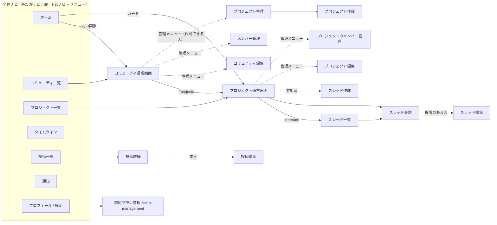

SP では、ホーム・コミュニティ・プロジェクト・通知は下部ナビから1タップ、タイムライン・投稿・プロフィール設定・ログアウトは「メニュー」から2タップです。
PC では、すべて左ナビから1クリックです。

---

## 5. 対象画面と対応状況

| 画面 | パス | ビュー | 対応 |
|------|------|--------|------|
| ログイン後ホーム | `/business` | `business/homes/_member_home`（新規） | ✅ 2一覧（コミュニティ = 丸画像、プロジェクト = 画像付きカード）、ページ分割は従来どおり |
| コミュニティ一覧 | `/business/communities` | `communities/index` | ✅ 丸画像のタイル一覧。controller にあったページ分割（5件）のリンクを表示 |
| コミュニティ通常画面 | `/business/communities/:id` | `communities/show` | ✅ カバー + 丸画像 + 状態、`概要 / プロジェクト / タイムライン / メンバー` のページ内切替 |
| コミュニティ作成 / 編集 | `…/new`, `…/edit` | `communities/new`, `edit`, `_form`, `_plan_trial` | ✅ 基本情報 / 画像 / 参加方式に分割。プロジェクト管理・お試し設定は別のまとまり |
| コミュニティのメンバー管理・参加申請 | `/business/communities/:id/permits` | `communities/permits` | ✅ 承認待ち / 参加中 / 停止中を見出しの状態表示で区別。却下とアクセス停止の違いを文で明記 |
| プロジェクト管理 | `…/project_management` | `community_project_managements/show` | ✅ |
| プロジェクト一覧 | `/business/projects` | `projects/index` | ✅ 画像付きカード（共通部品） |
| プロジェクト通常画面 | `/business/projects/:id` | `projects/show`, `_join_status` | ✅ 画像・状態・目標・参加状態、`概要 / スレッド / メンバー` のページ内切替。状態は日本語表示（募集中 / 進行中 / 終了） |
| プロジェクト作成 / 編集 | `…/new`, `…/edit` | `projects/new`, `edit`, `_form` | ✅ 基本情報 / 進行と参加 / 画像 |
| プロジェクトのメンバー管理・参加申請 | `…/members` | `projects/members` | ✅ |
| タイムライン（コミュニティ内） | `communities/show#timeline` | `business/chat/_post`（新規） | ✅ |
| スレッド一覧・作成・編集・会話 | `/business/projects/:id/threads…` | `project_threads/*` | ✅ |
| 入力欄・スタンプ・添付表示 | — | `business/chat/_composer`, `_stamp_picker`, `_message_content` | ✅ 構造は維持し見た目を調整（クリップのアイコン化） |
| 投稿一覧・詳細・作成・編集 | `/business/posts…` | `posts/*`（`_card` 新規） | ✅ |
| タイムライン（フォロー等の投稿） | `/business/timeline` | `posts/timeline` | ✅ 押しても反応しなかった「いいね / コメント」の表示は削除 |
| 通知 | `/business/notifications` | `notifications/index` | ✅ 種類ごとのアイコン、開いた時点の未読に「未読」表示 |
| プロフィール / プロフィール設定 | `/business/customers/:id(/edit)` | `customers/show`, `edit` | ✅ 契約プラン管理はプロフィールの保存とは別のまとまりにした（`#plan-management` は維持） |
| 共通ヘッダー・メニュー・通知・パンくず | — | `layouts/business`, `_business_shell` | ✅ 左ナビ / 下部ナビ / メニューシート / パンくずに置き換え |
| ログイン前の紹介ページ | `/business`（未ログイン） | `homes/top` + `_header_menu_nakama` | ⏸ 対象外（構成・訴求を維持） |
| Business 利用開始 | `/business/join` | `shared/domain_auth/join` | ⏸ 対象外（音楽・歌声と共通の認証デザインのため） |
| ログイン・新規登録・パスワード | `/business/sign_in` など | `shared/domain_auth/*` | ⏸ 対象外（同上） |
| Stripe 決済完了 | `/business/stripe/success` | — | ⏸ 対象外（決済サービス側の導線） |

### 共用部分への対応

| 共用部分 | 対応 | 音楽側への影響 |
|----------|------|----------------|
| `layouts/application` | `content_for` で body の class・viewport・中身の差し替えをできるようにした | 何も指定しない画面は従来と同じ HTML |
| `shared/_member_home`（`/` と共通） | 変更なし。Business は新しい `business/homes/_member_home` を使う | なし |
| `Homes::MyCommunities` / `MyProjects` | `with_images:` を追加。Business ホームのときだけ画像の添付をまとめて読み込む | 既定 `false` のため、`/` のクエリは不変 |
| `shared/_manage_bar` | 変更なし。`.ba-body` 配下でだけ見た目を変更 | なし |
| `feature_gate` / `subscription_manager` / Danger Zone / スタンプ選択 | 変更なし。`.ba-body` 配下でだけ見た目を調整 | なし |

### 利用開始・ログイン・登録・契約関連の対応一覧

| 画面 | パス | 今回の扱い | Business との行き来 |
|------|------|------------|---------------------|
| ログイン前の紹介ページ | `/business`（未ログイン） | 従来のまま（旧ヘッダー・スライダー） | ログイン・新規登録へリンク。ログイン後は同じ `/business` が新しい枠のホームになる |
| Business ログイン | `/business/sign_in` | 従来のまま（`shared/domain_auth`） | ログイン後は `/business` のホームへ。左ナビ・メニューの「ログアウト」から戻ってくる |
| Business 新規登録 | `/business/sign_up` | 従来のまま（同上） | 登録後は従来どおりオンボーディングへ |
| パスワード再設定 | `/business/password/new` | 従来のまま（同上） | ログイン画面から移動 |
| Business 利用開始 | `/business/join` | 従来のまま（同上） | 「今はやめておく」で `/business` へ戻る（従来どおり） |
| 契約プラン管理 | `/business/customers/:id/edit#plan-management` | 改修（プロフィール設定内の独立したまとまり。部品 `shared/_subscription_manager` 自体は不変） | プラン案内（`feature_upgrade_path`）・Stripe 完了・キャンセル後の戻り先（`business_plan_management_path`）はすべてここ。見出しが上部バーに隠れないことを確認 |
| Stripe Checkout / カスタマーポータル | Stripe 側 | 対象外（Stripe の画面） | 戻り先は上の契約プラン管理（コード変更なし） |
| Stripe 決済完了 | `/business/stripe/success` | 画面なし（リダイレクトのみ、変更なし） | 契約プラン管理へリダイレクト |

---

## 6. 管理者と一般参加者の表示の違い

| 画面 | 運営者・管理者 | プロジェクト作成のみ可能な参加者 | 一般参加者 | 未参加 / 承認待ち / 停止中 |
|------|----------------|----------------------------------|------------|----------------------------|
| コミュニティ通常画面 | 管理メニュー（通常画面 / 編集 / メンバー管理〈申請件数〉/ プロジェクト管理）、状態「運営者」 | 管理メニュー（通常画面 / プロジェクト管理） | 管理メニューなし、状態「参加済み」、プラン案内（作成できない場合） | 概要と「参加を申請する」のみ / 「承認待ち」+ 取り消し / 「アクセス停止中」。プロジェクト・タイムライン・メンバーは「参加者限定」 |
| プロジェクト通常画面 | 管理メニュー（通常画面 / 編集 / メンバー管理〈申請件数〉） | — | 状態「参加中」、退出 | 参加ボタン / 「承認待ち」+ 取り消し / 「アクセス停止中」/「募集終了」。スレッド・メンバーは非表示 |
| スレッド会話 | 編集・削除（権限に応じて。全体トークは削除不可） | — | 自分の投稿の削除のみ | 閲覧不可（従来どおりリダイレクト） |
| 編集・メンバー管理・プロジェクト管理 | 表示 | プロジェクト管理のみ | 直接アクセスは拒否（従来どおり） | 拒否 |
| ホーム | 状態「運営」「管理」 | 状態「主催」 | 状態「参加中」 | 状態「承認待ち」（名前と状態のみ） |

権限の判定（`can_manage_community?` / `can_create_project_for?` / `business_project_manager?` / `can_edit_project_thread?` / `can_destroy_project_thread?` など）は一切変えていません。表示の出し分けは、従来と同じ条件をそのまま使っています。

---

## 7. スクリーンショット（改修前後）

すべて架空データ（テスト環境で作成した人物・団体名）で撮影しています。撮影用のスクリプトはリポジトリに含めていません。

| 画面 | 改修前 | 改修後 |
|------|--------|--------|
| ホーム（PC 1280px） | 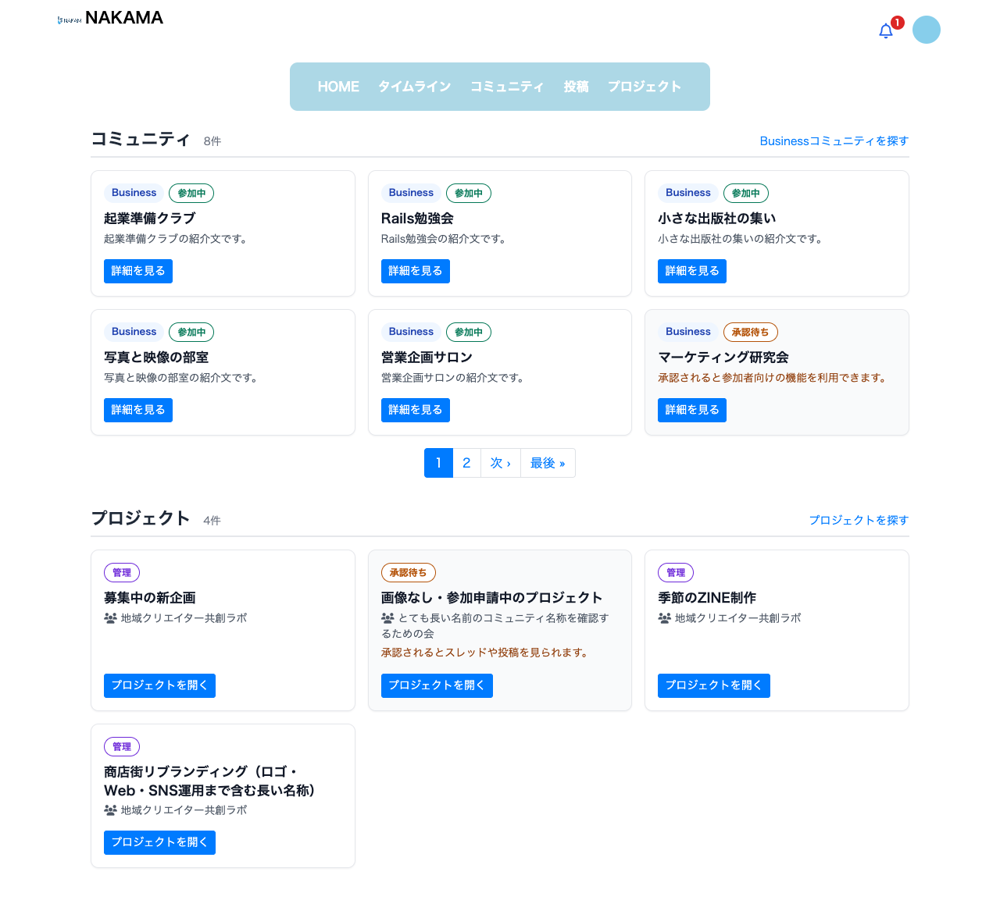 | 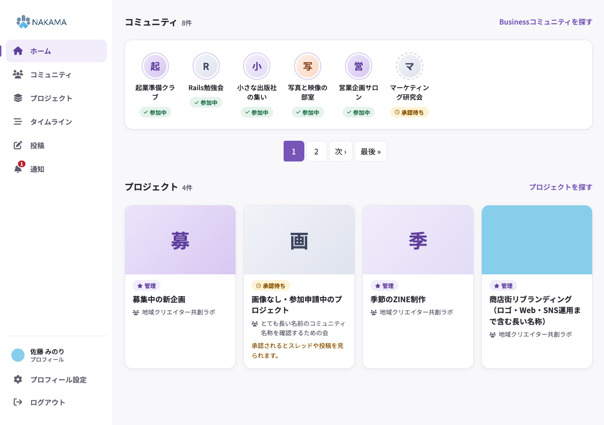 |
| ホーム（SP 375px） | 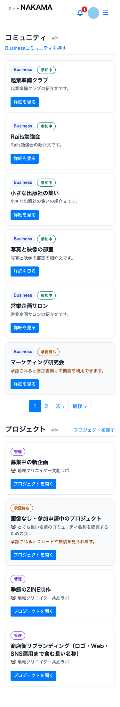 | 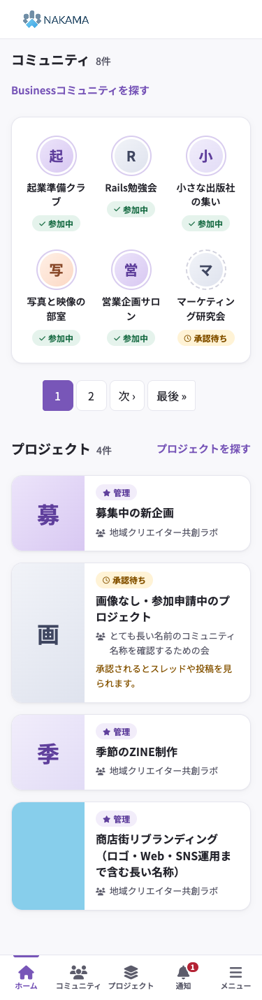 |
| コミュニティ通常画面（PC） | 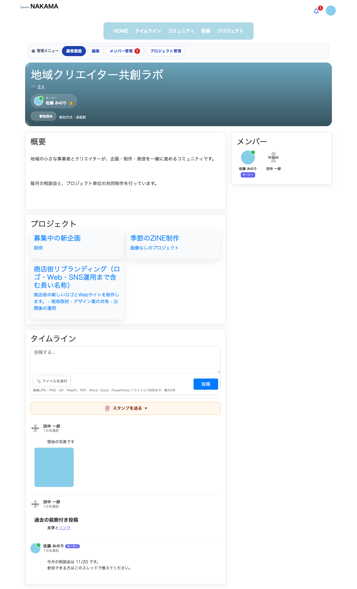 | 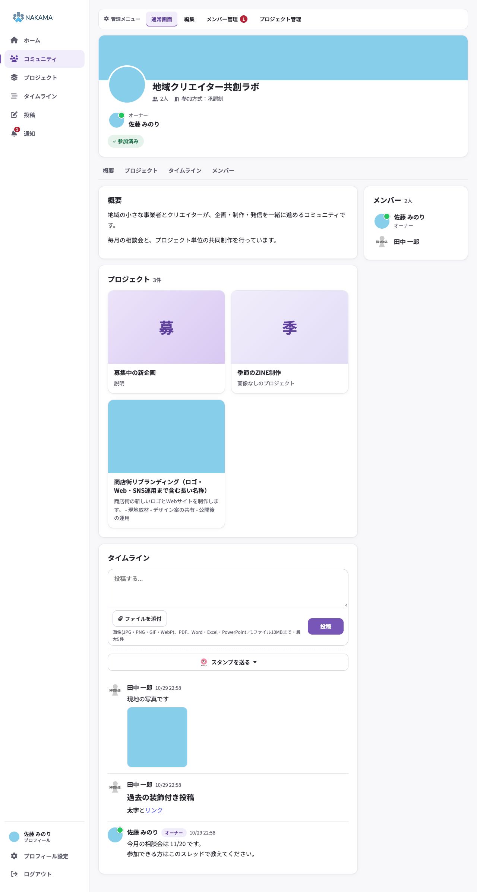 |
| コミュニティ通常画面（SP・未参加） | 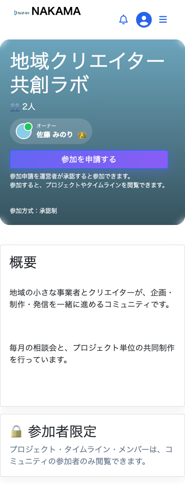 | 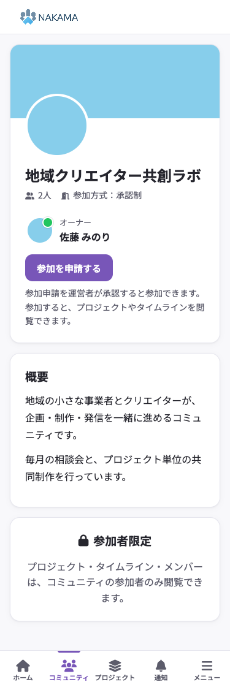 |
| プロジェクト通常画面（SP） | 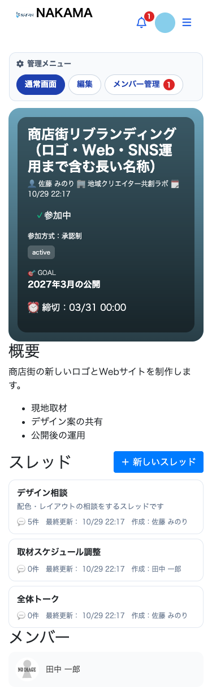 | 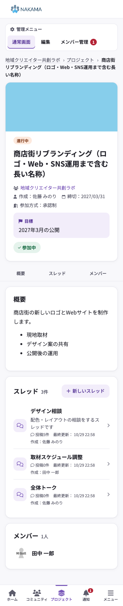 |
| スレッド会話（SP） | 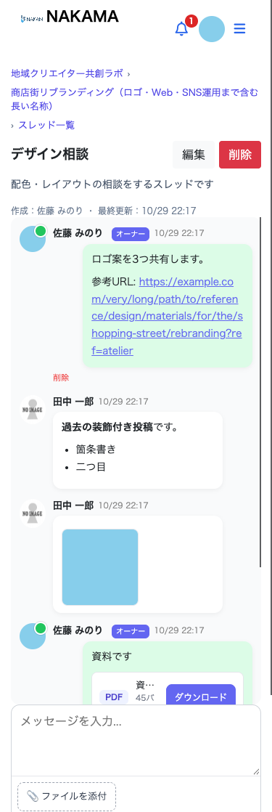 | 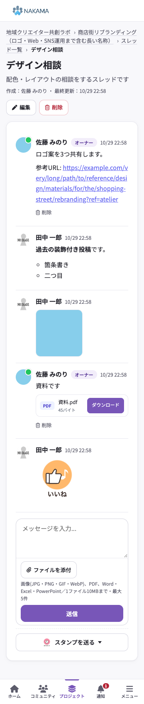 |
| メンバー管理（SP） | 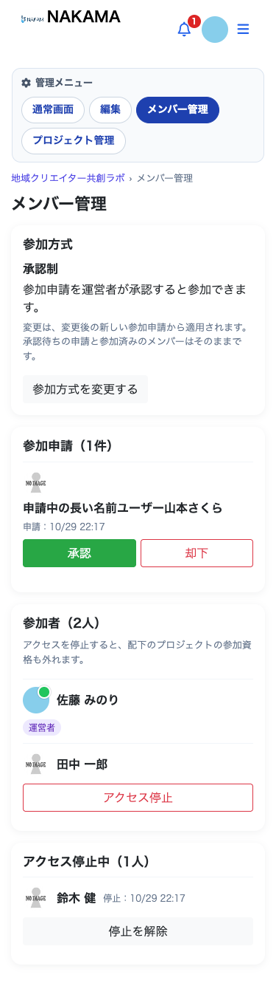 | 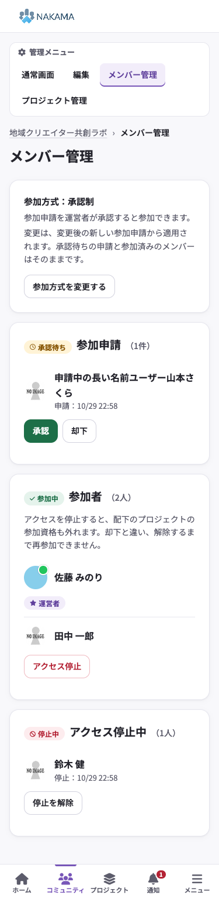 |
| プロジェクト編集（PC） | 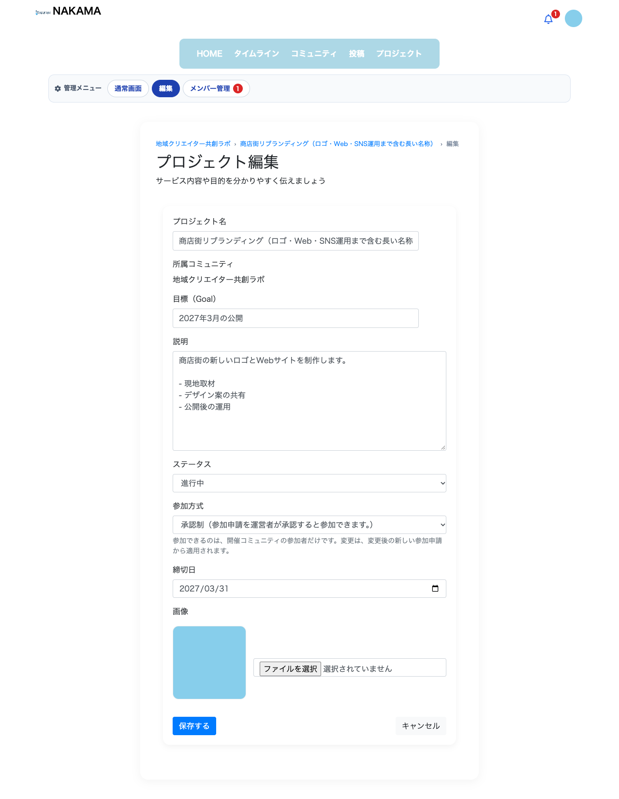 | 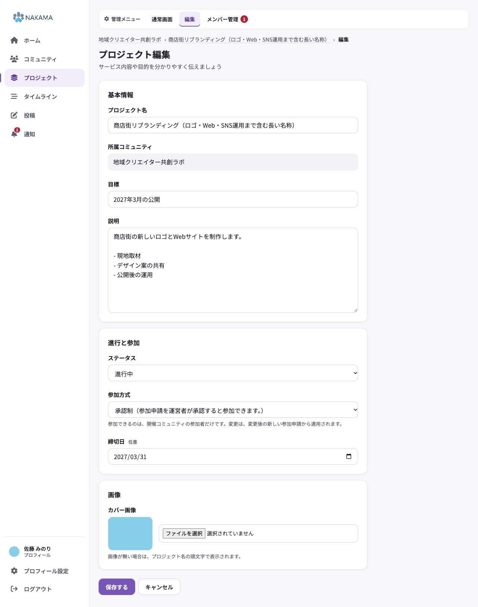 |
| メニューシート（SP） | — | 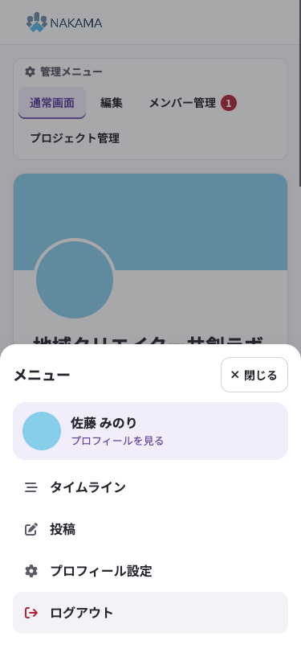 |
| 縮約した左ナビ（1024px） | — | 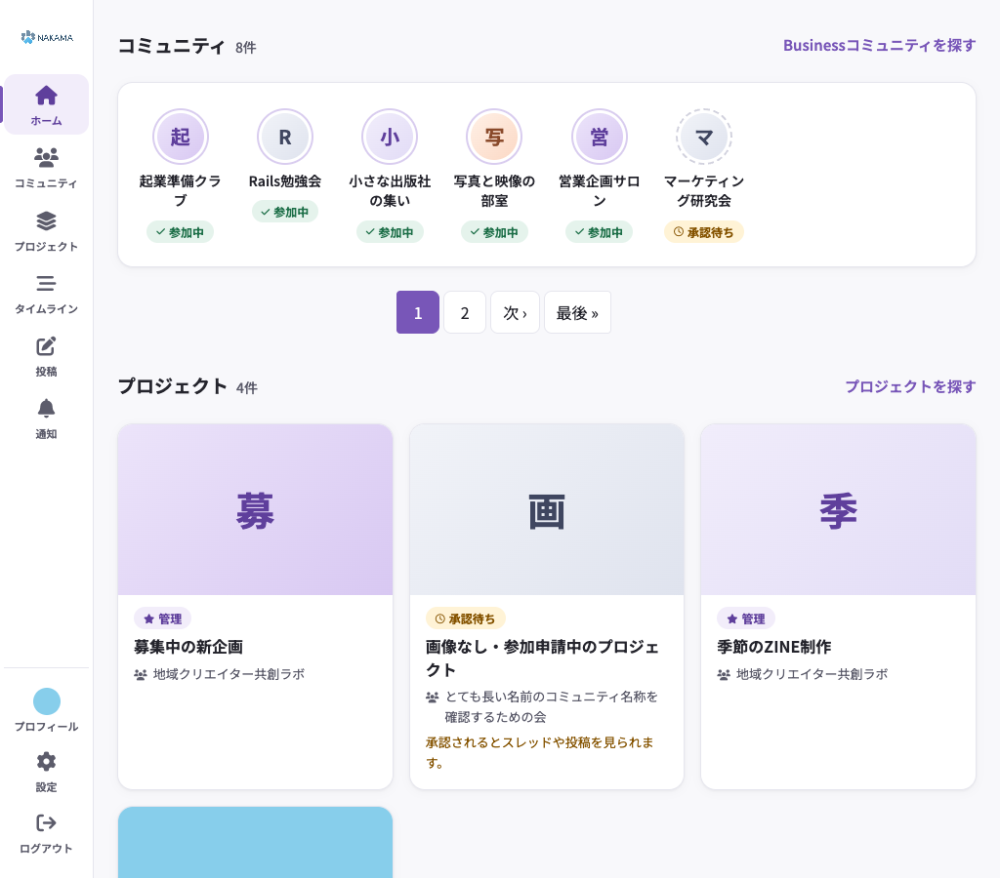 |
| タイムライン `/business/timeline`（SP・MySQL） | — | 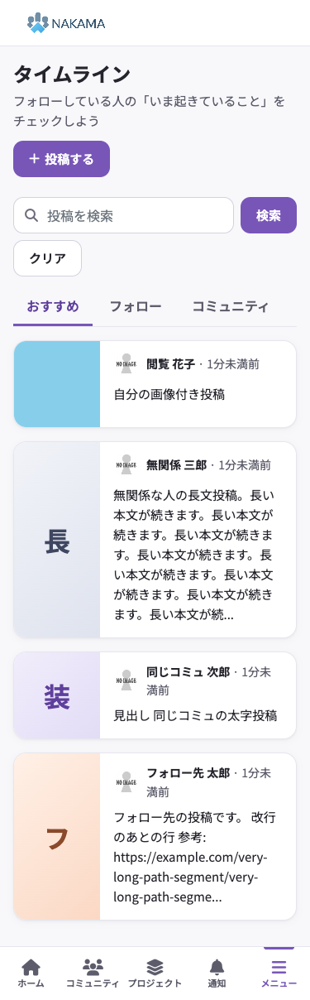 |
| タイムライン `/business/timeline`（PC・MySQL） | — | 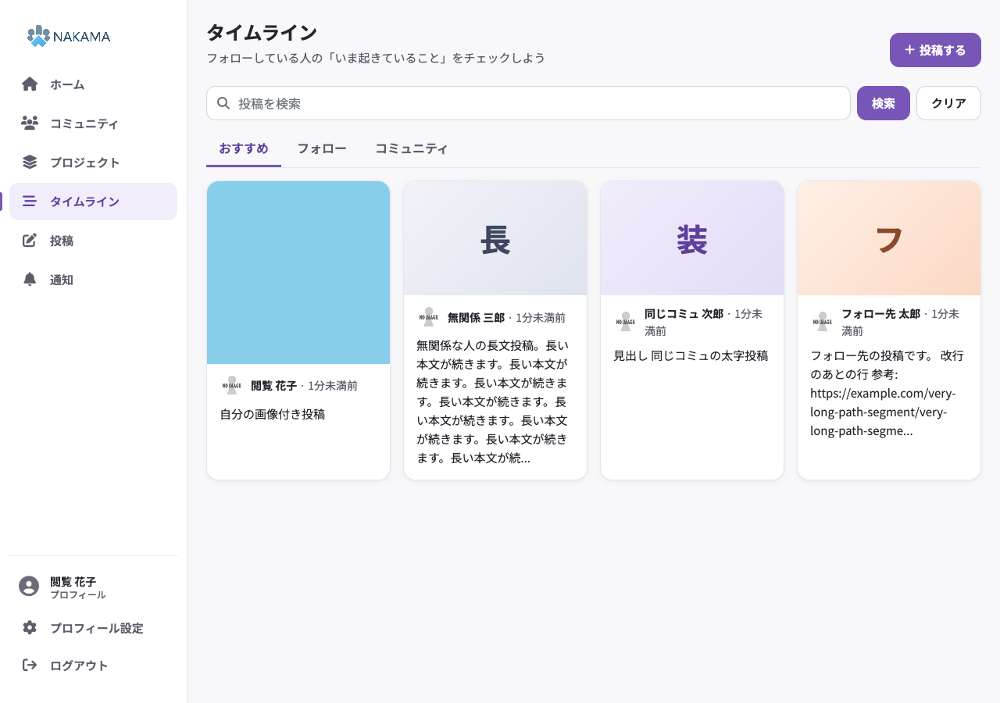 |
| コミュニティ内タイムライン（SP・MySQL） | — | 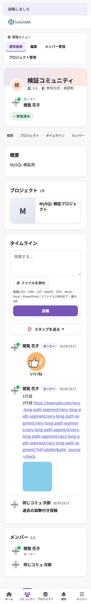 |

---

## 8. 確認結果・残課題

### 8.1 確認結果（2026-10-29）

| 確認 | 結果 |
|------|------|
| `git diff --check` | 問題なし |
| Rails 起動（`rails runner`） | `boot ok` |
| `RAILS_ENV=production rails assets:precompile` | 成功。生成した `application-*.css` に新しい定義が入っていることを確認。生成物はコミット対象外とし、元の `public/assets` に戻した |
| Business・共用部分の request / system / view spec | 434例すべて成功（タッチ操作 spec の一時的な失敗は 8.8 のとおり原因を特定して修正済み） |
| 全体 `bundle exec rspec`（6989例、1回目の仕上げ前に実施） | 37件失敗。うち36件は最新 main（`4596e74e`）でも同じ spec が失敗する既存の失敗。残り1件（`spec/requests/public/sessions_spec.rb:176`）は Business ホームのクラス名変更によるもので、spec を修正して成功を確認 |
| 実ブラウザ（headless Chrome） | 320 / 375 / 768 / 1024 / 1280px で全23画面と、一般参加者・未参加者・承認待ちの見え方を撮影。ページ全体の横はみ出しは 0、画面外にはみ出す要素なし |

注意: ローカルの `public/assets` に古いコンパイル済み CSS があると、テスト環境もそちらを配信し、新しいスタイルが反映されません。画面確認・system spec の間は `public/assets` を一時的に退避し、確認後に元へ戻しました。

### 8.2 MySQL での `/business/timeline` 検証

本番の DB・データは使わず、ローカルの MySQL サーバーに使い捨てのデータベースを作り（`bemystyle_atelier_tmp`、スキーマのみ読み込み）、テスト環境の接続先だけを `DATABASE_URL` で切り替えて、実際の Rails 画面を headless Chrome で操作しました。データはすべて架空です。検証後にデータベースは削除しました。

`/business/timeline` は「投稿機能（Post）」の一覧です。書式なし（plain）・添付ファイル・スタンプの投稿は、コミュニティ内タイムライン（CommunityPost）とスレッド（ProjectChat）の機能のため、同じ MySQL 環境でそちらも確認しました。

| 項目 | 結果 |
|------|------|
| 並び替え（`UNIX_TIMESTAMP` を使うスコア） | MySQL で正常に表示（SQLite のテスト環境では表示できない既存の制約） |
| 「おすすめ」タブ | 全員のビジネス投稿（`Post`。`/business/posts` と同じデータ）。既存の仕様（`Post.all`）のままで、コミュニティ内の会話（`CommunityPost`）やスレッドは含まない |
| 「フォロー」タブ | フォロー先と自分の投稿だけ。無関係な人・同じコミュニティだけの人の投稿は出ない |
| 「コミュニティ」タブ | 同じコミュニティの参加者の投稿だけ。無関係な人・フォローだけの人の投稿は出ない |
| キーワード検索 | 該当する1件だけ表示 |
| 改行・長い URL | 詳細画面で改行（`br`）と自動リンクを確認。375px で横はみ出しなし |
| 既存の装飾付き投稿 | 詳細画面で見出し・太字として表示。一覧カードでは書式記号を除いた文字だけを抜粋（従来は `##` などが文字のまま見えていた） |
| 長文・画像なし | 長文は抜粋で省略。画像なしは頭文字、画像ありは画像 |
| 空状態 | フォローも投稿もない人の「フォロー」タブで空状態を表示 |
| スタンプ（投稿機能） | 詳細画面のコメントとしてスタンプを送信できる（既存の形式） |
| コミュニティ内タイムライン | 書式なしで保存（`content_format: plain`）、改行・長い URL のリンク・画像添付・過去の装飾付き投稿・スタンプを確認 |
| スレッド | 長文スレッドでも末尾のスタンプ選択が下部ナビより上にあり、送信後に下部ナビが戻る |
| スマホの入力欄 | 文字入力中は下部ナビが隠れ、送信ボタンが画面内にある。ファイル選択・スタンプ選択では下部ナビが表示されたまま |

### 8.3 ナビゲーションと共用画面

実ブラウザの system spec（`spec/system/business/atelier_navigation_spec.rb` ほか）で確認しました。

- 下部ナビは文字入力中だけ隠れ、セレクト・日付・ファイル選択・スタンプ選択の操作では表示されたまま。入力欄から離れると戻る。
- メニューシートは、Enter で開き、Escape・閉じる・背景で閉じてフォーカスがメニューボタンへ戻る。開いている間は Tab がシート内で循環する。リンクで移動した後・ブラウザの「戻る」の後は閉じた状態で表示される。
- 固定ナビ（上部バー・下部ナビ）は、ページ末尾の操作（スタンプ選択・お試し設定）と、保存失敗時のエラーメッセージを隠さない。
- プロフィール設定は、キャンセルで保存されず、保存するとプロフィールへ戻ってお知らせが表示される。
- プラン案内から契約プラン管理（`#plan-management`）へ移動でき、見出しが上部バーに隠れない。
- ログアウトするとドメイン共通のログイン画面へ移り、ログインし直すと Business の枠に戻る。

### 8.4 通知の「未読」表示

`Business::NotificationsController#index` で、既読にする前に未読の ID を読み取る SELECT を1回追加しただけです。既読化の処理（`@notifications.where(checked: false).update_all(checked: true)`）は従来と同じ文のまま残しているため、次の点は変わりません。

- 既読にする対象（Business の自分宛て通知のうち未読のものだけ。音楽側の通知は既読にしない）
- 既読にするタイミング（通知一覧を開いたとき）
- 表示する件数・並び順
- 未読バッジ（開いた後は消える）

「未読」の目印は、開いた時点で未読だったものに、その表示の間だけ付けます。データとしての既読状態は従来どおりです（`spec/requests/business/notifications_spec.rb` で確認）。

### 8.5 Business 以外の画面への影響

- **CSS**: 新しい SCSS（`business/atelier/*`）をコンパイルし、467個のセレクタすべてが `.ba-body` から始まることを確認。`.ba-body` は `layouts/business` だけが付ける。
- **JS**: `business/atelier_nav.js` は、メニューの要素がない画面では何もしない。入力中の判定は `body.ba-body` と `.ba-main` の中だけ。
- **見た目の比較**: 最新 main と作業ブランチで、同じ架空データ・同じ幅（375 / 1280px）の画面を撮影して画素単位で比べた。音楽ホーム・音楽コミュニティ一覧・音楽コミュニティ詳細・音楽プロフィール・ログイン前の Business トップ・Business ログイン・音楽ログイン・Business 利用開始の16枚のうち、13枚は完全一致。残り3枚の差分は右端2px（x=373〜375）だけで、スクロール直後に出るスマホのスクロールバー表示によるもの。

### 8.6 画像の先読みとクエリ件数

同じデータで、main と作業ブランチの1回分の SQL 件数を比べました（2回目のリクエストを計測）。

| 画面 | main | 作業ブランチ | 理由 |
|------|------|--------------|------|
| ホーム | 15 | 17 | コミュニティ・プロジェクトの画像を表示するため、添付の読み込みを2件まとめて実行（一覧の件数によらず一定） |
| コミュニティ一覧 | 21 | 14 | 画像の N+1 を解消 |
| コミュニティ通常画面（参加者） | 18 | 20 | プロジェクトカードに画像を出すための読み込み2件 |
| コミュニティ通常画面（未参加） | 16 | 16 | 変化なし |
| プロジェクト一覧 | 13 | 7 | カードごとの参加人数の集計（N+1）をやめた |
| プロジェクト通常画面 | 23 | 23 | 変化なし |
| 通知 | 7 | 8 | 未読 ID の読み取り1件 |

- 画像を先読みするのは、各画面がもともと表示対象として認可済みのレコード（参加中・運営中・承認待ちのコミュニティとプロジェクト）だけです。未参加コミュニティのプロジェクト画像の URL は、どの画面の HTML にも出ていないことを確認しました。
- 承認待ちのプロジェクト・コミュニティの画像は、従来から詳細画面（概要の表示）で見えていたものと同じです。
- 一覧の画像は `loading="lazy"` で、画面外の画像は読み込みを後回しにします。

### 8.7 旧 Business スタイルを削除しない理由（別 PR へ回す根拠）

ログイン後画面の旧マークアップを置き換えたため、旧 Business 用 SCSS の多くは新しい Business 画面から参照されなくなりました。ただし次の理由から、今回は削除せず別 PR で扱います。

1. **全体に効く定義を含む**: 旧ファイルは `require_tree .` で `application.css` に入り、スコープのない上位セレクタを多く持っています。例: `.form-control` / `.form-group`（`business/communities/edit.scss`、`posts/_form.scss` など）、`.card` / `.btn-danger` / `.introduction`（`communities/show.scss`）、`.card-body`（`communities/index.scss`、`projects/index.scss`）、`.tag` / `.comment`（`posts/show.scss`）、`.owner`（`projects/index.scss`）、`.time` / `.meta` / `.name` / `.tab`（`posts/timeline.scss`）。これらのクラスは、管理画面（`admin/*`）、音楽側（`public/registrations/new`、`public/communities/*`、`public/events/*`、チャット）、learning、singing、LP、オンボーディングのビューでも使われています。削除するとこれらの画面の見た目が変わる可能性があるため、画面ごとの見た目の比較が必要です。
2. **ログイン前ページで使用中**: `business/header_menu_nakama.scss` と `business/homes/top.scss` は、ログイン前の紹介ページ（旧ヘッダー・スライダー・お知らせ）で使っています。`top.scss` にも `.dashboard` / `.section-title` / `.plan-badge` など、音楽 LP・about・learning と同じクラス名の定義があります。
3. **新しい画面でも使用中**: `business/chat.scss`（入力欄・添付・スタンプ選択）は、新しい画面がそのまま使っています。
4. **マニフェストからの明示 import**: `application.scss.erb` が `business/communities/show` を個別に `@import` しているため、削除にはマニフェストの変更も伴います。

別 PR では、ファイルごとに「Business だけで使うクラス」と「全体に効くクラス」を分け、前者を削除し、後者は利用画面の見た目を比較してから扱う手順を勧めます。

### 8.8 未対応・残課題・既存の制約

| 項目 | 内容 |
|------|------|
| `/business/join`・ログイン・新規登録・パスワード | 音楽・歌声と共通の `shared/domain_auth` のため、今回は対象外（行き来は確認済み） |
| ログイン前の紹介ページ | 依頼どおり構成・訴求を維持 |
| 旧 Business 用 SCSS | 8.7 のとおり別 PR |
| タイムラインのテスト | `UNIX_TIMESTAMP` を使うため、通常のテスト環境（SQLite）では表示できない既存の制約。今回は使い捨ての MySQL で確認した（自動テストへの組み込みはしていない） |
| 投稿機能（Post）の公開範囲 | 「おすすめ」タブは全員の投稿を表示する既存の仕様のまま（今回は変更していない） |
| 投稿機能のスタンプ（コメント） | 既存の文字ボタン形式のまま、見た目だけを揃えた |
| 画像の転送量 | サムネイル用の縮小画像（variant）は本番のライブラリ構成に依存するため導入していない |
| 実機確認 | iPhone 実機でのセーフエリア・画面キーボードの見え方は未確認（headless Chrome のモバイル表示と CDP のタッチ入力で確認） |
| タッチ操作の system spec | `header_menu_auth_spec.rb` の「下部ナビ・メニュー・閉じる・メニュー内リンクをタップで操作できる」が一括実行時にまれに失敗していた。失敗時の診断記録（完了した操作・失敗した操作・URL のパス・画面サイズ・JavaScript エラー・スクリーンショット）を追加し、PR の CI で原因を特定した。Turbolinks は描画前に URL を変えるため、前の画面のメニューシートが開いたまま下部ナビの位置をタップし、同じ位置のシートの「ログアウト」に当たっていた。新しい画面の表示とシートが閉じたことを確認してから次をタップするよう修正済み（テストの待ち方の問題で、本番コードの不具合ではない） |
