# Business「Social Atelier」デザイン方針と実装記録

Business（NAKAMA）のログイン後画面を「Social Atelier」という方針で統一したときの設計資料です。
見た目だけでなく、情報の配置・ナビゲーション・操作の分かりやすさを揃えました。
権限・料金プラン・参加承認・データ・業務ロジックは変えていません。

- ブランチ: `feature/business-social-atelier-redesign`（2026-10-29 作業）
- 対象: Business のログイン後画面
- 対象外: ログイン前の紹介ページ（`/business` 未ログイン）、Business 認証画面（`shared/domain_auth`）、音楽側、システム管理画面、Stripe 側の画面
- 追加改修: `feature/business-login-join-flow`（2026-10-30）で、ログインの案内・音楽コミュニティ導線の除去・参加導線を整理した（[9 章](#9-実機確認を受けた追加改修2026-10-30)）
- 追加改修: `feature/business-landing-atelier`（2026-10-30）で、ログイン前の紹介ページ（`/business` 未ログイン）も Social Atelier に揃えた（[10 章](#10-ログイン前の紹介ページ2026-10-30)）
- 追加改修: `feature/business-blue-brand`（2026-10-30）で、ロゴを NAKAMA の青いロゴに差し替え、配色を紫から青に統一した（[11 章](#11-nakama-の青いロゴと配色2026-10-30)）。1・2 章の色は改修後の値
- 追加改修: `feature/business-help-and-timeline`（2026-10-30）で、利用イメージのイラスト・使い方ページ（`/business/help`）を追加し、ビジネス投稿の一覧をタイムラインに統一した（[12 章](#12-利用イメージのイラスト使い方ページタイムラインの整理2026-10-30)）
- 追加改修: `feature/business-join-theme-share-help`（2026-10-30）で、プロジェクトの参加表現の統一・「目標」「締切」の取りやめと「テーマ」の追加・招待用URLのコピー・使い方の「一般ユーザー向け／管理者向け」の切り替えを行った（[13 章](#13-参加表現テーマ招待用url使い方の切り替え2026-10-30)）

---

## 1. デザイン方針

| 観点 | 方針 |
|------|------|
| 雰囲気 | 写真・アイコンで「誰が・何をしているか」が伝わる、親しみやすい SNS 的な構成。特定サービスの画面・ロゴは複製しない |
| 色 | 白を基調に、ページ背景（`#F7F9FC`）とカード（白）を薄く区別する。アクセントは NAKAMA ロゴのブランドブルー（`#2864D9`）、補助にロゴのスカイブルー（`#55BCEB`）を淡くした面と、種別ラベルのピーチ（2026-10-30 にバイオレットから変更） |
| グラデーション | 画像がないときの頭文字の背景と、カバー画像がないときの細い帯だけに使う |
| 文字 | 本文 16px・行間 1.6〜1.75。本文は濃いグレー（`#1F2633`）でコントラストを確保する |
| 形 | コミュニティは丸い画像、プロジェクトは画像付きカード。角丸・線・影はトークンの値に揃える |
| 画像なし | 名前の頭文字（`business_monogram`）で代替する。ダミー画像は追加しない |
| 装飾 | 意味のない英語コピー、大きなヒーロー、装飾目的のアニメーションは入れない |
| 状態表示 | 色だけで伝えない。「参加中」「承認待ち」「停止中」などの文字と記号を必ず付ける |
| 操作 | タップ領域は原則 44px 以上。hover だけに頼らず、フォーカスリングを表示する |
| 動き | 状態変化の短いトランジションのみ。`prefers-reduced-motion: reduce` では無効にする |

---

## 2. デザイントークン（最終値）

定義場所: `app/assets/stylesheets/business/atelier/tokens.scss`（`.ba-body` の CSS カスタムプロパティ）

### 色

| トークン | 値 | 用途 | コントラスト（白背景） |
|----------|----|------|------------------------|
| `--ba-brand-blue` / `--ba-accent` | `#2864D9` | ブランドブルー。リンク・主ボタン・現在地・フォーカス | 約 5.4:1（ページ背景上 5.1:1） |
| `--ba-accent-strong` | `#1D4FB3` | hover・淡い背景上の文字 | 約 7.4:1（`--ba-accent-soft` 上 6.7:1） |
| `--ba-accent-pressed` | `#173F8F` | 主ボタンを押している間 | 白文字 9.8:1 |
| `--ba-accent-soft` | `#EDF3FD` | 現在地の背景・補助ボタン | — |
| `--ba-accent-tint` | `#DFE9FB` | 補助ボタンの hover | `--ba-accent-strong` 6.1:1 |
| `--ba-accent-line` | `#C5D7F5` | 丸画像の輪・淡い枠線・補助ボタンの押下中 | — |
| `--ba-brand-sky` | `#55BCEB` | ロゴのスカイブルー（ロゴ画像の中だけ）。文字には使わない | 2.2:1 |
| `--ba-sky-soft` | `#E6F5FC` | 補助の淡い面（プロフィールのカバーがないときの帯） | — |
| `--ba-peach` / `--ba-peach-text` | `#FDE9DD` / `#8A4A2B` | 種別ラベル・お試し表示 | 約 5.8:1（ピーチ背景上） |
| `--ba-text` | `#1F2633` | 本文 | 約 15:1 |
| `--ba-text-muted` | `#545C6B` | 補助文字 | 約 6.7:1 |
| `--ba-text-subtle` | `#636B7A` | さらに弱い補助（区切り記号など） | 約 5.4:1（ページ背景上 5.1:1） |
| `--ba-bg` | `#F7F9FC` | ページ背景 | — |
| `--ba-surface` / `--ba-surface-muted` | `#FFFFFF` / `#F1F4F8` | カード / 静的な値・hover | — |
| `--ba-border` / `--ba-border-strong` | `#E2E7EF` / `#CBD3DF` | 区切り線 / 入力欄・副ボタンの枠 | — |
| `--ba-success` / `-soft` | `#1D6F48` / `#E5F3EC` | 参加中・承認 | 約 5.4:1（淡背景上） |
| `--ba-warning` / `-soft` | `#855300` / `#FFF3D6` | 承認待ち | 約 5.9:1（淡背景上） |
| `--ba-danger` / `-soft` | `#B42335` / `#FDECEE` | 停止中・削除・未読バッジ | 約 5.7:1（淡背景上） |

状態色（成功・警告・停止）は意味を持つため、2026-10-30 のブランド色変更でも変えていません。
改修前（2026-10-29〜30）のバイオレット系の値と変更理由は [11.3](#113-カラーパレットと各色の役割) にあります。

### 余白・角丸・影・寸法

| 種類 | 値 |
|------|----|
| 余白 | `--ba-space-1〜6` = 4 / 8 / 12 / 16 / 24 / 32px |
| 角丸 | カード 16px、ボタン・入力欄 12px、小さい部品 8px、ピル 999px |
| 影 | カード: `0 1px 2px rgba(37,37,45,.05), 0 2px 10px rgba(37,37,45,.04)`、浮き上がり（メニュー・hover）: `0 4px 18px rgba(37,37,45,.1)` |
| フォーカス | `0 0 0 2px #FFF, 0 0 0 4px #2864D9`（白の隙間 + ブランドブルーの実線） |
| タップ領域 | 44px（`--ba-tap`）。小ボタンは 40px、通知・状態チップ以外の操作は 36px を下限にする |
| 本文幅 | 投稿本文・フォーム・説明は 720px まで（`--ba-reading-width`）。ページ全体は 1040px まで |
| ナビ | 上部バー 56px、下部ナビ 64px + セーフエリア、左ナビ 240px（縮約時 96px） |

### 文字

| 用途 | 大きさ | 太さ |
|------|--------|------|
| ページ見出し（h1） | 24px（プロジェクト名は 22px） | 700 |
| セクション見出し（h2） | 19px | 700 |
| 本文・入力欄 | 16px（iOS の自動ズームを避けるため入力欄も 16px） | 400 |
| 補助・メタ情報 | 13〜14px | 400〜600 |
| 状態チップ・ナビのラベル | 11〜12px | 600〜700 |

フォントは既に読み込んでいる Noto Sans JP を使い、新しい外部フォント・CDN は追加していません。

---

## 3. コンポーネント規約

| 部品 | クラス | 使い方 |
|------|--------|--------|
| カード | `.ba-card` | 画面内のまとまり。中の見出しは `.ba-section-title` |
| ページ見出し | `.ba-page-header` / `.ba-page-title` / `.ba-page-lead` / `.ba-page-actions` | 画面ごとに1つの h1。ページ固有の操作（作成など）は右側に置く |
| パンくず | `nav.ba-breadcrumb > ol > li` | 最後の項目は `aria-current="page"`。長い名前でも文章として折り返す |
| ボタン | `.ba-btn` + `--primary` / `--secondary` / `--soft` / `--success` / `--danger`、`--sm` | 主操作は1画面1つを目安に `--primary`。重大操作（停止・削除）は `--danger`（赤枠） |
| 状態 | `.ba-status` + `--member` / `--manager` / `--owner` / `--pending` / `--suspended` / `--kind` | 必ず文字と記号を一緒に出す |
| アバター | `.ba-avatar`、`business_community_avatar` | コミュニティは丸。画像がなければ `business_monogram` の頭文字 |
| 人 | `.ba-person`（`__avatar` / `__name` / `__meta`） | メンバー・申請者・オーナー・投稿者の表示 |
| 一覧の行 | `.ba-rows > .ba-row`（`__main` / `__actions`） | メンバー管理・プロジェクト管理。狭い幅では操作が下に回り込む |
| フォーム | `.ba-form` > `.ba-fieldset`（`legend.ba-fieldset__legend`）> `.ba-field`（`.ba-label` / `.ba-help`） | 入力項目を意味のあるまとまりに分ける。保存・キャンセルは `.ba-form-actions` に「主 → 副」の順 |
| エラー | `.ba-errors`（`role="alert"`） | フォームの先頭 |
| 空状態 | `.ba-empty`（`__title` / `__actions`） | 次に何をすればよいかの導線を置く |
| ページ内切替 | `nav.ba-sectnav` + `.ba-anchor-target` | `#about` などのアンカーで移動。URL・戻る操作と一致し、JS を使わない |
| 管理入口 | `shared/_manage_bar`（音楽側と共通の部品） | `.ba-body` 配下だけで見た目を変更。権限のある人だけに出す |
| 投稿 | `business/chat/_post`（`.ba-post`） | アバター → 名前・オーナー表示・時刻 → 本文 → 削除（本人のみ） |
| プロジェクトカード | `business/projects/_card`（`.ba-project-card`） | ホーム・プロジェクト一覧・コミュニティ通常画面で共通 |

### スコープの決まり

- Social Atelier のスタイルは、すべて `body.ba-body` 配下に書きます（`layouts/business` だけが `ba-body` を付けます）。
- 新しいマークアップは `ba-` 接頭辞のクラスだけを使います。既存の Business 用 SCSS には `.card` / `.btn-danger` などスコープのない定義があるため、新しい画面ではそれらのクラス名を使いません。
- 共有パーシャル（`feature_gate` / `subscription_manager` / Danger Zone / スタンプ選択 / 管理メニュー）は変更せず、`.ba-body` 配下で見た目だけを合わせています。
- リンクの色は `:where(a:not([class]))` で詳細度を上げずに付け、部品側の配色を上書きしないようにしています。

---

## 4. 画面レイアウトとナビゲーション

### 枠の構成（`layouts/business` → `layouts/_business_shell`）

| 幅 | 構成 |
|----|------|
| 〜991px（スマホ・タブレット縦） | 上部バー（ロゴ） + 本文 + 下部ナビ（5項目） + メニューシート |
| 992〜1199px | 左のアイコンナビ（96px、ラベルは小さく下に表示。プロフィール設定は「設定」と短く表示） |
| 1200px〜 | 左ナビ（240px、アイコン + ラベル） |

- 下部ナビ: **ホーム / コミュニティ / プロジェクト / 通知 / メニュー**
  - メニュー（シート）: プロフィール（名前つき）/ タイムライン / 投稿（プラン制限の表示つき）/ プロフィール設定 / ログアウト
- 左ナビ: ホーム / コミュニティ / プロジェクト / タイムライン / 投稿 / 通知、下部にプロフィール / プロフィール設定 / ログアウト
- 現在地は色に加えて、線（下部ナビは上端、左ナビは左端）と `aria-current="page"` で示します。
- 通知の未読件数はバッジと `aria-label`（例:「通知（未読4件）」）の両方で伝えます。件数は1回だけ数え、両方のナビで使います。
- iPhone のセーフエリア: `viewport-fit=cover`（Business のログイン後だけ）と `env(safe-area-inset-*)`。
- 画面キーボード: SP で文字入力欄（textarea・テキスト系 input）にフォーカスがある間だけ下部ナビを隠し（`body.ba-is-typing`）、入力欄・送信ボタンと重ねません。セレクト・日付・ファイル選択・スタンプ選択は OS の選択画面やパネルが出るだけなので、下部ナビは表示したままにします。
- メニューシート: `role="dialog"`。開くと「閉じる」にフォーカスし、Escape・閉じる・背景で閉じてメニューボタンへ戻します。開いている間は Tab がシート内で循環します（`business/atelier_nav.js`）。
- 本文へスキップするリンク（`.ba-skip-link`）を先頭に置いています。
- 旧ヘッダー（`layouts/_header_menu_nakama`）はログイン前の紹介ページだけで使い続けています。ログイン後の画面では、ヘッダーとナビの重複をなくしました。
- 新しい検索・DM・未読管理などの機能は追加していません。ナビの項目は既存のページだけです。

### ページ遷移図

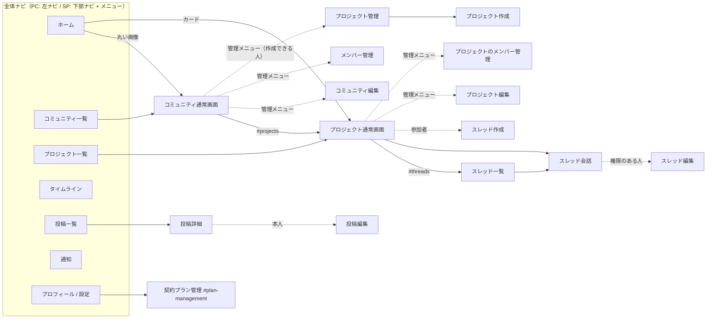

SP では、ホーム・コミュニティ・プロジェクト・通知は下部ナビから1タップ、タイムライン・投稿・プロフィール設定・ログアウトは「メニュー」から2タップです。
PC では、すべて左ナビから1クリックです。

---

## 5. 対象画面と対応状況

| 画面 | パス | ビュー | 対応 |
|------|------|--------|------|
| ログイン後ホーム | `/business` | `business/homes/_member_home`（新規） | ✅ 2一覧（コミュニティ = 丸画像、プロジェクト = 画像付きカード）、ページ分割は従来どおり |
| コミュニティ一覧 | `/business/communities` | `communities/index` | ✅ 丸画像のタイル一覧。controller にあったページ分割（5件）のリンクを表示 |
| コミュニティ通常画面 | `/business/communities/:id` | `communities/show` | ✅ カバー + 丸画像 + 状態、`概要 / プロジェクト / タイムライン / メンバー` のページ内切替 |
| コミュニティ作成 / 編集 | `…/new`, `…/edit` | `communities/new`, `edit`, `_form`, `_plan_trial` | ✅ 基本情報 / 画像 / 参加方式に分割。プロジェクト管理・お試し設定は別のまとまり |
| コミュニティのメンバー管理・参加申請 | `/business/communities/:id/permits` | `communities/permits` | ✅ 承認待ち / 参加中 / 停止中を見出しの状態表示で区別。却下とアクセス停止の違いを文で明記 |
| プロジェクト管理 | `…/project_management` | `community_project_managements/show` | ✅ |
| プロジェクト一覧 | `/business/projects` | `projects/index` | ✅ 画像付きカード（共通部品） |
| プロジェクト通常画面 | `/business/projects/:id` | `projects/show`, `_join_status` | ✅ 画像・状態・目標・参加状態、`概要 / スレッド / メンバー` のページ内切替。状態は日本語表示（募集中 / 進行中 / 終了） |
| プロジェクト作成 / 編集 | `…/new`, `…/edit` | `projects/new`, `edit`, `_form` | ✅ 基本情報 / 進行と参加 / 画像 |
| プロジェクトのメンバー管理・参加申請 | `…/members` | `projects/members` | ✅ |
| タイムライン（コミュニティ内） | `communities/show#timeline` | `business/chat/_post`（新規） | ✅ |
| スレッド一覧・作成・編集・会話 | `/business/projects/:id/threads…` | `project_threads/*` | ✅ |
| 入力欄・スタンプ・添付表示 | — | `business/chat/_composer`, `_stamp_picker`, `_message_content` | ✅ 構造は維持し見た目を調整（クリップのアイコン化） |
| 投稿一覧・詳細・作成・編集 | `/business/posts…` | `posts/*`（`_card` 新規） | ✅ |
| タイムライン（フォロー等の投稿） | `/business/timeline` | `posts/timeline` | ✅ 押しても反応しなかった「いいね / コメント」の表示は削除 |
| 通知 | `/business/notifications` | `notifications/index` | ✅ 種類ごとのアイコン、開いた時点の未読に「未読」表示 |
| プロフィール / プロフィール設定 | `/business/customers/:id(/edit)` | `customers/show`, `edit` | ✅ 契約プラン管理はプロフィールの保存とは別のまとまりにした（`#plan-management` は維持） |
| 共通ヘッダー・メニュー・通知・パンくず | — | `layouts/business`, `_business_shell` | ✅ 左ナビ / 下部ナビ / メニューシート / パンくずに置き換え |
| ログイン前の紹介ページ | `/business`（未ログイン） | `homes/top` + `_header_menu_nakama` | ⏸ 対象外（構成・訴求を維持） |
| Business 利用開始 | `/business/join` | `shared/domain_auth/join` | ⏸ 対象外（音楽・歌声と共通の認証デザインのため） |
| ログイン・新規登録・パスワード | `/business/sign_in` など | `shared/domain_auth/*` | ⏸ 対象外（同上） |
| Stripe 決済完了 | `/business/stripe/success` | — | ⏸ 対象外（決済サービス側の導線） |

### 共用部分への対応

| 共用部分 | 対応 | 音楽側への影響 |
|----------|------|----------------|
| `layouts/application` | `content_for` で body の class・viewport・中身の差し替えをできるようにした | 何も指定しない画面は従来と同じ HTML |
| `shared/_member_home`（`/` と共通） | 変更なし。Business は新しい `business/homes/_member_home` を使う | なし |
| `Homes::MyCommunities` / `MyProjects` | `with_images:` を追加。Business ホームのときだけ画像の添付をまとめて読み込む | 既定 `false` のため、`/` のクエリは不変 |
| `shared/_manage_bar` | 変更なし。`.ba-body` 配下でだけ見た目を変更 | なし |
| `feature_gate` / `subscription_manager` / Danger Zone / スタンプ選択 | 変更なし。`.ba-body` 配下でだけ見た目を調整 | なし |

### 利用開始・ログイン・登録・契約関連の対応一覧

| 画面 | パス | 今回の扱い | Business との行き来 |
|------|------|------------|---------------------|
| ログイン前の紹介ページ | `/business`（未ログイン） | 2026-10-30 に Social Atelier へ改修（[10 章](#10-ログイン前の紹介ページ2026-10-30)） | ログイン・新規登録へリンク。ログイン後は同じ `/business` が新しい枠のホームになる |
| Business ログイン | `/business/sign_in` | 画面は従来のまま（`shared/domain_auth`）。2026-10-30 に失敗時・未ログイン時の戻り先を修正（[9.1](#91-ログインの案内)） | ログイン後は `/business` のホーム（未ログインで開こうとした Business の画面があればそこ）へ。左ナビ・メニューの「ログアウト」から戻ってくる |
| Business 新規登録 | `/business/sign_up` | 従来のまま（同上） | 登録後は従来どおりオンボーディングへ |
| パスワード再設定 | `/business/password/new` | 従来のまま（同上） | ログイン画面から移動 |
| Business 利用開始 | `/business/join` | 従来のまま（同上） | 「今はやめておく」で `/business` へ戻る（従来どおり） |
| 契約プラン管理 | `/business/customers/:id/edit#plan-management` | 改修（プロフィール設定内の独立したまとまり。部品 `shared/_subscription_manager` 自体は不変） | プラン案内（`feature_upgrade_path`）・Stripe 完了・キャンセル後の戻り先（`business_plan_management_path`）はすべてここ。見出しが上部バーに隠れないことを確認 |
| Stripe Checkout / カスタマーポータル | Stripe 側 | 対象外（Stripe の画面） | 戻り先は上の契約プラン管理（コード変更なし） |
| Stripe 決済完了 | `/business/stripe/success` | 画面なし（リダイレクトのみ、変更なし） | 契約プラン管理へリダイレクト |

---

## 6. 管理者と一般参加者の表示の違い

| 画面 | 運営者・管理者 | プロジェクト作成のみ可能な参加者 | 一般参加者 | 未参加 / 承認待ち / 停止中 |
|------|----------------|----------------------------------|------------|----------------------------|
| コミュニティ通常画面 | 管理メニュー（通常画面 / 編集 / メンバー管理〈申請件数〉/ プロジェクト管理）、状態「運営」（システム管理者は「管理権限あり」）と申請不要の理由 | 管理メニュー（通常画面 / プロジェクト管理） | 管理メニューなし、状態「参加中」+「プロジェクトを見る」、退出、プラン案内（作成できない場合） | 概要と「参加を申請する / 参加する」/ 「承認待ち」+ 取り消し / 「アクセス停止中」+ 再参加できない理由。プロジェクト・タイムライン・メンバーは「参加者限定」 |
| プロジェクト通常画面 | 管理メニュー（通常画面 / 編集 / メンバー管理〈申請件数〉）、状態「運営」「主催」「管理権限あり」 | — | 状態「参加中」+「スレッドを見る」、退出 | 参加ボタン / 「承認待ち」+ 取り消し / 「アクセス停止中」/「募集終了」。スレッド・メンバーは非表示 |
| スレッド会話 | 編集・削除（権限に応じて。全体トークは削除不可） | — | 自分の投稿の削除のみ | 閲覧不可（従来どおりリダイレクト） |
| 編集・メンバー管理・プロジェクト管理 | 表示 | プロジェクト管理のみ | 直接アクセスは拒否（従来どおり） | 拒否 |
| ホーム | 状態「運営」「管理」 | 状態「主催」 | 状態「参加中」 | 状態「承認待ち」（名前と状態のみ） |

権限の判定（`can_manage_community?` / `can_create_project_for?` / `business_project_manager?` / `can_edit_project_thread?` / `can_destroy_project_thread?` など）は一切変えていません。表示の出し分けは、従来と同じ条件をそのまま使っています。

---

## 7. スクリーンショット（改修前後）

すべて架空データ（テスト環境で作成した人物・団体名）で撮影しています。撮影用のスクリプトはリポジトリに含めていません。

| 画面 | 改修前 | 改修後 |
|------|--------|--------|
| ホーム（PC 1280px） |  |  |
| ホーム（SP 375px） |  |  |
| コミュニティ通常画面（PC） |  |  |
| コミュニティ通常画面（SP・未参加） |  |  |
| プロジェクト通常画面（SP） |  |  |
| スレッド会話（SP） |  |  |
| メンバー管理（SP） |  |  |
| プロジェクト編集（PC） |  |  |
| メニューシート（SP） | — |  |
| 縮約した左ナビ（1024px） | — |  |
| タイムライン `/business/timeline`（SP・MySQL） | — |  |
| タイムライン `/business/timeline`（PC・MySQL） | — |  |
| コミュニティ内タイムライン（SP・MySQL） | — |  |

---

## 8. 確認結果・残課題

### 8.1 確認結果（2026-10-29）

| 確認 | 結果 |
|------|------|
| `git diff --check` | 問題なし |
| Rails 起動（`rails runner`） | `boot ok` |
| `RAILS_ENV=production rails assets:precompile` | 成功。生成した `application-*.css` に新しい定義が入っていることを確認。生成物はコミット対象外とし、元の `public/assets` に戻した |
| Business・共用部分の request / system / view spec | 434例すべて成功（タッチ操作 spec の一時的な失敗は 8.8 のとおり原因を特定して修正済み） |
| 全体 `bundle exec rspec`（6989例、1回目の仕上げ前に実施） | 37件失敗。うち36件は最新 main（`4596e74e`）でも同じ spec が失敗する既存の失敗。残り1件（`spec/requests/public/sessions_spec.rb:176`）は Business ホームのクラス名変更によるもので、spec を修正して成功を確認 |
| 実ブラウザ（headless Chrome） | 320 / 375 / 768 / 1024 / 1280px で全23画面と、一般参加者・未参加者・承認待ちの見え方を撮影。ページ全体の横はみ出しは 0、画面外にはみ出す要素なし |

注意: ローカルの `public/assets` に古いコンパイル済み CSS があると、テスト環境もそちらを配信し、新しいスタイルが反映されません。画面確認・system spec の間は `public/assets` を一時的に退避し、確認後に元へ戻しました。

### 8.2 MySQL での `/business/timeline` 検証

本番の DB・データは使わず、ローカルの MySQL サーバーに使い捨てのデータベースを作り（`bemystyle_atelier_tmp`、スキーマのみ読み込み）、テスト環境の接続先だけを `DATABASE_URL` で切り替えて、実際の Rails 画面を headless Chrome で操作しました。データはすべて架空です。検証後にデータベースは削除しました。

`/business/timeline` は「投稿機能（Post）」の一覧です。書式なし（plain）・添付ファイル・スタンプの投稿は、コミュニティ内タイムライン（CommunityPost）とスレッド（ProjectChat）の機能のため、同じ MySQL 環境でそちらも確認しました。

| 項目 | 結果 |
|------|------|
| 並び替え（`UNIX_TIMESTAMP` を使うスコア） | MySQL で正常に表示（SQLite のテスト環境では表示できない既存の制約） |
| 「おすすめ」タブ | 全員のビジネス投稿（`Post`。`/business/posts` と同じデータ）。既存の仕様（`Post.all`）のままで、コミュニティ内の会話（`CommunityPost`）やスレッドは含まない |
| 「フォロー」タブ | フォロー先と自分の投稿だけ。無関係な人・同じコミュニティだけの人の投稿は出ない |
| 「コミュニティ」タブ | 同じコミュニティの参加者の投稿だけ。無関係な人・フォローだけの人の投稿は出ない |
| キーワード検索 | 該当する1件だけ表示 |
| 改行・長い URL | 詳細画面で改行（`br`）と自動リンクを確認。375px で横はみ出しなし |
| 既存の装飾付き投稿 | 詳細画面で見出し・太字として表示。一覧カードでは書式記号を除いた文字だけを抜粋（従来は `##` などが文字のまま見えていた） |
| 長文・画像なし | 長文は抜粋で省略。画像なしは頭文字、画像ありは画像 |
| 空状態 | フォローも投稿もない人の「フォロー」タブで空状態を表示 |
| スタンプ（投稿機能） | 詳細画面のコメントとしてスタンプを送信できる（既存の形式） |
| コミュニティ内タイムライン | 書式なしで保存（`content_format: plain`）、改行・長い URL のリンク・画像添付・過去の装飾付き投稿・スタンプを確認 |
| スレッド | 長文スレッドでも末尾のスタンプ選択が下部ナビより上にあり、送信後に下部ナビが戻る |
| スマホの入力欄 | 文字入力中は下部ナビが隠れ、送信ボタンが画面内にある。ファイル選択・スタンプ選択では下部ナビが表示されたまま |

### 8.3 ナビゲーションと共用画面

実ブラウザの system spec（`spec/system/business/atelier_navigation_spec.rb` ほか）で確認しました。

- 下部ナビは文字入力中だけ隠れ、セレクト・日付・ファイル選択・スタンプ選択の操作では表示されたまま。入力欄から離れると戻る。
- メニューシートは、Enter で開き、Escape・閉じる・背景で閉じてフォーカスがメニューボタンへ戻る。開いている間は Tab がシート内で循環する。リンクで移動した後・ブラウザの「戻る」の後は閉じた状態で表示される。
- メニューシートのリンクを選ぶと、新しい画面の表示を待たずにシートを閉じる。Turbolinks の遷移が始まったら、表示が切り替わるまで `body.ba-nav-pending`（`pointer-events: none`）でタップを受け付けない。これにより、読み込み中の続けてのタップが、背後の下部ナビやシートの「ログアウト」へ通らない。覆い用の要素は置いておらず、次の場面で必ず元に戻る。
  - 新しい画面の表示・エラー画面の表示: どちらも body が入れ替わる
  - Turbolinks の通信失敗: Turbolinks がページを再読み込みする
  - キャッシュ保存前（`turbolinks:before-cache`）、`turbolinks:load`、bfcache からの復元（`pageshow`）: この状態を外す
  - フォーカスは、移った先で消える「メニュー」ボタンへ戻さない。閉じる・背景・Escape で閉じたときは、従来どおり戻す。
  - ログアウトは、シートの「ログアウト」を選んだときだけ実行される。
  - 確認は `atelier_navigation_spec.rb` の「スマホ: メニューから画面を移る間の操作」で行う。テストからサーバーの応答を止めて遅い遷移を再現し、次を確認している。
    - 連続タップしても、ログアウトにも別の画面にも移らない
    - 戻る・進む・同じ画面へのリンクの後も、元どおり操作できる
    - 読み込み中に戻る操作をしても、エラー画面になっても、操作できない状態が残らない
    - 本来のログアウトは実行できる
- 固定ナビ（上部バー・下部ナビ）は、ページ末尾の操作（スタンプ選択・お試し設定）と、保存失敗時のエラーメッセージを隠さない。
- プロフィール設定は、キャンセルで保存されず、保存するとプロフィールへ戻ってお知らせが表示される。
- プラン案内から契約プラン管理（`#plan-management`）へ移動でき、見出しが上部バーに隠れない。
- ログアウトするとドメイン共通のログイン画面へ移り、ログインし直すと Business の枠に戻る。

### 8.4 通知の「未読」表示

`Business::NotificationsController#index` で、既読にする前に未読の ID を読み取る SELECT を1回追加しただけです。既読化の処理（`@notifications.where(checked: false).update_all(checked: true)`）は従来と同じ文のまま残しているため、次の点は変わりません。

- 既読にする対象（Business の自分宛て通知のうち未読のものだけ。音楽側の通知は既読にしない）
- 既読にするタイミング（通知一覧を開いたとき）
- 表示する件数・並び順
- 未読バッジ（開いた後は消える）

「未読」の目印は、開いた時点で未読だったものに、その表示の間だけ付けます。データとしての既読状態は従来どおりです（`spec/requests/business/notifications_spec.rb` で確認）。

### 8.5 Business 以外の画面への影響

- **CSS**: 新しい SCSS（`business/atelier/*`）をコンパイルし、467個のセレクタすべてが `.ba-body` から始まることを確認。`.ba-body` は `layouts/business` だけが付ける。
- **JS**: `business/atelier_nav.js` は、メニューの要素がない画面では何もしない。入力中の判定は `body.ba-body` と `.ba-main` の中だけ。
- **見た目の比較**: 最新 main と作業ブランチで、同じ架空データ・同じ幅（375 / 1280px）の画面を撮影して画素単位で比べた。音楽ホーム・音楽コミュニティ一覧・音楽コミュニティ詳細・音楽プロフィール・ログイン前の Business トップ・Business ログイン・音楽ログイン・Business 利用開始の16枚のうち、13枚は完全一致。残り3枚の差分は右端2px（x=373〜375）だけで、スクロール直後に出るスマホのスクロールバー表示によるもの。

### 8.6 画像の先読みとクエリ件数

同じデータで、main と作業ブランチの1回分の SQL 件数を比べました（2回目のリクエストを計測）。

| 画面 | main | 作業ブランチ | 理由 |
|------|------|--------------|------|
| ホーム | 15 | 17 | コミュニティ・プロジェクトの画像を表示するため、添付の読み込みを2件まとめて実行（一覧の件数によらず一定） |
| コミュニティ一覧 | 21 | 14 | 画像の N+1 を解消 |
| コミュニティ通常画面（参加者） | 18 | 20 | プロジェクトカードに画像を出すための読み込み2件 |
| コミュニティ通常画面（未参加） | 16 | 16 | 変化なし |
| プロジェクト一覧 | 13 | 7 | カードごとの参加人数の集計（N+1）をやめた |
| プロジェクト通常画面 | 23 | 23 | 変化なし |
| 通知 | 7 | 8 | 未読 ID の読み取り1件 |

- 画像を先読みするのは、各画面がもともと表示対象として認可済みのレコード（参加中・運営中・承認待ちのコミュニティとプロジェクト）だけです。未参加コミュニティのプロジェクト画像の URL は、どの画面の HTML にも出ていないことを確認しました。
- 承認待ちのプロジェクト・コミュニティの画像は、従来から詳細画面（概要の表示）で見えていたものと同じです。
- 一覧の画像は `loading="lazy"` で、画面外の画像は読み込みを後回しにします。

### 8.7 旧 Business スタイルを削除しない理由（別 PR へ回す根拠）

ログイン後画面の旧マークアップを置き換えたため、旧 Business 用 SCSS の多くは新しい Business 画面から参照されなくなりました。ただし次の理由から、今回は削除せず別 PR で扱います。

1. **全体に効く定義を含む**: 旧ファイルは `require_tree .` で `application.css` に入り、スコープのない上位セレクタを多く持っています。例: `.form-control` / `.form-group`（`business/communities/edit.scss`、`posts/_form.scss` など）、`.card` / `.btn-danger` / `.introduction`（`communities/show.scss`）、`.card-body`（`communities/index.scss`、`projects/index.scss`）、`.tag` / `.comment`（`posts/show.scss`）、`.owner`（`projects/index.scss`）、`.time` / `.meta` / `.name` / `.tab`（`posts/timeline.scss`）。これらのクラスは、管理画面（`admin/*`）、音楽側（`public/registrations/new`、`public/communities/*`、`public/events/*`、チャット）、learning、singing、LP、オンボーディングのビューでも使われています。削除するとこれらの画面の見た目が変わる可能性があるため、画面ごとの見た目の比較が必要です。
2. **ログイン前ページで使用中**: `business/header_menu_nakama.scss` と `business/homes/top.scss` は、ログイン前の紹介ページ（旧ヘッダー・スライダー・お知らせ）で使っています。`top.scss` にも `.dashboard` / `.section-title` / `.plan-badge` など、音楽 LP・about・learning と同じクラス名の定義があります。
3. **新しい画面でも使用中**: `business/chat.scss`（入力欄・添付・スタンプ選択）は、新しい画面がそのまま使っています。
4. **マニフェストからの明示 import**: `application.scss.erb` が `business/communities/show` を個別に `@import` しているため、削除にはマニフェストの変更も伴います。

別 PR では、ファイルごとに「Business だけで使うクラス」と「全体に効くクラス」を分け、前者を削除し、後者は利用画面の見た目を比較してから扱う手順を勧めます。

### 8.8 未対応・残課題・既存の制約

| 項目 | 内容 |
|------|------|
| `/business/join`・ログイン・新規登録・パスワード | 音楽・歌声と共通の `shared/domain_auth` のため、今回は対象外（行き来は確認済み） |
| ログイン前の紹介ページ | 依頼どおり構成・訴求を維持 |
| 旧 Business 用 SCSS | 8.7 のとおり別 PR |
| タイムラインのテスト | `UNIX_TIMESTAMP` を使うため、通常のテスト環境（SQLite）では表示できない既存の制約。今回は使い捨ての MySQL で確認した（自動テストへの組み込みはしていない） |
| 投稿機能（Post）の公開範囲 | 「おすすめ」タブは全員の投稿を表示する既存の仕様のまま（今回は変更していない） |
| 投稿機能のスタンプ（コメント） | 既存の文字ボタン形式のまま、見た目だけを揃えた |
| 画像の転送量 | サムネイル用の縮小画像（variant）は本番のライブラリ構成に依存するため導入していない |
| 実機確認 | iPhone 実機でのセーフエリア・画面キーボードの見え方は未確認（headless Chrome のモバイル表示と CDP のタッチ入力で確認） |
| タッチ操作の system spec | `header_menu_auth_spec.rb` の「下部ナビ・メニュー・閉じる・メニュー内リンクをタップで操作できる」が一括実行時にまれに失敗していた。失敗時の診断記録（完了した操作・失敗した操作・URL のパス・画面サイズ・JavaScript エラー・スクリーンショット）を追加し、PR の CI で原因を特定した。Turbolinks は描画前に URL を変えるため、前の画面のメニューシートが開いたまま下部ナビの位置をタップし、同じ位置のシートの「ログアウト」に当たっていた。新しい画面の表示とシートが閉じたことを確認してから次をタップするよう修正済み（テストの待ち方の問題で、本番コードの不具合ではない） |

---

## 9. 実機確認を受けた追加改修（2026-10-30）

ブランチ `feature/business-login-join-flow`。権限・承認方式・停止・料金プランの判定（`BusinessAccess` / `Business::Memberships::*` / `has_feature?`）は変えず、案内・表示・戻り先だけを整えた。

### 9.1 ログインの案内

**症状**: Business だけを利用している人がログインすると「音楽プラットフォームの利用には音楽ドメインの登録が必要です。」が出る。

**原因**（文言の誤りではなく、戻り先の誤り）:

1. Devise は「ログインが必要な画面を未ログインで開いた」「メール未確認・退会済みでログインに失敗した」とき、既定で**音楽のログイン画面 `/customers/sign_in`** へ戻す。Business の画面から来た人も同じだった。
2. そこでログインすると、音楽ドメインのログインとして音楽トップ `/` へ進む。
3. `/` は音楽会員向けのため、`ensure_music_domain_access_for_public_routes!` が上の案内を付けて `/business` へ戻していた。
4. パスワード再設定後も同様に `/` へ戻していた（再設定メールのリンク先は全ドメイン共通の画面）。

`/business/sign_in` から正しくログインした場合の判定（`business_user?` で Business ホーム、未登録なら利用開始画面）は元から正しかった。

**修正**:

| 場面 | 修正前 | 修正後 |
|------|--------|--------|
| 未ログインで Business の画面を開く | 音楽のログイン画面へ | Business のログイン画面へ。ログイン後は開こうとした Business の画面へ戻す |
| `/business/sign_in` でメール未確認・退会済み | 音楽のログイン画面へ（原因の文言は出る） | Business のログイン画面に原因（「メールアドレスの本人確認が必要です。」「このアカウントは退会済みです。」）を出す。ログインはさせない |
| `/business/sign_in` でパスワード違い | Business のログイン画面（変更なし） | 変更なし |
| 音楽のログイン画面から Business だけの利用者がログイン | `/` → 音楽向けの案内付きで `/business` | `/business`（またはオンボーディング）へ直接。音楽向けの案内は出ない |
| パスワード再設定後 | 全員 `/`（Business・歌声だけの利用者は音楽向けの案内付きで各ドメインへ） | 利用資格に応じて直接: 音楽会員・管理者は `/`（従来どおり）、それ以外は 歌声 → Business → Learning の順 |
| Business 未登録の人が `/business/sign_in` でログイン | 利用開始画面 `/business/join` | 変更なし（「Businessドメインの利用を開始しますか？」） |
| Business の画面からログアウト | `/business/sign_in` | 変更なし |

- 実装: `lib/customer_auth_failure_app.rb`（Devise の失敗時の戻り先。元のパスが `/business` 配下のときだけ Business のログイン画面にする。Warden は失敗処理の前にパスを書き換えるため `attempted_path` で判定）、`Public::SessionsController#business_after_sign_in_path`、`ApplicationController#business_only_customer?`、`Public::PasswordsController#after_resetting_password_path_for`。

**ログイン後の戻り先の復元（追加）**:

- 保存されるのは、未ログインで開いた GET の画面のパスだけ（Devise の既定。ホスト名は保存されない）。
- 戻すのは Business のログイン（または音楽のログイン画面から入った Business だけの利用者）のときだけ。`/business` 配下のパスに限り、`//` や `\` を含むもの、ログイン・新規登録・パスワード再設定・利用開始の画面（ループの原因）は使わず Business ホームへ。
- 保存された戻り先は、どのドメインのログインでも1回で取り出して捨てる。古い戻り先が後の音楽・歌声ログインに残らない。
- Business 未登録の人は利用開始画面、メール未確認・退会済みはログイン画面のまま（戻り先があっても制限は変わらない）。
- 「Business だけの利用者」は、Business 登録あり・音楽と歌声の登録なし・システム管理者でない人。歌声も使う人の行き先は従来どおり（音楽トップ経由で歌声へ）とし、音楽・歌声側の動作を変えない。
- 共通の認証基盤（Devise の設定・`DomainScopedSession`・音楽ガード）は分岐の追加だけで、音楽・歌声のログイン後の行き先は変えていない（request spec で確認）。

### 9.2 Business から外した音楽側の表示・リンク

| 場所 | 修正前 | 修正後 |
|------|--------|--------|
| Business プロフィール設定の「音楽」欄（パート・ジャンル） | 音楽にも登録している人に表示・保存 | 表示しない・受け付けない |
| Business ホームの「コミュニティ」一覧 | 音楽コミュニティも並ぶ（「音楽」バッジ・「イベントを見る」→ `/public/events`）。件数・ページ分割にも含む | Business コミュニティだけ。`Homes::MyCommunities` に `business_only:` を足し、件数・ページ分割の**前**に絞る（音楽と両方の利用者でも同じ） |
| ホームの探す導線 | 「音楽コミュニティを探す」「Businessコミュニティを探す」の文字リンク | 「コミュニティを探す」ボタン（Business のコミュニティ一覧）だけ |
| プロフィールの「参加コミュニティ」 | 音楽コミュニティも並び、Business 用の URL でリンクしていた | Business コミュニティだけ（他人のプロフィールでも同じ） |
| プロジェクト一覧の空状態 | 「Businessコミュニティを探す」 | 「コミュニティを探す」 |

- 音楽側のホーム `/`（`shared/_member_home`）・`member_home_community_search_links`・所属データは変えていない。
- 左ナビ・下部ナビ・メニューシート・通知はもともと Business のものだけだった（確認のみ）。
- 音楽の画面への直接アクセスを禁止する改修ではない。
- プロフィール設定の「音楽」欄（パート・ジャンル）は、音楽登録の有無にかかわらず Business 側では出さない。Business 側の保存では `part_ids` / `genre_ids` を受け付けないため、保存済みの音楽データは消えず、送られても変わらない。音楽側のプロフィール設定（`Public::CustomersController`）は不変。

### 9.3 参加ボタンが見つからなかった原因

実際の画面を一般利用者・管理者で確認した結果（改修前の画面は下表）:

1. **管理者（システム管理者・運営者）にはボタンが出ず、理由も出ない**: `can_manage_community?` が真になるため、どのコミュニティでも「運営者」バッジだけが出ていた。プロジェクトでも「参加中」とだけ出ていた。管理者アカウントで確認するとボタンが見つからない。
2. **ホームから探しにくい**: 音楽コミュニティに参加していると一覧が空にならず、Business の探す導線が見出し横の小さな文字リンクだけになっていた（音楽の導線と並んでいた）。
3. **一覧カードに状態・導線がない**: カード全体がリンクだが、参加状況や「詳細へ」の表示がなく、押せる場所だと分かりにくかった。
4. **プロジェクトは親コミュニティ参加後にしか見えない**（公開範囲どおり）。未参加のうちは一覧に出ず、コミュニティ詳細にも「参加するとプロジェクトを探せる」と書かれていなかった。
5. コミュニティの退出処理（`community_customers#destroy`）はあるのに、画面に退出の導線がなかった。

一般利用者が未参加の Business コミュニティ詳細を開いた場合は、改修前もボタン自体は表示されていた（SP でも固定ナビに隠れない位置）。

| 改修前 | 画面 |
|--------|------|
| ホーム（SP・音楽コミュニティが混ざる） | 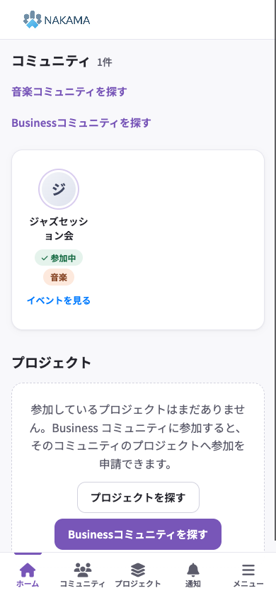 |
| ホーム（PC） | 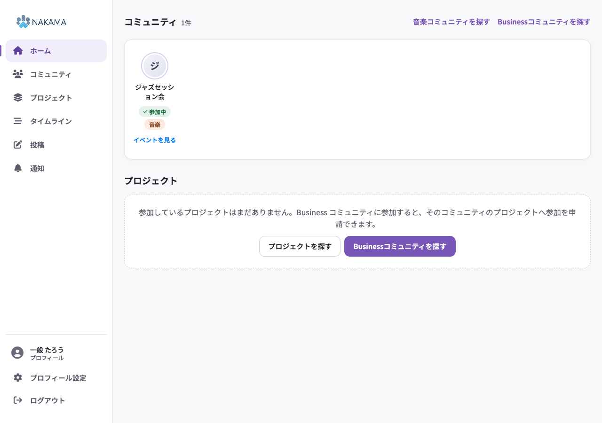 |
| コミュニティ一覧（SP・状態なし） | 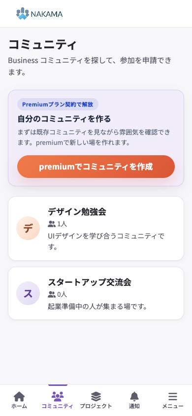 |
| 管理者で見たコミュニティ詳細（SP・「運営者」のみ） | 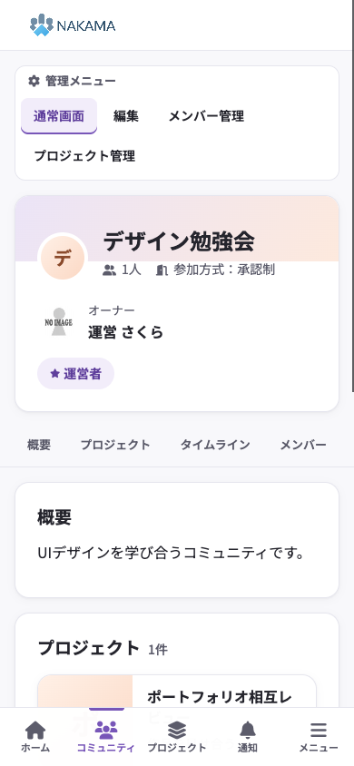 |

### 9.4 改修後の参加手順と状態表示

```
Business ホーム ─「コミュニティを探す」→ コミュニティ一覧（各カードに状態と「詳細を見る」）
  → コミュニティ詳細（紹介のすぐ下）
       未参加: 「参加を申請する」(承認制) / 「参加する」(自動承認)
       承認待ち: 「承認待ち」+「申請を取り消す」 … 運営者がメンバー管理で承認
       参加中:  「参加中」+「プロジェクトを見る」
  → プロジェクト詳細（概要のすぐ下）
       未参加: 「参加を申請する」/「参加する」
       承認待ち: 「承認待ち」+「申請を取り消す」 … プロジェクト管理者が承認
       参加中:  「参加中」+「スレッドを見る」
  → スレッドで閲覧・投稿
```

状態の判定は `Business::Memberships::CommunityStatuses` / `ProjectStatuses` にまとめ、一覧（表示中のページ分を種類ごとに1回ずつ問い合わせ）と詳細で同じ結果になるようにした。表示は `Business::MembershipHelper#business_join_status_badge`。

| 状態 | コミュニティ | プロジェクト | 操作 |
|------|--------------|--------------|------|
| 未参加（承認制） | 「参加を申請する」 | 同左 | 参加者自身の操作として通常画面に表示 |
| 未参加（自動承認） | 「参加する」 | 同左 | 同上 |
| 承認待ち | 「承認待ち」+「申請を取り消す」 | 同左 | 同上 |
| 参加中 | 「参加中」+「プロジェクトを見る」、メンバー欄に「コミュニティから退出する」 | 「参加中」+「スレッドを見る」、「プロジェクトから退出する」（従来どおり） | 同上 |
| アクセス停止中 | 「アクセス停止中」+ 再参加・再申請できない理由。ボタンなし | 同左 | なし |
| 募集終了 | — | 「募集終了」+ 理由。ボタンなし | なし |
| 運営（オーナー・運営権限） | 「運営」+「参加申請は不要です」 | 「運営」 | 管理操作は管理メニュー（従来どおり） |
| 主催（プロジェクト作成者） | — | 「主催」 | 同上 |
| システム管理者 | 「管理権限あり」+「参加申請なしで閲覧・管理できます」 | 同左 | 同上 |
| 親コミュニティ未参加 | — | 詳細は開かずコミュニティ詳細へ戻し「このプロジェクトに参加するには、先にコミュニティへの参加が必要です。」 | — |

- 承認・却下・停止・プロジェクト作成・編集は従来どおり管理メニュー（編集 / メンバー管理 / プロジェクト管理）にだけ置き、通常画面の参加操作と分けた。
- 参加・申請・取り消しのリンクには `data-disable-with` を付けた。連打・直接リクエストでの重複は従来どおりサービス側（`with_lock` と一意制約）で防ぐ。
- 公開範囲は変えていない: コミュニティ一覧は従来どおり Business の全コミュニティ（非公開の概念はない）、プロジェクト一覧は内部を閲覧できるコミュニティの分だけ、未参加者には内部の会話・メンバー・添付・プロジェクトを出さない。

### 9.5 画面例（架空データ）

人物・団体名はすべてテスト環境で作成した架空のもの（「一般 たろう」「運営 さくら」「管理 はなこ」「デザイン勉強会」「スタートアップ交流会」「ピッチ練習会」など）。

| 画面 | SP 375px | PC 1280px |
|------|----------|-----------|
| ホーム（参加 0 件） | 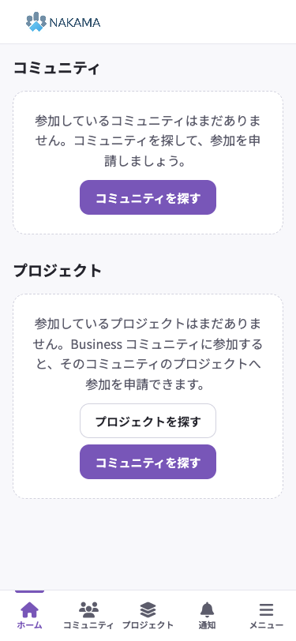 | — |
| ホーム（Business コミュニティだけ） | 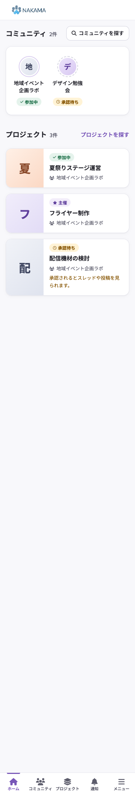 | 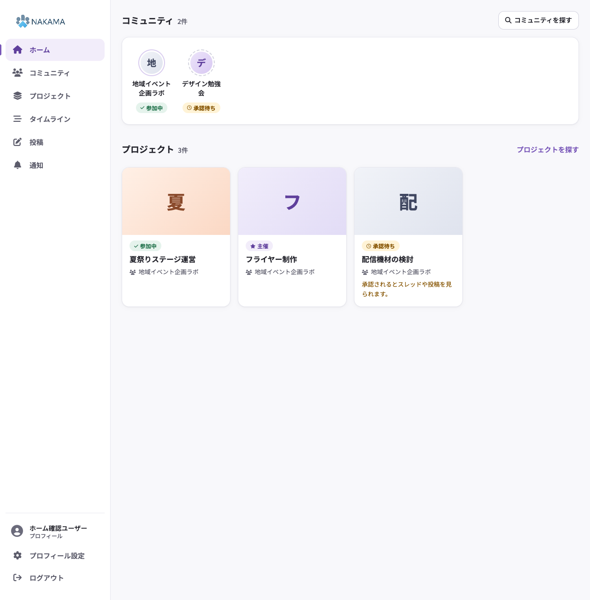 |
| コミュニティ一覧 | 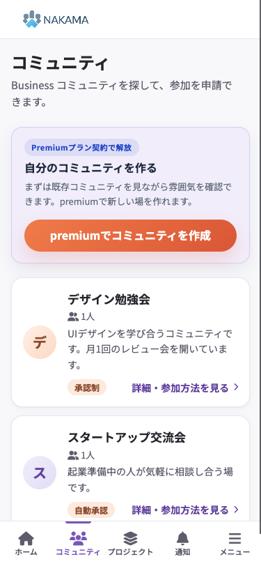 | 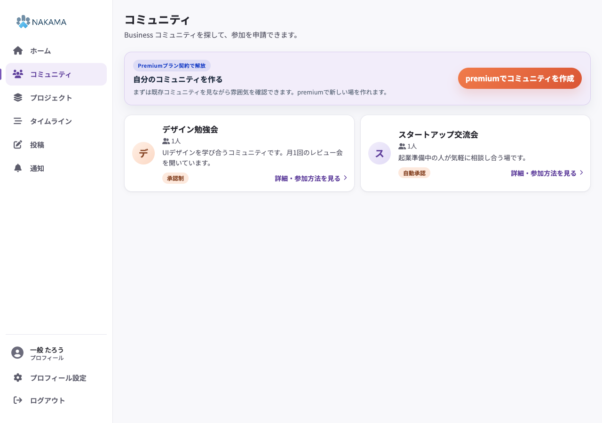 |
| コミュニティ詳細・未参加（自動承認） | 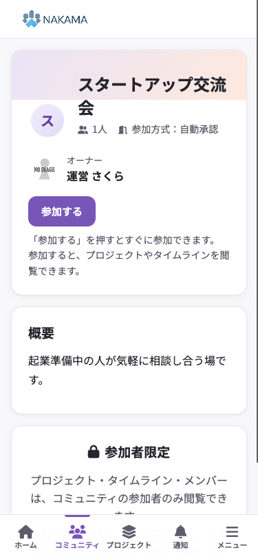 | — |
| コミュニティ詳細・未参加（承認制） | 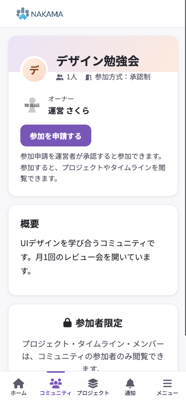 | 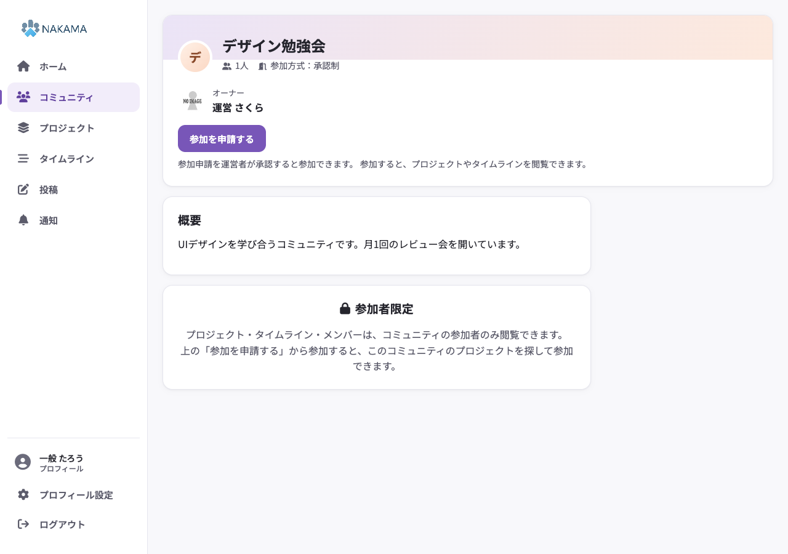 |
| コミュニティ詳細・承認待ち | 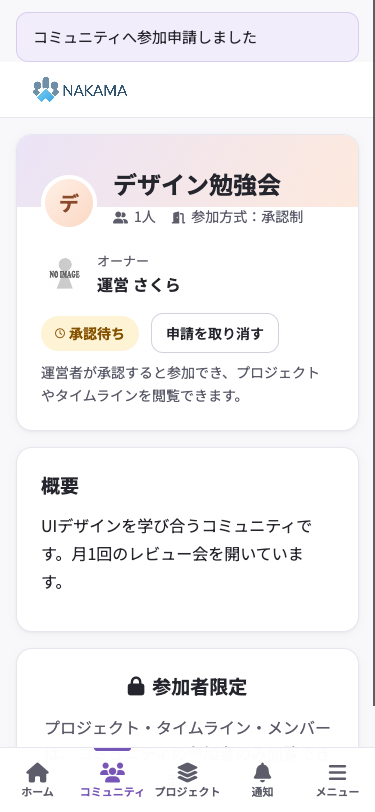 | — |
| コミュニティ詳細・参加中 | 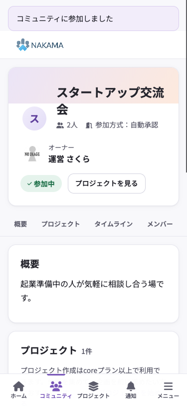 | — |
| コミュニティ詳細・停止中 | 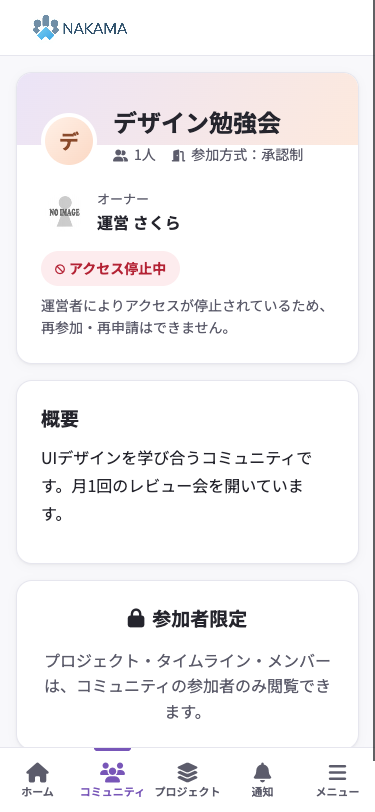 | — |
| コミュニティ詳細・管理者 | — | 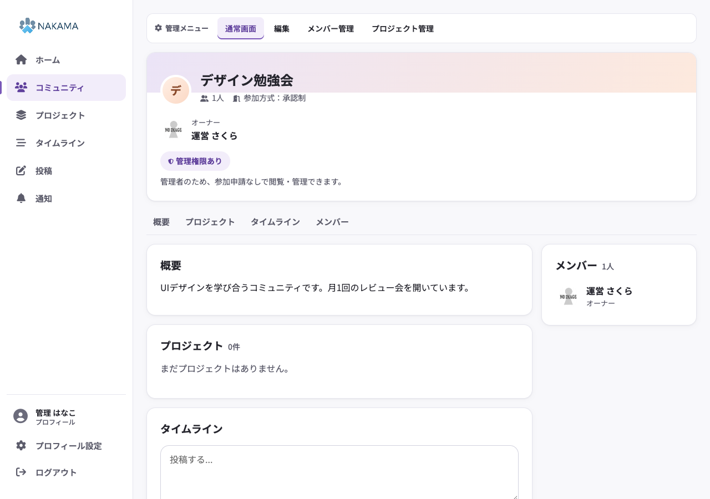 |
| プロジェクト詳細・未参加（自動承認） | 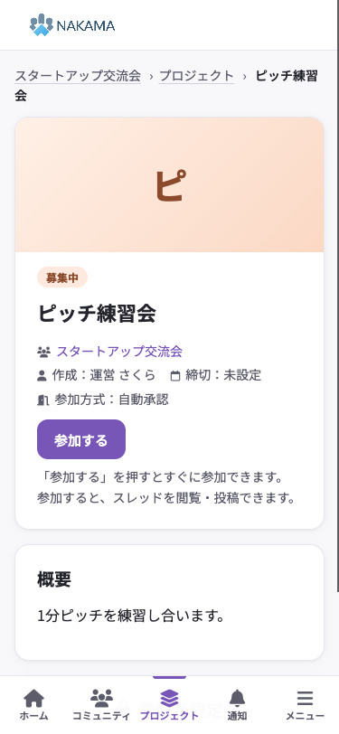 | — |
| プロジェクト詳細・参加中 | 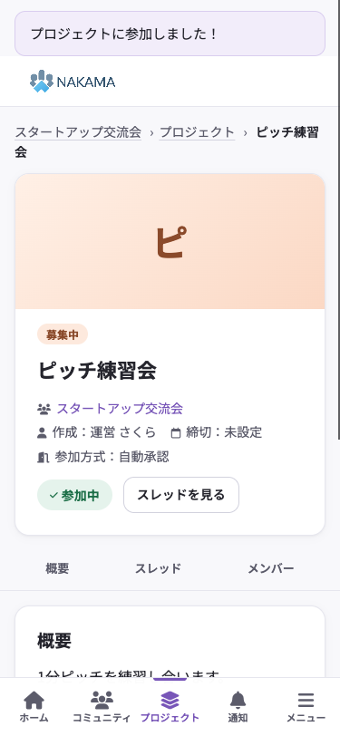 | — |
| プロジェクト詳細・運営者 | — | 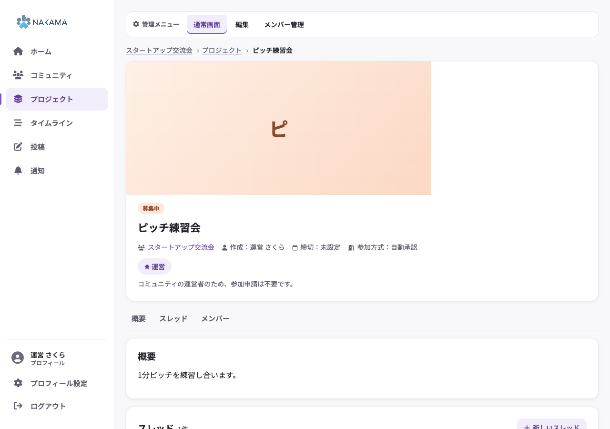 |

### 9.6 検証と残課題

テスト:

- `spec/requests/business/sign_in_guidance_spec.rb`: Business のみ / 両方 / Business 未登録 / パスワード違い / メール未確認 / 退会済み / 未ログイン時の戻り先（外部 URL・ログイン系画面を使わない、古い戻り先を残さない、制限を回避できない）/ 音楽・歌声のログイン後の行き先 / パスワード再設定後（音楽・歌声・Business）/ ログアウト後。
- `spec/requests/business/customers_spec.rb`: Business のプロフィール設定に音楽欄を出さず、保存しても音楽のパート・ジャンルが変わらないこと。
- `spec/requests/business/join_flow_spec.rb`（退出）: GET では退出しない、CSRF トークンの無い DELETE を拒否、退出後は内部・配下プロジェクトに入れない、運営者には退出リンクを出さない。
- `spec/requests/business/music_separation_spec.rb`: Business ホーム・一覧・プロフィール・設定・コミュニティ詳細に音楽コミュニティの名称・件数・`/public` へのリンクが出ないこと、ページ分割が Business の分だけで数えられること、音楽ホームと所属データが変わらないこと。
- `spec/requests/business/join_flow_spec.rb`: 状態別の表示（手動・自動・承認待ち・参加中・停止中・募集終了・運営・主催・管理者）、一連の操作（自動承認 / 手動承認）、連打、直接リクエストの認可、申請取り消しが本人分だけであること、未参加者に内部情報を出さないこと。
- `spec/services/business/memberships/statuses_spec.rb`: 状態の優先順位と問い合わせ回数。
- `spec/system/business/join_flow_spec.rb`: 実ブラウザ（375px・1280px）でホームからスレッドまで進めること、参加ボタンが最初の表示で見え、下部ナビに隠れないこと、横はみ出しがないこと。

残課題:

- パスワード再設定メールのリンク先（`/customers/password/edit`）・メール確認の再送画面は全ドメイン共通の画面のまま（Business 用の見た目にはしていない）。行き先だけを直した。
- 歌声の画面を未ログインで開いた場合の戻り先は、従来どおり音楽のログイン画面（今回は Business だけを対象にした）。
- 音楽ガードの文言（「音楽プラットフォームの利用には…」）自体は、音楽の画面を直接開いた Business 利用者向けに残っている。Business の画面からその導線はなくなった。
- オンボーディング（`/onboarding/step1〜3`）は共通画面のままで、今回は確認のみ。

---

## 10. ログイン前の紹介ページ（2026-10-30）

ブランチ `feature/business-landing-atelier`。対象は未ログインの `/business` だけ。ログイン後の `/business`（ホーム）、認証・認可・料金プラン・DB は変えていない。

### 10.1 改修前の問題

- 大きな青いグラデーションのヒーローが画面を占め、Social Atelier（白・薄いニュートラル・ラベンダー）と別のサービスに見える。
- 見出しが大きく長く、スマホでは「コミュニ／ティ」「終わらな／い」と語の途中で折り返す。
- 英語のキャッチコピー（BUILD YOUR CIRCLE, MOVE YOUR WORK）と説明が多い。
- 未ログインなのに大きなアカウントアイコン（ログイン済みに見える）と☰があり、ロゴも小さい。
- 「新規登録」（緑）と「ログイン」（青）がどちらも強い色で、主な操作が分からない。
- 写真の自動スライダー（画像5枚）、大きな空の「プロジェクトはログインすると閲覧できます」枠、フッターなし。

### 10.2 デザイン方針

- `body.ba-lp`（ログイン後の `body.ba-body` とは別）に、Social Atelier の `tokens.scss`（色・文字・余白・角丸・フォーカス）と `components.scss`（`ba-btn` / `ba-status` / `business_monogram`）をそのまま共有。ページ固有の配置は `business/atelier/landing.scss` に `.ba-lp` 配下で置いた。`ba-body` を使わないのは、PC で左ナビ分の余白が body に付くため。
- 背景は白と `--ba-bg`、アクセントは淡いラベンダー（`--ba-accent-soft`）。主ボタンは既存のバイオレット（`ba-btn--primary`）、副ボタン（ログイン）はバイオレットの枠と文字（既定の灰色の枠は白背景とのコントラストが 1.5:1 と低いため、このページだけ変更）。
- 青い背景・全面のグラデーション・自動スライダー・アニメーションは使わない。画像はロゴだけ（新しい画像・外部画像・ライブラリの追加なし）。
- 見出しは `word-break: keep-all` で読点の位置だけで改行し、改行タグは使わない。スマホ 28px（幅 400px 以上 32px）、768px 以上 38px、992px 以上 44px。
- 文字のコントラスト: 主ボタン 5.49:1、説明文 6.57:1、補足 5.23:1（背景上 4.94:1）、ラベル 6.82:1。ボタンの高さは 44px 以上（ヒーローと案内のボタンは 48px）。

### 10.3 ページ構成と実際のリンク先

| 部分 | 内容 | リンク先 |
|------|------|----------|
| 本文へスキップ | キーボードで最初に止まる。押すと本文へフォーカスを移す（`business/landing.js`） | `#ba-lp-main` |
| ヘッダー（固定） | 左に NAKAMA ロゴ（画像に文字が含まれるため文字は重ねない）、右に「ログイン」「無料で始める」。幅 360px 未満は「ログイン」だけ（「無料で始める」は直下のヒーローにある）。アカウントアイコン・通知・☰は出さない | ロゴ `/business`、ログイン `/business/sign_in`、無料で始める `/business/sign_up` |
| ヒーロー | 「ビジネスコミュニティ NAKAMA」、見出し「出会いを、いっしょに動く力へ。」、説明2文、主ボタン「無料で始める」・副ボタン「ログイン」、注記「無料で登録・参加できます。プロジェクトやコミュニティの作成には、有料プランなどの条件があります。」 | 同上 |
| 画面イメージ | PC は右、スマホ・タブレットはコピーの下。コミュニティの丸い頭文字・プロジェクトカード・スレッドの会話を HTML/CSS で表現。「画面イメージ（架空の例）」と明記し、中身は読み上げ対象外（`aria-hidden`）。人数・未読件数は出さない | なし |
| NAKAMAでできること | 実装済みの3機能: コミュニティでつながる（参加・タイムライン）／プロジェクトで進める（目標・締切・募集）／スレッドで話す（話題ごと・画像やファイル添付） | なし |
| お知らせ | 既存の2件（2026年3月1日・3月5日）を新しい順の一覧に | なし |
| さっそく始めましょう | 旧「プロジェクトはログインすると閲覧できます」枠の置き換え。「コミュニティ内の会話やプロジェクトのスレッドは、参加したメンバーが見られます。登録またはログインすると、参加先を探して参加・申請できます。」 | 無料で始める・ログイン（同上） |
| フッター | ロゴ、ログイン・新規登録・利用規約・プライバシーポリシー・特定商取引法に基づく表記、© BeMyStyle | `/business/sign_in`・`/business/sign_up`・`/public/terms`・`/public/privacy`・`/public/legal` |

- 「無料で始める」: Business の新規登録は無料で、Free プランで投稿・コミュニティ／プロジェクトへの参加・コミュニティ内投稿ができる（`Customer::FEATURE_RULES`、参加にプラン条件はない）。プロジェクト作成は Core、コミュニティ作成は Premium が基本だが、お試し中のコミュニティ（`plan_restrictions_waived_for?`）では無料でもプロジェクトを作成でき、コミュニティの運営者はプランに関係なく作成できる。このため注記は「有料プランなどの条件」とした。
- 公開範囲の案内: 参加者限定なのはコミュニティ内のタイムライン・プロジェクト・メンバー（承認済みの参加者）とプロジェクトのスレッド（プロジェクト参加者）。ビジネス投稿（`/business/timeline` の「おすすめ」）はログインした全員が見られるため、「内容は参加者だけ」とは書かず対象を会話・スレッドに限定した。
- 画面イメージは読み上げ対象外だが、サービスの説明（何ができるか・どう始めるか）はヒーローの見出し・説明文と「NAKAMAでできること」の本文だけで伝わる。
- 未ログインでは、コミュニティ・プロジェクト・通知など実データを取得しない（`Business::HomesController#top` は従来どおり未ログイン時に何も読み込まない）。
- 音楽コミュニティ・音楽トップ・歌声への案内は置いていない。
- 削除: 旧ヘッダー `layouts/_header_menu_nakama`（紹介ページだけで使用）、`business/homes/_projects`、スライダー・旧ヒーローのマークアップ。旧ヘッダーの JS（`business/header_menu_nakama.js`）と SCSS（`header_menu_nakama.scss`・`business/homes/top.scss`）は、音楽側のヘッダーと共有するセレクタがあるため今回は残した（要素が無ければ何もしない）。

### 10.4 改修前後の画面

架空データ（画面イメージの名前はすべて架空）。改修前の画像は改修前のコードで撮影した。

| 幅 | 改修前 | 改修後 |
|----|--------|--------|
| PC 1280px（最初の画面） | 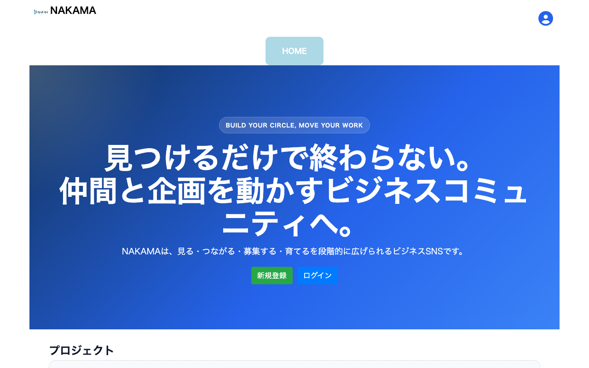 |  |
| PC 1280px（全体） | 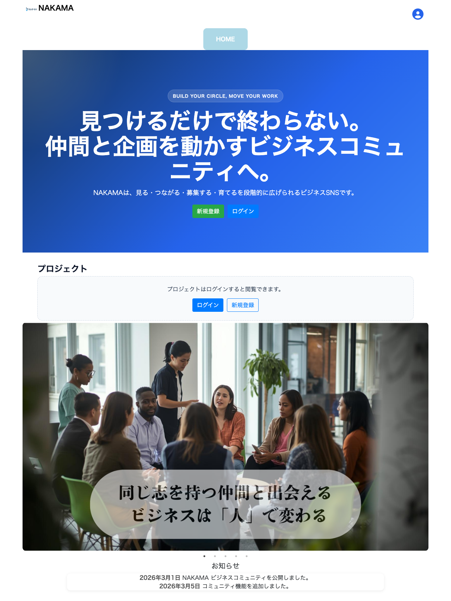 | 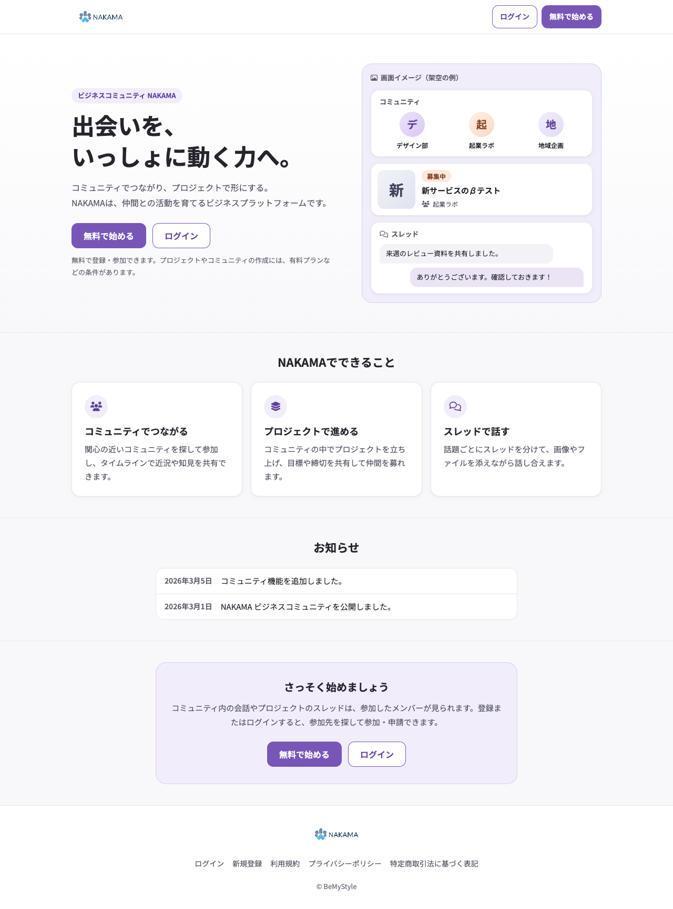 |
| タブレット 768px（全体） | 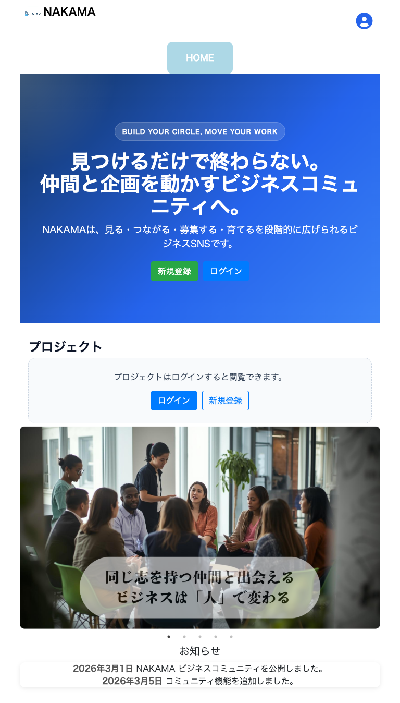 | 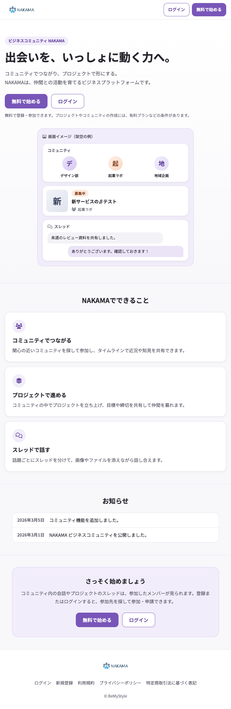 |
| スマホ 430px（全体） | 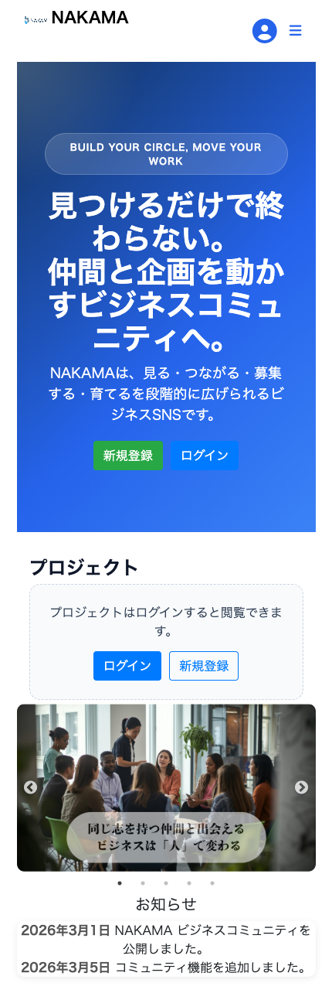 | 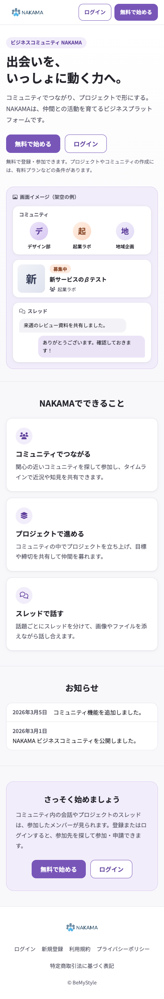 |
| スマホ 375px（最初の画面） | 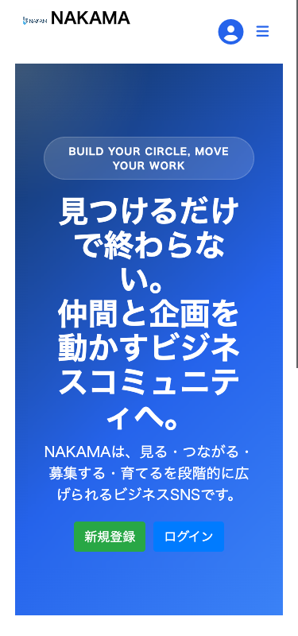 | 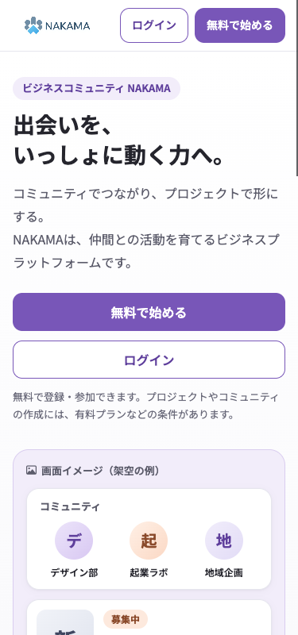 |
| スマホ 375px（全体） | 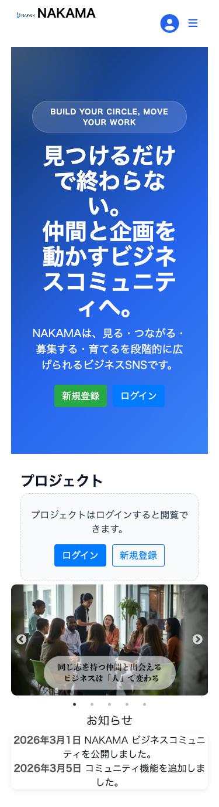 | 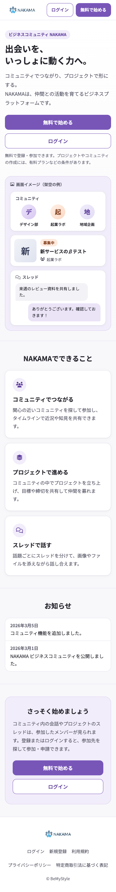 |
| スマホ 320px（全体） | 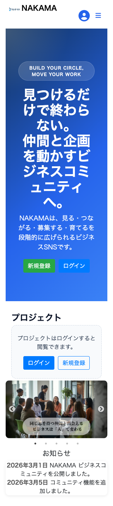 | 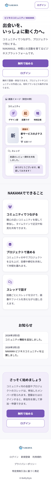 |

### 10.5 検証

- `spec/system/business/landing_spec.rb`（実ブラウザ）: 320 / 375 / 430 / 768 / 1280px で横はみ出しなし、見出しは読点の直後でだけ改行（各文字の表示行で判定）、スマホの見出しは 28〜34px、最初の画面に「無料で始める」（高さ 44px 以上）とヘッダーの「ログイン」。ヘッダーのロゴとボタンが重ならない。「無料で始める」→ Business 新規登録、「ログイン」→ Business ログイン → ログイン後は同じ `/business` がホーム（`body.ba-body`）に切り替わる。Tab の順（本文へスキップ → ロゴ → ログイン → 無料で始める）とフォーカス表示、スキップで本文へフォーカス。音楽トップと歌声 LP に `body.ba-lp` / `ba-body` が付かない。
- `spec/requests/business/homes_spec.rb`: 未ログインでアカウントアイコン・通知・ログアウトを出さない、実データを出さない、画面イメージが架空と明記され読み上げ対象外、無料の範囲の注記、音楽側へのリンクなし、フッターのリンク先がすべて 200。
- 旧ヘッダー・スライダー前提の system spec（未ログインのアカウントメニュー・☰・スライダーの矢印）は、上の spec に置き換えて削除した。
- 本番用プリコンパイル（`RAILS_ENV=production rails assets:precompile`）が成功し、生成された CSS に `.ba-lp` の規則、JS に本文へスキップの処理が含まれることを確認（確認後、生成物は削除してローカルの `public/assets` を元に戻した）。

### 10.6 残課題

- 旧ヘッダーの JS・SCSS と `business/homes/top.scss`（旧ヒーロー・スライダー）の削除は、音楽側のヘッダーへの影響を確認したうえで別 PR。
- スライダーの画像（`business1〜5.png`）は使わなくなったが、ファイルは残している。
- お知らせは従来どおりビューに直接書いた2件（更新の仕組みはない）。
- 実機（iPhone Safari）での確認は未実施。

---

## 11. NAKAMA の青いロゴと配色（2026-10-30）

ブランチ `feature/business-blue-brand`。採用案①（3人の仲間がつながる青いロゴ）に合わせて、ロゴを差し替え、Business 領域のブランド色を紫から青に統一した。
レイアウト・文言・認証・権限・参加承認・料金・通知の仕様は変えていない。音楽・歌声・Learning の配色とロゴも変えていない。

**結論**: Business の 24 画面とタイムライン（MySQL）で紫〜インディゴの色は 0 件、横はみ出しは 0。音楽・歌声・Learning の 12 画面は改修前と画素単位で一致。全体テストは 7069 件中 36 件失敗で、すべて今回の変更を外したコードでも失敗する既存のもの。別の実行で 1 回だけ失敗した `atelier_navigation_spec.rb:208` は、既存のテストの待ち方による不安定さで、原因を特定済み（11.6）。

### 11.1 方針

- 白と薄いグレー（`--ba-bg` / `--ba-surface-muted`）を中心にし、青は操作（ボタン・リンク・現在地・フォーカス）と強調だけに使う。画面全体を濃い青で塗らない。大きなグラデーションは増やさない。
- ブランド色は `tokens.scss` の `--ba-brand-blue` / `--ba-brand-sky` にまとめ、部品は `--ba-accent*` を通して使う。紫のカラーコードを機械的に置き換えず、トークン・旧ファイル・認証画面ごとに使い道を確認して直した。
- 状態色（参加中・承認待ち・停止中・削除・未読）とピーチの種別ラベルはそのまま残す。

### 11.2 採用したロゴ素材と用途

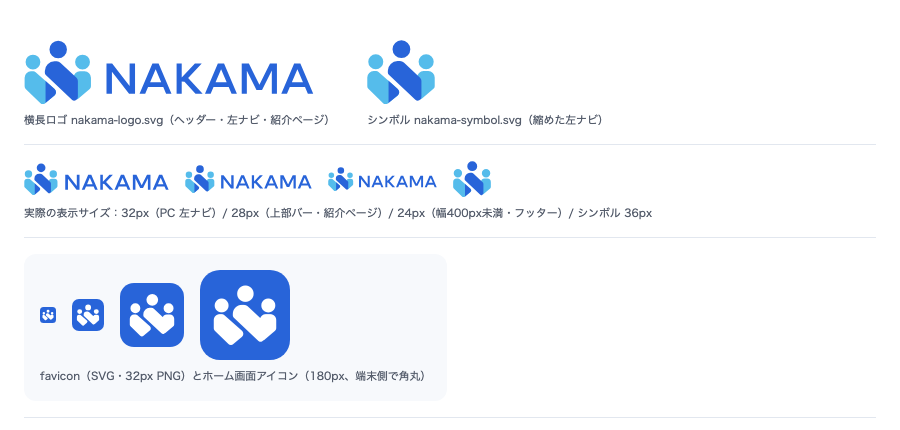

| ファイル（`app/assets/images/business/`） | 形式 | 用途 | 表示サイズ |
|------|------|------|------|
| `nakama-logo.svg` | ベクター（背景透過・余白なし、viewBox 935×206） | ログイン後の上部バー・広い左ナビ、ログイン前トップのヘッダー・フッター | 左ナビ（1200px 以上）32px、上部バー 28px、紹介ページ 28px（幅 400px 未満とフッターは 24px） |
| `nakama-symbol.svg` | ベクター（背景透過、viewBox 473×448） | 縮めた左ナビ（992〜1199px、幅 96px） | 36px |
| `nakama-app-icon.svg` | ベクター（青の角丸 + 白いシンボル） | Business の favicon（SVG 対応ブラウザ） | — |
| `nakama-icon-32.png` | 透過 PNG 32×32 | favicon（SVG 非対応ブラウザ） | — |
| `nakama-apple-touch-icon.png` | PNG 180×180（角丸なし。端末側で角丸になる） | iPhone などのホーム画面アイコン | — |
| `nakama-logo.png` / `nakama-symbol.png` | 透過 PNG（726×160 / 270×256） | SVG を使えない場所（メール・外部資料など）向けの予備。画面では使っていない | — |

- **作り方**: 添付の比較ボード（シンボル／横長ロゴ／アプリアイコン）から、ボード全体ではなく各ロゴの形を測り、円（頭）と角丸の多角形（胴体）・直線の文字（NAKAMA）でベクターとして作り直した。画像を SVG で包んだものではない（`<image>` を含まず、すべて `<path>`）。
- **形の再現度（測定値）**: 作り直した SVG を元画像（1536×1024）と同じ座標・同じ大きさで描画し、両方の画像から「濃い青」「淡い青」の画素をそれぞれ色の範囲で取り出して、重なりの割合（IoU = 両方で塗られた画素数 ÷ どちらかで塗られた画素数）を数えた。シンボルは濃い青・淡い青とも約 0.97、文字（NAKAMA）は約 0.92。ずれの大部分は輪郭の 1px 前後で、元画像（AI 生成のラスター画像）の縁のにじみ・色の境目を、取り出すときの色の範囲で切った差による。
  - この数値は「元の案と輪郭がどれだけ重なるか」の目安で、見た目の品質を保証するものではない。見た目は別に、実際の画面（2 倍の解像度）での目視と、小さいサイズ（16〜36px）での潰れ方の確認で判断した（11.6）。
  - 左の人物の右側だけ濃い青になる「N」の形、中央の人物と右の人物の重なり、頭の大きさの違いを残している。
- **色**: 基準色どおり、濃い部分 `#2864D9`、淡い部分 `#55BCEB`（元画像の実測は約 `#255FCD` / `#4DB1EF`）。
- **アプリアイコン**: ボードのアイコンと同じく、青の角丸の正方形に白いシンボル（重なりは塗り分けず、元の隙間だけで形を出す）。16px でも3人の形が分かることを確認した。
- **favicon の適用範囲**: 共通の `public/favicon.ico`・`public/apple-touch-icon.png` は音楽・歌声側が使うため置き換えていない。`layouts/application` に `content_for :head_icons` の差し込み口を作り、Business のレイアウト・ログイン前トップ・Business のログイン／新規登録／パスワード再設定／利用開始だけが `layouts/_business_icons` を差し込む。何も指定しない画面は従来と同じ HTML（音楽・歌声は `favicon.ico` の1行だけ）。
- **manifest**: リポジトリに Web アプリ manifest の仕組みがないため、新しく作っていない。
- 旧ロゴ `nakama_logo.jpg` はどこからも参照されなくなったが、ファイルは残している。

### 11.3 カラーパレットと各色の役割

値と白背景でのコントラストは [2 章](#2-デザイントークン最終値) の表。改修前からの主な変更は次のとおり。

| 役割 | 改修前 | 改修後 | 補足 |
|------|--------|--------|------|
| ブランド色・リンク・主ボタン・現在地 | `#7856B8` | `#2864D9` | 白背景 5.4:1、ページ背景 5.1:1 |
| hover・淡い背景上の文字 | `#5F3F9C` | `#1D4FB3` | 淡い青の上で 6.7:1 |
| 押下中（active） | なし | `#173F8F` | 主ボタンを押している間。補助ボタンは `--ba-accent-line` |
| 淡い背景（現在地・補助ボタン・お知らせ） | `#F2EDFA` | `#EDF3FD` | |
| 補助ボタンの hover | `--ba-lavender` `#EBE4F7` | `--ba-accent-tint` `#DFE9FB` | トークン名も変更（ラベンダーは廃止） |
| 淡い枠線・丸画像の輪 | `#D9CDEF` | `#C5D7F5` | |
| 補助の淡い面 | ラベンダー + ピーチの帯 | `--ba-accent-soft` + `--ba-sky-soft` の帯 | プロフィールにカバー画像がないときだけ |
| 文字・背景・枠線のグレー | 紫寄りのグレー（`#25252D` / `#F8F8FB` など） | 青寄りのグレー（`#1F2633` / `#F7F9FC` など） | すべて 4.5:1 以上を維持 |
| フォーカス | `rgba(120,86,184,.35)` の 3px の輪 | 白 2px の隙間 + `#2864D9` 4px の実線 | 淡い輪は白背景との差が 2:1 未満だったため、5.4:1 の実線にした |
| 本文中のリンク（class のない `a`） | 色だけ | 色 + 下線 | 色だけに頼らない。ボタン・カードなどの部品のリンクは従来どおり |
| 頭文字（画像がないとき）の色 | violet / peach / lavender / mist | blue / peach / sky / mist | `business_monogram` の色名も変更。文字 `#1D4FB3` は背景の濃い側でも 5.4:1 以上 |
| 入力欄・添付（旧 `business/chat.scss`） | `#6366F1` / `#4338CA` / `#EEF2FF` | Business のトークン（`var(--ba-accent)` など） | `business-` で始まる Business 専用のクラスだけ |
| Business のログイン・登録・利用開始（`.domain-auth--business`） | Tailwind 系の青（`#1E40AF` / `#2563EB`）と放射状グラデーション | `#2864D9`（hover `#1D4FB3`、押下中 `#173F8F`）、背景は白→淡い青の縦グラデーションだけ | リンクに下線、戻るリンクを `#9CA3AF`（2.5:1）から `#545C6B`（6.7:1）へ。利用開始ボタンは共通の白文字が Bootstrap の `.btn`（`#212529`）に上書きされ、青の上に暗い文字になっていた（改修前から）ため、Business だけ白文字を明示 |

- スカイブルー `#55BCEB` は白背景で 2.2:1 しかないため、文字・アイコン・枠線には使わず、ロゴの中と淡い面（`--ba-sky-soft`）だけに使う。
- disabled は従来どおりグレー（`--ba-surface-muted` の背景 + `--ba-text-muted` の文字 6.1:1）。

### 11.4 変更したファイル

| ファイル | 内容 |
|----------|------|
| `app/assets/images/business/*` | 新しいロゴ・アイコン（11.2） |
| `business/atelier/tokens.scss` | 色トークン、フォーカス、本文リンクの下線 |
| `business/atelier/components.scss` | 押下中の色、補助ボタンの hover、頭文字の色 |
| `business/atelier/shell.scss` | ロゴの大きさ（高さだけ指定し縦横比を保つ）、縮めた左ナビのシンボル表示 |
| `business/atelier/landing.scss` / `pages.scss` | ロゴの大きさ、ラベンダーを使っていた2か所 |
| `business/chat.scss` | 入力欄・添付・リンクの色をトークンに |
| `domain_auth.scss` | `.domain-auth--business` の規則だけ（音楽・歌声・Learning の規則は不変） |
| `helpers/business/navigation_helper.rb` | 頭文字の色名（`MONOGRAM_TONES`） |
| `layouts/application`・`business`・`_business_shell`・`_business_icons`（新規） | ロゴ画像、Business だけの favicon |
| `business/homes/_landing`、`business/{sessions,registrations,passwords}/new`、`business/joins/show` | ロゴ画像、Business の favicon |

### 11.5 改修前後の画面

架空データ（テスト環境で作成した人物・団体名）。改修前の画像は改修前のコードで撮影した。

| 画面 | 改修前 | 改修後 |
|------|--------|--------|
| ログイン前トップ（PC 1280px） | 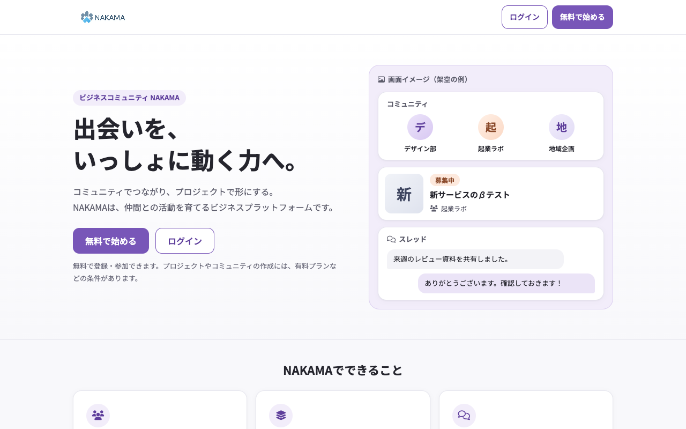 | 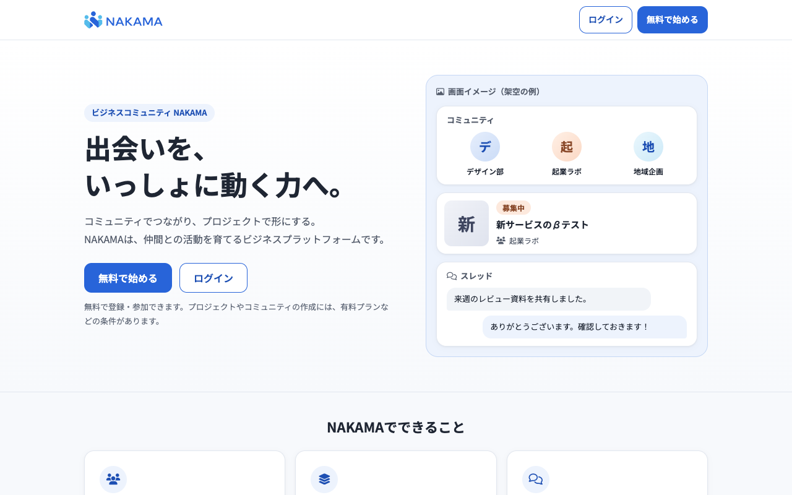 |
| ログイン前トップ（SP 375px） | 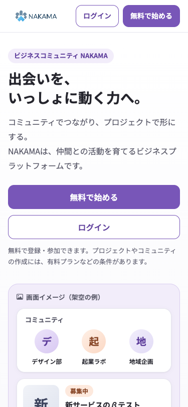 | 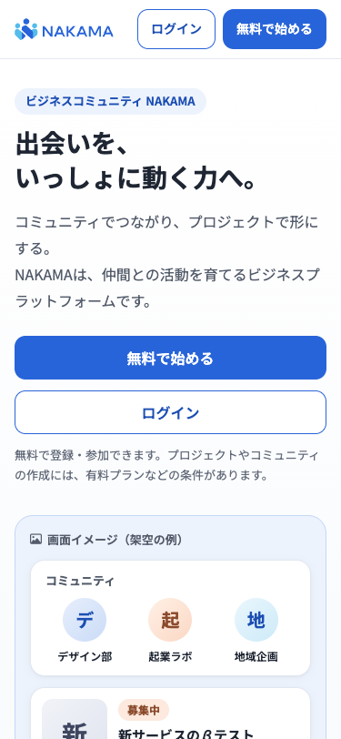 |
| ログイン後ホーム（PC） | 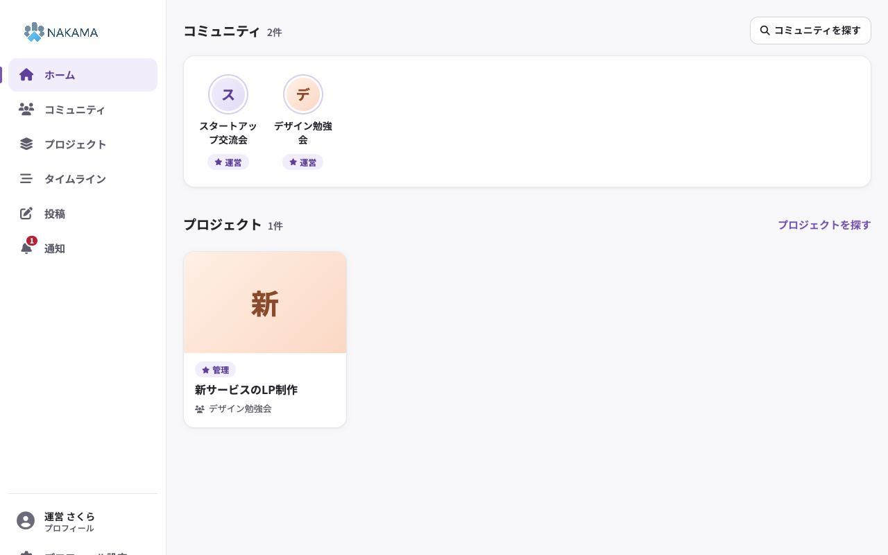 | 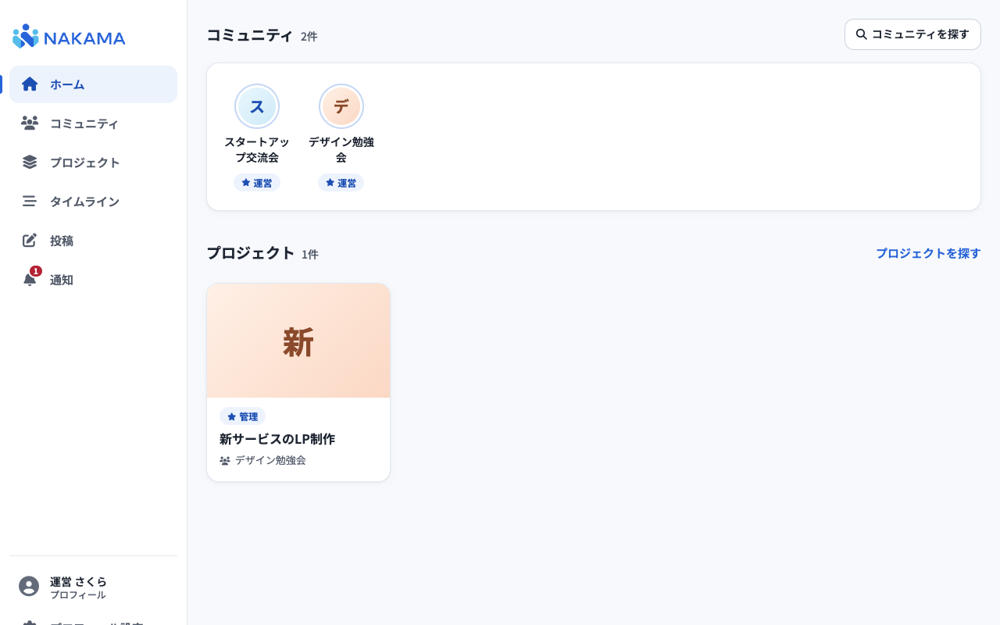 |
| メンバー管理（PC） | 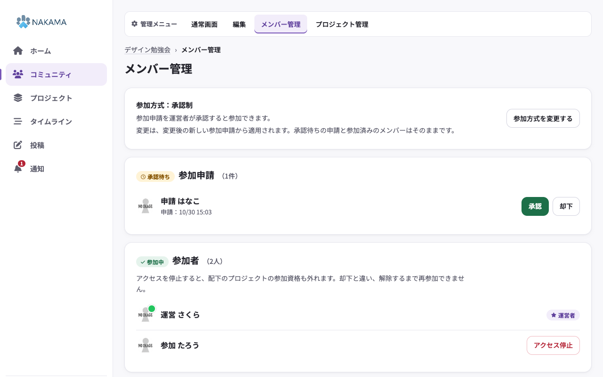 | 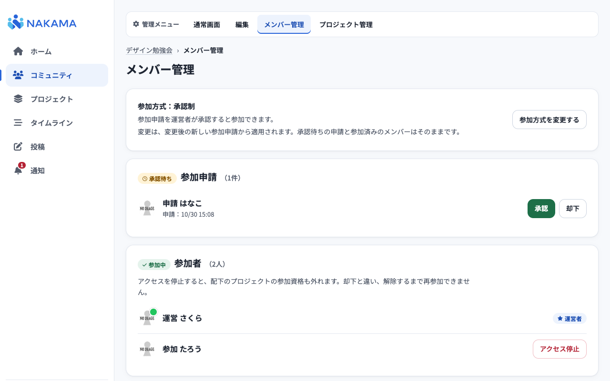 |
| コミュニティ通常画面・運営者（SP） | 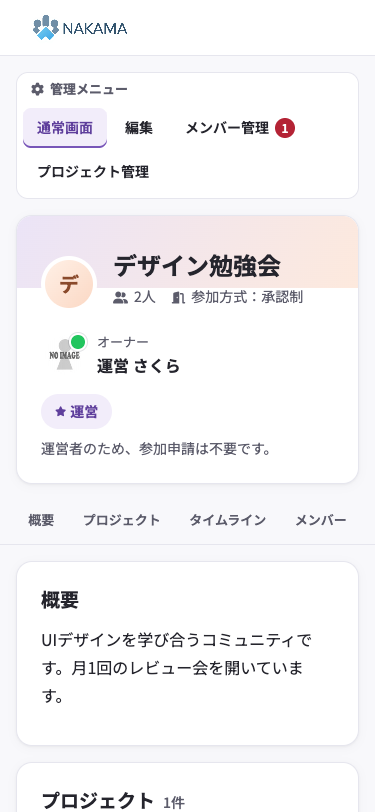 | 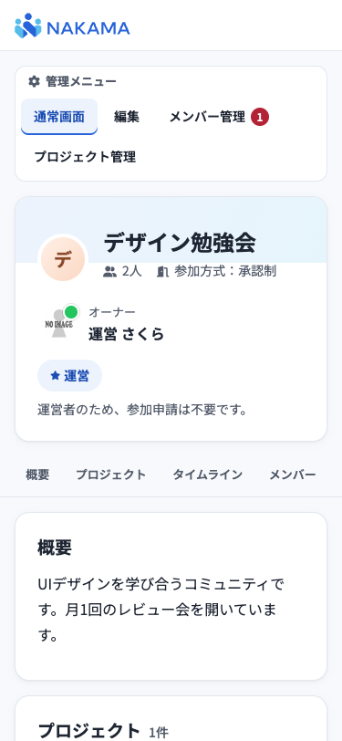 |
| プロジェクト通常画面（SP） | 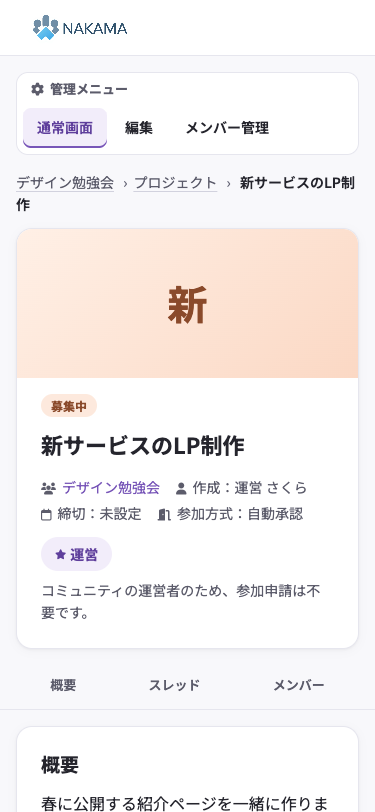 | 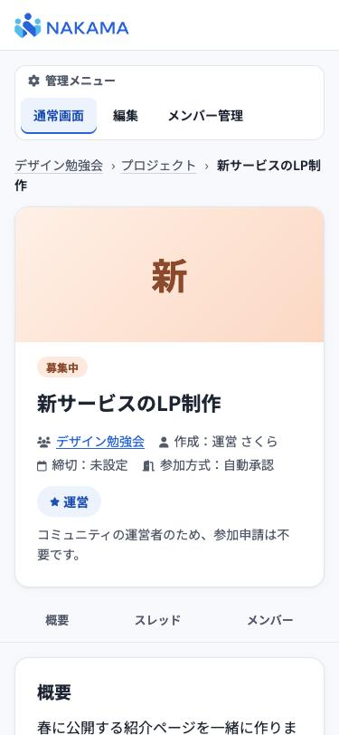 |
| スレッド会話・入力欄（SP） | 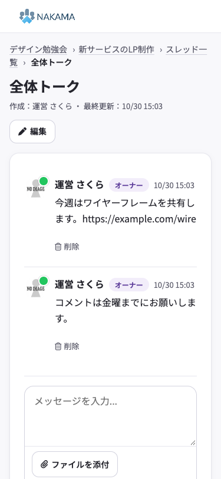 | 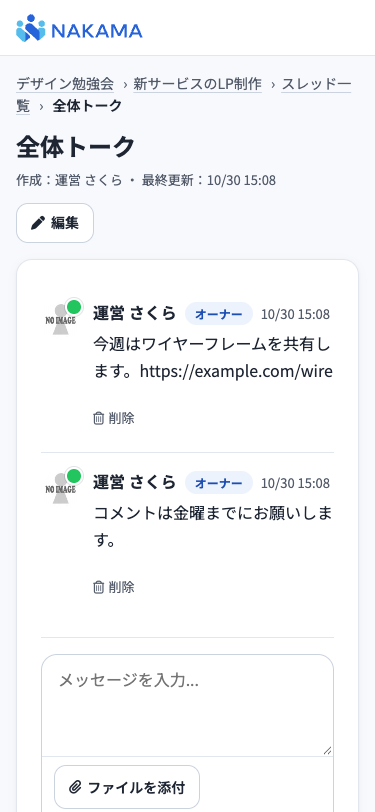 |
| メニューシート（SP） | 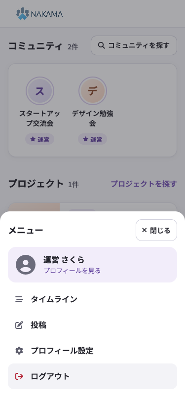 | 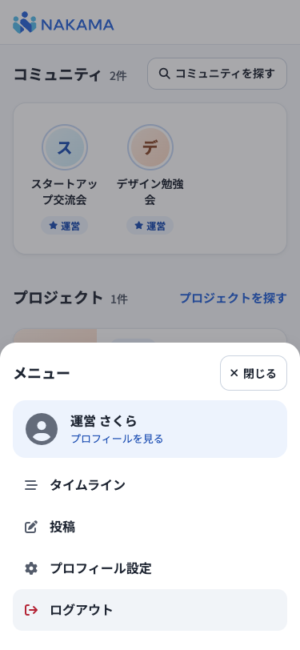 |
| Business ログイン（SP） |  |  |

### 11.6 検証

- **紫の残り**: 撮影用スクリプトで、Business の 24 画面（ログイン前トップ・ログイン・新規登録・利用開始・ホーム・コミュニティ一覧／通常画面／作成／編集・メンバー管理・プロジェクト管理・プロジェクト一覧／通常画面／編集／メンバー・スレッド一覧／会話・投稿一覧／作成／詳細・通知・プロフィール／設定、未参加者のコミュニティ画面。利用開始は音楽だけを使っている人で表示）の全要素について、計算後の文字色・背景色・枠線・アウトライン・影・背景画像から紫〜インディゴの色相（228〜335°、彩度 30% 以上）を探し、すべて 0 件。同じ判定で旧来の `#7856B8`・`#6366F1` は検出されることを確認した。
- **横はみ出し**: 上の各画面を 320 / 375 / 768 / 1280px で開き、`scrollWidth - clientWidth` がすべて 0（改修前も 0）。
- **ロゴ**: `spec/system/business/brand_logo_spec.rb`（実ブラウザ）で、紹介ページ 320px は 24px・1280px は 28px、ログイン後の上部バー（375px）28px、縮めた左ナビ（1024px）はシンボル 36px で横長ロゴは非表示、広い左ナビ（1280px）は横長ロゴ 32px でシンボルは非表示、いずれも読み込み済みで縦横比が SVG と一致。主ボタン・現在地の色がブランドブルー。
- **favicon**: `spec/requests/business/brand_assets_spec.rb` で、Business の各画面は NAKAMA のアイコン3種だけを出し `favicon.ico` を出さないこと、音楽トップ・音楽ログイン・歌声トップは従来どおり `favicon` の1行だけで NAKAMA の画像を参照しないこと。
- **音楽・歌声・Learning への影響**: アニメーションを止めた状態で、今回の変更を一時的に外したコードと現在のコードで、音楽トップ・音楽ログイン・音楽新規登録・歌声トップ・歌声ログイン・Learning ログインを 375 / 1280px で撮影し、12 枚すべて画素単位で一致。
- **本番用プリコンパイル**: `RAILS_ENV=production rails assets:precompile` が成功し、生成された CSS に新しいトークン・`.ba-brand__symbol`・`.domain-auth--business` の青が含まれ、`#7856B8` などの旧色が 0 件であることを確認（確認後に生成物を削除し、退避していたローカルの `public/assets` を元に戻した。`public/packs` は更新されていない）。
- **ロゴの目視確認**: 実際の画面を 2 倍の解像度で撮影し、ログイン後の上部バー（375px）・広い左ナビ（1280px）・縮めた左ナビのシンボル（1024px）・紹介ページのヘッダー（375 / 1280px）とフッターで、縁がにじまないこと、白いキャンバスが残らないこと、ボタン・ナビとの余白を確認した。

  

- **SVG の確認**: 3 ファイルとも `<image>` を含まない（すべて `<path>`）。背景透過で四隅は透明（アプリアイコンは角丸の外側が透明）。表示上の縦横比は viewBox と一致（横長ロゴ 935:206、シンボル 473:448、PNG もそれぞれ 726×160・270×256 で同じ比率）。塗りの外側の余白は、にじみを切らないための viewBox 端の数単位だけで、表示サイズに換算すると 0.5px 未満。
- **テスト（既存の 36 件）**: `spec/system/business`（48 件）・`spec/requests/business`・新しい 2 つの spec はすべて成功。全体は 7069 件中 36 件失敗（音楽・歌声・モデルなど）で、今回の変更を一時的に外したコードで失敗する 36 件と完全に同じ（増減なし）。
- **テスト（追加の 1 件 `atelier_navigation_spec.rb:208` の調査）**: 別の一括実行（前回失敗した 20 ファイルの再実行）で 1 回失敗した「移った後の戻る・進む・同じ画面へのリンク…」。最終の全体テストでは成功。
  - 失敗内容: 最後の手順（今いる「プロフィール設定」へのリンクを Enter で選ぶ）の後、「メニュー」を押してもシートが開かない（`expect_menu_usable` の `have_css("#baMenuSheet", visible: :visible)`）。失敗時の画面はプロフィール設定で、シートは閉じたまま。
  - 再現: このリポジトリはテストの実行順がランダムではない（`config.order = :random` はコメントアウト）ため、失敗したときと同じ 20 ファイルを同じ並びで実行（1 回は再現せず）。この例だけを繰り返すと、今回の変更ありで 30 回中 1 回、今回の変更を外したコードで 40 回中 2 回、同じ行で失敗した。ファイル単位では 10 回中 1 回。
  - 原因: 応答を止める診断で確定的に再現した。同じ画面へのリンクでは、Turbolinks がまずキャッシュの「プレビュー」を描画して body を入れ替え、その後サーバーの応答で本物の画面に描き直す。プレビューの描画では `turbolinks:load` が出ないため、`business/atelier_nav.js` は「メニュー」にクリックの処理を付けておらず（`baMenuBound` が無い）、押しても開かない。応答が返ると処理が付き、押せば開く。テストの `expect_body_replaced` は 1 回目の入れ替え（プレビュー）で「切り替わった」と判断するため、サーバーの応答がクリックより遅れたときだけ失敗する。
  - 判断: メニューの JS とこのテストは今回変更しておらず、変更を外したコードでも同じ頻度で起きるため、今回の変更が原因ではない（テストの待ち方の既存の問題）。修正は別 PR を提案する（例: `expect_body_replaced` で `html[data-turbolinks-preview]` が消えるまで待つ、または JS で `turbolinks:render` でも初期化する）。skip・自動再試行・待ち時間の延長はしていない。
  - 実際の利用者への影響: プレビューが出ている短い間（応答待ち）に「メニュー」を押しても反応しない。応答後は通常どおり動く。
- **注意（ローカル確認の罠）**: ローカルに古い `public/assets` があると、テスト環境もその CSS を使い Business の system spec が大量に落ちる（今回も一度 64 件失敗した）。画面確認・system spec の前に退避し、終わったら戻す。

### 11.7 対象外の共用画面と残る制約

| 項目 | 内容 |
|------|------|
| 認証画面の見出し | `shared/domain_auth` は音楽・歌声・Learning と共通。ブランド表示は文字の「BeMyStyle」+「Business」バッジのままで、ロゴ画像は置いていない（文言・構成を変えないため）。色は `.domain-auth--business` の規則だけで変更 |
| 歌声の利用開始画面 | 同じ原因（Bootstrap の `.btn` の文字色）で、青のボタンに暗い文字が乗っている。Business 外のため未修正（共通の `.domain-auth__submit` を直せば全ドメインが直るが、各ドメインの見た目確認が必要） |
| 旧 Business 用 SCSS | `posts/index.scss`（`.tag` `#4F46E5`）、`communities/show.scss`（`.btn-cta` のインディゴ〜紫のグラデーション）、`membership.scss`、`header_menu_nakama.scss`、`homes/top.scss` などにインディゴ・紫・別の青が残る。現在の Business 画面では使われておらず（11.6 の検出で 0 件）、音楽側と共有する上位セレクタを含むため、8.7 の方針どおり別 PR |
| Web アプリ manifest | 仕組みがないため未作成。必要になれば Business 用に別ファイルで追加する |
| OGP 画像 | Business の紹介ページに `og:image` はなく、今回も追加していない |
| 旧ロゴ `nakama_logo.jpg` | 参照がなくなったがファイルは残している |
| 実機確認 | iPhone Safari でのホーム画面アイコン・favicon（Safari は PNG を使う）の見え方は未確認。headless Chrome で確認 |
| 音楽ログインの横はみ出し | `/customers/sign_in` は改修前から 320〜1280px で 36〜84px 横にはみ出す（Business 外、今回の変更とは無関係） |

### 11.8 Business タイムライン（MySQL）での確認

`/business/timeline` は並び替えに `UNIX_TIMESTAMP` を使うため、通常のテスト環境（SQLite）では表示できない。8.2 と同じく、ローカルの MySQL サーバーに使い捨てのデータベース（`bemystyle_blue_tmp`、スキーマのみ）を作り、テスト環境の接続先だけを `DATABASE_URL` で切り替えて headless Chrome で確認した。本番・開発の DB は使っていない。データはすべて架空で、確認後にデータベースを削除した。

| 確認項目 | 結果 |
|----------|------|
| 配色 | 「おすすめ／フォロー／コミュニティ」の 3 タブ × 320 / 375 / 768 / 1280px、コミュニティ内タイムライン、スレッド（スタンプ選択を開いた状態を含む）で、紫〜インディゴの色は 0 件。投稿ボタン・検索・選択中のタブ・送信・ダウンロード・スタンプのタブが青 |
| 横はみ出し | 上のすべてで 0 |
| 本文 | 改行、長い URL（青＋下線のリンクで折り返し）、長文の一覧での省略 |
| 添付 | 画像のサムネイル、PDF（種類の目印は淡い青、ダウンロードは青のボタン） |
| スタンプ | コミュニティ内タイムライン・スレッドで表示。スタンプ選択のパネル |
| スマホの入力欄と下部ナビ | 文字入力中は下部ナビが隠れ、送信ボタンは画面内（下端 663px／画面の高さ 812px）。スタンプ選択を開くと下部ナビは表示されたまま |

| 画面 | 画像 |
|------|------|
| タイムライン（PC） |  |
| タイムライン（SP） |  |
| コミュニティ内タイムライン（本文・長い URL・添付・スタンプ、SP） |  |
| スレッド（添付・スタンプ、SP） |  |
| スレッドの入力中（下部ナビが隠れる、SP） |  |
| スタンプ選択を開いた状態（下部ナビは表示、SP） |  |

---

## 12. 利用イメージのイラスト・使い方ページ・タイムラインの整理（2026-10-30）

ブランチ `feature/business-help-and-timeline`。公開範囲・権限・料金判定・DB は変えていない（マイグレーションなし、既存データの削除なし）。音楽・歌声・Learning の画面は変えていない。

### 12.1 タイムラインと「投稿」の調査結果

| 観点 | `/business/timeline`（タイムライン） | `/business/posts`（投稿一覧） |
|------|------|------|
| コントローラー | `Business::PostsController#timeline` | `Business::PostsController#index` |
| データ | `Post`（ビジネス投稿） | 同じ `Post` |
| 閲覧範囲 | ログインした全員（`Post.all` を基に絞り込み） | 同じ |
| 投稿できる人 | `business_post_create`（free / light / core / premium＝全プラン） | 同じ |
| 並び順 | いいね×3＋コメント×2＋作成時刻の点数順 | 新しい順 |
| 絞り込み | タブ「おすすめ（全件）／フォロー（自分＋フォロー先）／コミュニティ（同じコミュニティの参加者）」、キーワード | キーワード、人気タグ、投稿者（`user_id`） |
| ページ分割 | あり | `per(12)` だけで**ページ送りの表示が無く、13件目以降に到達できなかった** |
| ナビ | 「タイムライン」 | 「投稿」（鍵アイコンの判定付き） |
| 既存リンク | ナビ、投稿フォームの「キャンセル」 | ナビ、投稿詳細・作成・編集のパンくず、詳細のタグ、プロフィールの「もっと見る」（`user_id`）、作成・削除後の戻り先 |

- 詳細・作成・編集・削除（`/business/posts/:id` など）は両方の一覧から共通で使う画面。通知（いいね・コメント）とメールのリンクは**詳細** `/business/posts/:id` を指しており、一覧は指していない。
- **コミュニティ内の会話**（`CommunityPost`）は別のデータで、コミュニティ詳細の中だけに表示され、閲覧・投稿ともコミュニティの参加者（承認済み参加者・運営者）だけ（`BusinessAccess#business_community_participant?`）。削除の機能はない。改修前はこの欄の見出しも「タイムライン」で、全体向けのタイムラインと名前が重なっていた。
- **プロジェクトのスレッド**（`ProjectChat`）はプロジェクトの参加者だけが閲覧・投稿でき、メッセージの削除は書いた本人だけ。スレッド自体の削除はプロジェクト管理者（全体トークを除く）。
- 結論: 2つの一覧は**同じ投稿を別の並べ方で出しているだけ**で、独立した役割はなかった。

### 12.2 タイムラインの最終的な役割と変更点

| 項目 | 改修後 |
|------|--------|
| 一覧の入口 | 「タイムライン」1つ。ナビの「投稿」を外した（PC 左ナビ・スマホのメニューとも） |
| 旧一覧 `/business/posts` | `keyword` / `tag` / `user_id` / `page` のうち**文字列の値だけ**を引き継いで `/business/timeline` へ 301 転送（配列・ハッシュの値やその他のパラメーターは捨てる）。転送先はルートヘルパーで作る同じホストのパスだけなので、外部 URL へは転送されない。未ログインは従来どおり Business ログインへ戻り、ログイン後は元の条件のまま旧 URL → タイムラインの順に表示される。存在しない投稿者を指定した場合は、全件ではなく該当なし（旧一覧と同じ） |
| タイムラインの機能 | 旧一覧の人気タグ・投稿者の絞り込みを統合し、絞り込み中の条件を「解除」できるチップで表示。タブは「おすすめ／フォロー中／コミュニティの仲間」（「コミュニティ」は会話と紛れるため改名）と、選択中のタブの説明文 |
| 投稿導線 | 見出し横の「投稿する」と空状態の「投稿する」 |
| 見える範囲の説明 | タイムラインと投稿フォームに「ビジネス投稿は、NAKAMAにログインしている全員が見られます。参加者だけに共有したい内容は…」と使い方ページ（見える範囲の表）へのリンク |
| 作成後 | 作成した投稿の詳細へ（「投稿しました。NAKAMAにログインしている全員が見られます。」）。オンボーディング中は従来どおり step3 へ |
| 削除後・コメント削除の戻り先 | タイムライン |
| パンくず・タグ・プロフィール | 「タイムライン」へ。プロフィールの「もっと見る」は「投稿をすべて見る」（`/business/timeline?user_id=…`） |
| ナビの現在地 | 投稿の詳細・作成・編集もタイムラインを現在地にする |
| コミュニティ内の会話 | コミュニティ詳細の見出し・ページ内リンク・参加案内を「タイムライン」→「コミュニティ内の会話」に改名し、「このコミュニティの参加者だけが見られます。タイムラインには表示されません。」を追加。アンカー `#timeline` は既存リンクのため維持 |

不具合の修正（同じ一覧に統合するため）:

- キーワード検索をすると点数順の並びとページ分割が外れていた（`@posts = posts.where(...)` で点数付きの問い合わせを上書き）。絞り込みを点数付けの前に適用するよう修正。
- 「コミュニティ」タブは参加者の結合で同じ投稿が重複し得た（キーワード時）。サブクエリで投稿者を絞る形に変更（対象の人は同じ）。
- 一覧の「いいね・コメント数」は1件ずつ数えていたため、`preload` で先読みし `size` で数える（投稿者アイコン・投稿画像も先読み）。
- 並び替えの時刻の数値化は MySQL では従来どおり `UNIX_TIMESTAMP`、テスト環境（SQLite）では `strftime('%s')` を使う。これでタイムラインを通常のテストで確認できるようになった。

### 12.3 使い方ページ（`/business/help`）

- ルート: `get "help", to: "helps#show"`（`/business/help` は既存ルートと衝突しないことを確認）。`Business::HelpsController` は認証を外し、会員データを一切読み込まない。
- レイアウト: ログイン前は紹介ページと同じヘッダー・フッター（`body.ba-lp`、ヘッダー・フッターは `business/homes/_lp_header` / `_lp_footer` に切り出して共用）、ログイン後は Business の枠（`body.ba-body`、左ナビ・下部ナビ）。
- 本文（`business/helps/_content`）: 目次（番号付き・ページ内リンク・PC 2列／スマホ 1列）と 8 セクション。

| # | セクション | 内容 |
|---|-----------|------|
| 1 | NAKAMAでできること | 文字とアイコンの3ステップ（紹介ページと共用。使い方ページには利用イメージの絵を置かない）と、全体向けのタイムラインの補足 |
| 2 | 関係 | コミュニティ ⊃ プロジェクト ⊃ スレッド ⊃ メッセージの入れ子図（HTML）。それぞれ「見られる人」を併記し、タイムラインは外側の別枠 |
| 3 | コミュニティを探す・参加する | 番号付き手順。「参加する」（自動承認）と「参加を申請する」（承認制）の違い、「コミュニティから退出する」 |
| 4 | プロジェクトとスレッド | コミュニティ参加が前提、「参加する／参加を申請する」、「全体トーク」、「送信」「新しいスレッド」、締切、「プロジェクトから退出する」 |
| 5 | 投稿・添付・スタンプ | 会話・スレッドの「ファイルを添付」（`BusinessChatContent.limits_description` をそのまま表示）、「スタンプを送る」（シンプル／動物）、ビジネス投稿の手順。**書く場所ごとの「見られる人・書ける人・削除」の表**（`#help-visibility`、スマホでは行ごとのカード表示） |
| 6 | 承認待ち・却下・アクセス停止 | 実画面と同じ状態バッジで説明。却下＝申請が消え未参加に戻り再申請可、停止＝再参加・再申請不可でコミュニティ停止は配下プロジェクトにも及ぶ |
| 7 | 運営者向け | 作成条件の表、管理メニュー（「通常画面」「編集」「メンバー管理」「プロジェクト管理」）、「承認」「却下」「アクセス停止」「停止を解除」（解除しても自動では参加者に戻らない）、投稿の種類ごとの編集・削除できる人（`#help-delete`）と、スレッド・プロジェクト・コミュニティそのものの編集・削除 |
| 8 | よくある質問 | `details` / `summary`（キーボードの Enter で開閉） |

権限・料金との照合（`Customer::FEATURE_RULES`、`Community::PLAN_RESTRICTION_WAIVABLE_FEATURES`、`BusinessAccess`、各コントローラー）:

- 無料: 登録、参加、ビジネス投稿（`business_post_create` は全プラン）、コミュニティ内の会話（`business_community_post_create` は全プラン）、スレッド。参加にプラン条件はない。
- コミュニティ作成: Premium（`business_community_create`）。
- プロジェクト作成: コミュニティの運営者、または Core 以上の参加者。お試し中のコミュニティでは参加者がプランに関係なく作成できる（`can_create_project_for?`）。
- 削除・編集（2026-10-30 PR 前の確認で、投稿の種類ごと・対象そのものとの区別に書き直し。使い方の `#help-delete`）:

| 対象 | 編集 | 削除 | サーバー側の根拠 |
|------|------|------|------------------|
| ビジネス投稿 | 投稿者本人だけ | 投稿者本人だけ | `PostsController#ensure_post_owner!`（運営者・システム管理者 `is_owner: admin` の例外なし） |
| ビジネス投稿へのコメント | なし | なし（投稿の削除で一緒に消える） | `MessagesController` は `create` だけ（ルートの `destroy` は未実装）、`Post has_many :messages, dependent: :destroy` |
| コミュニティ内の会話 | なし | なし（本人・運営者とも） | `CommunityPostsController` は `create` だけ |
| スレッド内のメッセージ | なし | 書いた本人だけ（プロジェクト参加中） | `ProjectChatsController#destroy`（本人以外は何もしない）＋`require_business_project_participant!` |
| スレッド | 作成者・プロジェクト管理者（タイトル・説明） | プロジェクト管理者だけ。中のメッセージも消える。全体トーク不可 | `can_edit_project_thread?` / `can_destroy_project_thread?` |
| プロジェクト | プロジェクト管理者 | 画面に操作なし | `ProjectsController` に `destroy` なし |
| コミュニティ | 運営者 | Business の画面に操作なし | `CommunitiesController#destroy`（オーナー・システム管理者）はあるが、画面にリンクが無い。システム管理画面の削除は別 |

  `spec/requests/business/help_permissions_spec.rb`（13件）で、上の各行を実際のリクエスト（運営者・システム管理者・スレッド作成者・本人）で確かめ、使い方の表の文言とも照合している。
- `spec/requests/business/helps_spec.rb` で、作成条件の文言とプラン判定の値を同じテストで確認している（判定が変わるとテストが落ちる）。

ページ遷移:

```
ログイン前トップ /business ─┬─ ヘッダー「使い方」（600px 以上）
                           ├─ ヒーロー「はじめての方へ：NAKAMAの使い方」
                           ├─ 3ステップの「使い方を詳しく見る」
                           └─ フッター「使い方」
                                   ↓
                           /business/help（ログイン前: 登録・ログインの案内付き）

ログイン後 ─┬─ PC 左ナビ「使い方」（現在地表示あり）
           ├─ スマホのメニュー（下部ナビ「メニュー」→「使い方」）
           ├─ ホームの利用ガイド「使い方を見る」（所属あり）
           ├─ ホームの空状態「使い方を見る」（所属0件）
           └─ タイムライン・投稿フォームの「見える範囲の違い」→ /business/help#help-visibility
```

### 12.4 利用イメージの絵の配置と意図

採用画像は、白背景に立体的な青いリボンが交わり、オンラインでつながる様子を表す抽象的な絵1枚（ユーザー提供、1536×1024・PNG 約 2.0MB）。人物・仕事の場面を固定する絵は使わない（2026-10-30 の方針変更で、先に生成した人物中心の5枚は今回の変更から外した）。

| ファイル | 大きさ・容量 | 用途 |
|----------|-------------|------|
| `docs/business_social_atelier/illustrations/nakama-ribbon-original.png` | 1536×1024・2,074KB | 原本の保管（配信しない。`app/assets` に置かないのでプリコンパイルの対象外） |
| `app/assets/images/business/illustrations/ribbon.webp` | 1200×800・77KB（WebP 品質 80） | ログイン前トップ「NAKAMAの使い方」 |
| `app/assets/images/business/illustrations/ribbon-small.webp` | 480×320・17KB（WebP 品質 80） | ログイン後ホームの空状態・利用ガイド |

- 原本の縦横比 3:2 のまま縮小しただけで、切り取りはしていない（リボンの主要部分はすべて残る）。
- 説明はすべて HTML の文字で書き、絵は装飾として `alt=""`。`business_illustration` ヘルパーが必ず `width` / `height` を付けるので、読み込み前から 3:2 の場所が確保される。

| 画面 | 配置 | 表示の大きさ |
|------|------|-------------|
| ログイン前トップ | 「NAKAMAの使い方」に1枚。PC（992px 以上）は左に絵・右に3ステップ、それより狭い幅は絵を上に置き、その下に3ステップ。白背景の絵が薄い背景で四角く浮かないよう、カードと同じ角丸と線で囲む。画面外なので `loading="lazy"` | PC 約 480px 幅、SP 最大 520px（375px 幅で 343px） |
| 使い方ページ | 置かない。3ステップは文字とアイコン（同じ絵を繰り返さない） | — |
| ホーム・所属0件 | 空状態の案内の横（PC）／上（SP）。最初の画面に出るので `loading="eager"` | PC 200px、SP 最大 180px |
| ホーム・所属あり | 一覧の下の小さな「利用ガイド」 | PC 132px、SP 96px（360px 未満は非表示） |

- 3ステップ（コミュニティに参加 → プロジェクトで協力 → スレッドで話す）は、番号・アイコン・見出し・本文の HTML カード（`business/helps/_flow`）。ログイン前トップと使い方ページで共用する。
- ヒーローの HTML 製「画面イメージ」が画面の見た目、リボンの絵がつながりの雰囲気を担当し、同じ内容を2回並べない。登録・ログインのボタンの位置は変えていない。
- ログイン後ホームは一覧（コミュニティ・プロジェクト）が主役のまま。大きな紹介ヒーローは置かない。所属0件は「まずはコミュニティに参加しましょう」＋番号付きの次の操作＋「コミュニティを探す」「使い方を見る」（このときは利用ガイドを重ねて出さない）。

### 12.5 改修前後の画面

架空データ。タイムラインを含むため、改修前（`origin/main` 5c93da96）・改修後とも使い捨ての MySQL データベースで撮影した。画像は 256 色に減色している。

| 画面 | 改修前 | 改修後 |
|------|--------|--------|
| ログイン前トップ（PC 1280px） |  |  |
| ログイン前トップ（SP 375px） |  |  |
| ホーム・所属0件（PC） |  |  |
| ホーム・所属0件（SP） |  |  |
| ホーム・所属あり（PC） |  |  |
| ホーム・所属あり（SP） |  |  |
| タイムライン（PC） |  |  |
| タイムライン（SP） |  |  |
| 旧「投稿」一覧 `/business/posts`（PC） |  | タイムラインへ転送（上の画像） |
| 旧「投稿」一覧（SP） |  | 同上 |
| スマホのメニュー |  |  |
| コミュニティ詳細（会話の欄、SP） |  |  |

| 使い方ページ | 画像 |
|--------------|------|
| ログイン前（PC 1280px） |  |
| ログイン前（タブレット 768px） |  |
| ログイン前（SP 375px） |  |
| ログイン前（SP 320px） |  |
| ログイン後（PC 1280px） |  |
| ログイン後（SP 375px） |  |

### 12.6 検証

| 確認 | 結果 |
|------|------|
| 新規 request spec `spec/requests/business/timeline_spec.rb`（17件） | タブごとの対象、点数順、キーワード・タグ・投稿者の絞り込みと解除、旧一覧の 301 転送（条件の引き継ぎ・不要なパラメーターの除去）と、転送後に検索語・タグ・投稿者・ページ番号が実際に適用されること、未ログイン→ログイン後も条件が保たれること、外部 URL へ転送されないこと、配列などの値で 500 にならないこと、存在しない投稿者は該当なし、投稿詳細（通知・メールのリンク先）とパンくず、作成フォームの公開範囲の説明、削除後の戻り先、ナビ（「投稿」なし・現在地）、未ログイン時の転送、コミュニティ内の会話が混ざらないこと |
| 新規 request spec `spec/requests/business/helps_spec.rb`（8件） | ログイン前に開ける・目次と8セクションのアンカー・会員データを読まない、ログイン後は Business の枠で現在地表示、作成条件の文言とプラン判定の一致、ログイン前トップの導線・3ステップが文字とアイコンで画像なし・絵は1枚だけ（`ribbon.webp`、alt 空、1200×800）、使い方ページに絵が無い、ホームの空状態（所属0件）と利用ガイド（所属あり）の出し分け・順序・`ribbon-small.webp` |
| 新規 request spec `spec/requests/business/help_permissions_spec.rb`（13件） | 12.3 の削除・編集の表を、運営者・システム管理者・スレッド作成者・本人の実際のリクエストで確認し、使い方の表の文言とも照合 |
| 新規 system spec `spec/system/business/help_guide_spec.rb`（12件、headless Chrome） | 320 / 375 / 768 / 1280px で、ログイン前の使い方・トップ、ログイン後のホーム（所属0件・所属あり）・使い方・タイムラインが横にはみ出さない。絵が読み込まれ縦横比が属性どおり、読み込みの前後でセクションの高さが変わらない。絵の読み込みを止めても 3:2 の場所が確保され、読み込み後も高さが同じ（レイアウトずれなし）。ホームの絵は空状態で 200px 以下・「コミュニティを探す」が最初の画面に収まる、利用ガイドで 132px 以下。タイムラインの3タブが横スクロールなしで見える。目次リンクを Enter で選ぶと該当セクションへ移動し、見出しが固定ヘッダーに隠れない。フォーカスリングが出る。よくある質問を Enter で開閉。スマホのメニュー→「使い方」、PC 左ナビの現在地。タイムラインの「投稿する」→作成→編集→削除→タイムライン |
| 既存 spec の更新 | 作成後の戻り先（投稿詳細へ）、スマホのメニューの項目（「投稿」→「使い方」）、ログイン前トップのキーボード順（ロゴ → 使い方 → ログイン → 無料で始める）と3ステップの見出しの改行判定 |
| MySQL（使い捨て DB） | ローカル MySQL 9.6 に `bemystyle_help_tmp` を作り、**コミット済み**の `db/schema.rb`（作業ツリーの未コミット変更は使わない）を読み込んで、テスト環境の接続先だけを `DATABASE_URL` で切り替えた。`DISABLE_SPRING=1` で実行し、接続先が `Mysql2` / `bemystyle_help_tmp` であることを先に確認。timeline / posts / helps の request spec 23件が成功し、ログで `UNIX_TIMESTAMP(posts.created_at)` の並び替えが使われたことを確認。12.5 のタイムラインの画面もこの DB で撮影。確認後に DB を削除 |
| Business の request spec 一式＋オンボーディング＋音楽ホーム | 611件中失敗1件（歌声のヘルパー。main でも失敗する既存の失敗） |
| Business の system spec 一式＋音楽ホーム（`member_home_spec`） | 72件すべて成功 |
| 全体 `bundle exec rspec` | 7,098件・失敗36件・保留21件。失敗36件は歌声・音楽・管理画面などで Business 関連は 0 件。同じ36件を `origin/main` の別ワークツリーで実行し、36件とも main でも失敗することを確認（既存の失敗と同じ） |
| 本番用プリコンパイル | `RAILS_ENV=production rails assets:precompile`（SECRET_KEY_BASE はダミー）が成功。CSS に `.ba-help-toc` `.ba-flow__step` `.ba-home-guide` `.ba-visibility` `.ba-timeline__tabs` `.ba-lp-header__help`、`.ba-lp-flow` などの規則と、`ribbon.webp`（77KB）・`ribbon-small.webp`（17KB）がダイジェスト付きで出力されることを確認（絵の差し替え後に再実行）。原本 PNG は `app/assets` に無いため出力されない。実行前に `public/assets` を退避・`public/packs` を複製し、確認後に生成物を削除して元に戻した |
| 古い public/assets | 画面確認・system spec の前に `public/assets` をリポジトリ外へ退避し、最新の SCSS がその場でコンパイルされる状態で確認した（終了後に戻した） |
| 音楽・歌声・Learning への影響 | 変更したスタイルはすべて `.ba-body` / `.ba-lp` 配下。共用レイアウト（`layouts/application`）は変更なし（`layouts/_business_shell` はコメントだけ）。音楽ホーム（`/`）の request / system spec は成功。全体テストで音楽・歌声・Learning の新しい失敗なし |

### 12.7 未確認事項・残課題

| 項目 | 内容 |
|------|------|
| 実機 | iPhone Safari・Android Chrome での表示は未確認（headless Chrome の 320 / 375 / 768 / 1280px で確認） |
| 本番データでの見え方 | 本番のタイムライン（投稿件数・タグの多さ）での表示は未確認 |
| 旧 `/business/posts` の 301 | ブラウザが転送を記憶するため、将来この URL に一覧を戻す場合は注意（詳細 `/business/posts/:id` は対象外） |
| `business_post_create` が使えない場合の表示 | 現在は全プランで使えるため、ナビの鍵表示（旧「投稿」項目だけにあった）は無くなった。タイムラインの見出しの導線と空状態は従来どおりプラン判定で出し分けている |
| コミュニティ内の会話の削除 | 機能がない（運営者も削除できない）。使い方にはそのまま「画面からは削除できません」と書いた。削除機能の要否は別途判断 |
| 却下の通知 | 申請を却下しても本人への通知は無い（既存仕様）。使い方では「ふたたび参加ボタンが表示され」と画面の変化で説明した |
| 投稿のコメントの削除 | ビジネス投稿のコメント（`Message`）は画面から削除できない（既存仕様、今回は変更なし） |
| 絵の差し替え | 原本（`docs/business_social_atelier/illustrations/`）から同じ 3:2 のまま `ribbon.webp`（1200×800）・`ribbon-small.webp`（480×320）を作り直す。比率を変える場合は `Business::IllustrationHelper::ILLUSTRATIONS` の `width` / `height` も合わせる |

---

## 13. 参加表現・テーマ・招待用URL・使い方の切り替え（2026-10-30）

ブランチ `feature/business-join-theme-share-help`（`origin/main` 94afda95 から作成）。青いブランドと Social Atelier のデザインはそのまま。認可・参加方式・アクセス停止の扱いは変えていない（締切による「募集終了」だけは、ユーザー確認のうえ参加可否の判定から外した。13.2 参照）。

### 13.1 プロジェクトは「参加する」に統一

調査の結果、ボタン・状態表示・通知はすでに「参加する／参加を申請する／承認待ち／申請を取り消す／参加中」で、「賛同」はどこにも無かった。プロジェクトへの加入を「協力」と表していたのは次の3か所で、「プロジェクトに参加」へ変えた。一般的な文章（ご意見BOXの「ご協力ありがとうございます」など）は対象外。

| 場所 | 改修前 | 改修後 |
|------|--------|--------|
| 3ステップの見出し（ログイン前トップ・使い方で共用、`Business::HelpHelper::FLOW_STEPS`） | プロジェクトで協力 | プロジェクトに参加 |
| 同じ説明文 | …参加し、目標や締切を共有して一緒に進めます。 | コミュニティの中から、テーマに関心のあるプロジェクトに参加します。承認制のプロジェクトは、管理者が承認すると参加できます。 |
| ログイン後ホームの利用ガイド | プロジェクトで協力 | プロジェクトに参加 |
| 参加方式の説明（プロジェクトの参加欄・メンバー管理・編集画面の選択肢） | 参加申請を運営者が承認すると参加できます。 | 参加申請をプロジェクトの管理者が承認すると参加できます。（承認できるのは運営者とプロジェクト作成者のため。コミュニティは従来どおり「運営者」） |

参加方式ごとのボタンと状態表示（変更なし。`spec/requests/business/join_flow_spec.rb` で確認）:

| 参加方式 | 未参加 | 押したあと | 承認後 |
|----------|--------|-----------|--------|
| 自動承認 | 「参加する」 | 「参加中」 | — |
| 承認制 | 「参加を申請する」 | 「承認待ち」＋「申請を取り消す」 | 「参加中」 |
| アクセス停止中 | ボタンなし・「アクセス停止中」 | — | — |

### 13.2 「目標」「締切」の取りやめと「テーマ」の追加

改修前の使われ方（調査結果）:

| 項目 | DB | フォーム | 表示 | 検索・並び替え | 通知・メール | 参加判定 |
|------|----|---------|------|---------------|-------------|---------|
| `goal`（目標） | `projects.goal` string | 作成・編集 | 詳細画面の「目標」枠 | なし | なし | なし |
| `deadline`（締切） | `projects.deadline` datetime | 作成・編集（任意の日付） | 詳細画面「締切：YYYY/MM/DD／未設定」 | なし | なし | **あり**：過ぎた未参加プロジェクトは「募集終了」になり、`JoinProject` が `:closed` で参加・申請を拒否 |

締切は参加可否にも使われていたため、入力欄を外すと管理者が解除できない「募集終了」が残ることをユーザーに確認し、**判定にも使わない**方針にした。

- 作成・編集フォームから「目標」「締切日」を外し、`project_params` からも `:goal` `:deadline` を外した（直接送っても保存されない。既存の値はそのまま残る）。
- 詳細画面の「締切」「目標」表示、`ProjectStatuses` の `:closed`、`JoinProject` の締切チェック、`Project#deadline_passed?`、「募集終了」バッジ・文言、Help の締切の説明を削除。
- 列とデータは削除せず、テーマへの転記もしない。
- 同じ意味で使える既存項目を調べた（`projects` の列、タグ（`acts_as_taggable` は `Post` のみ）、`status`）。`goal`（目標）は意味が違い、流用すると既存の目標が自動的にテーマとして表示される（転記と同じ）ため使わず、`theme` 列を新設した。

テーマ:

| 項目 | 内容 |
|------|------|
| 列 | `projects.theme` string(100)、NULL 許容、既定値なし（`db/migrate/20261030000000_add_theme_to_projects.rb`） |
| 検証 | `Project::THEME_MAX_LENGTH = 100`、`validates :theme, length: { maximum: 100 }`。保存前に改行・連続空白を1つの空白にまとめ（`squish`）、空なら NULL |
| フォーム | プロジェクト名の次に「テーマ（任意）」1行入力、`maxlength=100`、例「地域のお店の魅力発信」「AIを使った仕事の改善」を説明に表示。エラー時は入力内容を残して再表示（`テーマは100文字以内で入力してください`） |
| 表示 | 詳細画面で、設定されていればタイトル下に「テーマ」枠（旧「目標」枠のデザインを `.ba-theme` として再利用）。未設定なら枠ごと出さない |
| マイグレーション | 列の有無を確認してから追加（途中失敗後の再実行可）、`MigrationLockWaitTimeout` で ALTER のロック待ちを短くする（既存方針） |

### 13.3 招待用URL（共有リンク）

| 項目 | 実装 |
|------|------|
| 置き場所 | コミュニティ・プロジェクトの**通常画面**の紹介欄（参加ボタンの下）。編集・メンバー管理の画面には出さない。そのページを見られる人なら誰でも表示・コピーできる（新しい招待権限は追加していない） |
| URL | `Business::ShareHelper#business_share_url` で、通常画面のパスだけを `config.x.business_share_url_options` のホストで組み立てる。本番は `https://be-my-style.com`（メール本文と同じ正規ホスト）、それ以外は `http://localhost:3000`。リクエストの Host・検索条件・会員ID・認証情報・招待トークンは含めない |
| コピー | `business/share_link.js`。Clipboard API → 失敗・非対応なら `execCommand('copy')` → それも失敗なら URL 欄を全選択し「コピーできませんでした。選択されたURLを長押し（PCは Ctrl+C / ⌘+C）してコピーしてください。」。成功時は「URLをコピーしました」。結果は `role="status"`（`aria-live="polite"`）の欄に出す（同じ文言を続けても読み上げるよう、一度空にしてから書き込む） |
| JavaScript なし | ボタンは `hidden` で出力し、JS が動くときだけ表示。URL 欄（読み取り専用・ラベル付き）は常に表示され、選択して手動でコピーできる |
| スマホ | URL 欄は 16px（iPhone Safari のフォーカス時の拡大を防ぐ）、ボタンは高さ 44px 以上。読み取り専用の欄では下部ナビを隠さない（`atelier_nav.js` の判定に `readOnly` 除外を追加） |
| 説明 | ボタンの下に参加方式に合わせた短い説明（例: コミュニティ・承認制「開いた人はNAKAMAへのログイン（未登録なら新規登録）が必要です。参加には運営者の承認が必要です。コミュニティ内の会話やメンバーは、参加した人だけが見られます。」） |
| 副作用 | コピーはブラウザ内の操作だけで、サーバーへは何も送らない（参加・申請・データ変更なし） |

共有先での実際の遷移（request spec で実測。同じブラウザ＝同じセッションでの結果）:

```
未ログインで共有URLを開く
 └→ Devise が戻り先（/business/communities/:id など）をセッションに保存 → /business/sign_in
     ├ ログイン（Business 利用者・オンボーディング済み） → 元のページ
     ├ ログイン（オンボーディング未完了）
     │     → /onboarding/step1 → step2 → step3 →「準備完了！」→ 元のページ
     │       （step3 で投稿して完了した場合は投稿詳細へ。戻り先は捨てる）
     ├ ログイン（Business 未登録＝音楽・歌声だけの人）
     │     → /business/join「利用を開始」→ 元のページ（利用開始だけでは参加・申請しない）
     └ 新規登録 → 確認メール送信の案内（/business/sign_in）
           ├ 同じブラウザで確認リンク → 自動ログイン → 元のページ
           └ 別のブラウザ・アプリで確認リンク → そのブラウザでは Business ホーム（戻り先を持たない）
                 → 元のブラウザ（共有URLを開いたほう）に戻ってログイン
                    → オンボーディング → 完了後に元のページ

ログイン済みで Business 未登録（音楽・歌声だけ）の人が共有URLを開く
 └→ /business/join「利用を開始」（「参加するには、NAKAMA（Business）の利用開始が必要です。」）→ 元のページ

元のページがプロジェクトで、親コミュニティに未参加
 └→ 親コミュニティの通常画面へ転送し「先にコミュニティへの参加が必要です」＋参加ボタン（従来どおり）
```

- 戻り先の判定は `BusinessReturnPath`（新規 concern）にまとめ、ログイン（`Public::SessionsController`、既存処理を移しただけ）・確認メール（`Public::ConfirmationsController`）・利用開始（`Business::JoinsController`）・オンボーディング完了（`OnboardingsController#complete`）で再利用。使うのは Devise が保存した戻り先だけで、URL パラメータからは受け取らない。`/business` 配下のパスのみ、`//`・`\`・ログイン/登録/パスワード/利用開始の画面は除外（外部転送・ループ防止）。オンボーディング中は専用のセッションキーに1回だけ預け、使ったら消す。
- 参加・閲覧の条件は変えていない。未参加・承認待ち・停止中の人にはコミュニティの紹介と状態だけを出し、会話・プロジェクト・メンバー・スレッド・添付は出さない（request spec で本文・名前が含まれないことを確認）。
- 今回は未ログイン向けの公開プレビュー・OGP への会員データ掲載は追加していない（未ログインはログイン画面へ転送）。

戻り先を保持できない経路（制約。新しいトークンなどは追加していない）:

| 経路 | 結果 | 理由 |
|------|------|------|
| 確認メールを別のブラウザ・アプリ（LINE 内ブラウザで登録 → メールアプリから Safari など）で開く | そのブラウザでは Business ホーム。元のブラウザでログインし直せば元のページへ戻る | 戻り先は登録したブラウザのセッション（Cookie）にだけある |
| 登録後にブラウザを閉じてから確認・ログインする | Business ホームになる場合がある | `session_store` は Rails 既定（有効期限なしのセッション Cookie）。閉じると消えるかはブラウザ次第（スマホは復元することが多い）で、実機では未確認 |
| オンボーディング step3 で投稿して完了する | 投稿の詳細画面 | 投稿を見せる既存の流れを優先し、預かった戻り先は捨てる |
| 戻り先が Business 以外・外部・ログイン系の画面 | Business ホーム | 外部転送・ループ防止のため使わない |

### 13.3.1 Business 利用資格の確認（追加修正）

調査結果: Business の利用資格の判定は `Customer#business_user?`（Business ドメインの登録の有無）だけで、使われていたのは Business のログイン画面（`DomainScopedSession` が未登録者を `/business/join` へ案内）だけだった。ログイン済みのまま `/business/communities/:id` などを開くと、音楽・歌声だけの会員でも紹介が見え、参加申請・自動参加（`POST /business/communities/:id/permit`、`POST /business/projects/:id/join`）もできた。共有URLで起きやすくなるため、次のように直した。

| 対象 | 変更 |
|------|------|
| 判定 | `BusinessAccess#business_eligible?`（`admin? \|\| business_user?`）を追加。システム管理者は従来どおり全コミュニティを管理できるよう例外 |
| 既存の運営者 | システム管理者が管理権限を付けた運営者（`CommunityOwner`）や、親コミュニティに参加中のプロジェクト作成者は、Business ドメインが無くても運営・管理している画面を従来どおり開ける（`can_manage_community?` / `business_project_manager?` の人は確認の対象外） |
| 画面 | コミュニティ・プロジェクトの通常画面（`show`）は、資格が無ければ `/business/join` へ転送し「参加するには、NAKAMA（Business）の利用開始が必要です。」を表示。利用開始後は Devise の戻り先として保存した通常画面へ戻す |
| 直接のリクエスト | `PermitsController#create`、`ProjectsController#join` でも同じ確認（画面を通らない POST でも参加・申請しない）。戻り先は POST ではなく通常画面（GET）にするため、利用開始しただけでは参加・申請は起きない |
| サービス | `JoinCommunity` / `JoinProject` の最初で確認し、`:business_required` を返す（ほかの呼び出し口ができても参加行を作らない） |
| 変えないもの | 親コミュニティの参加条件、停止中の扱い、承認方式、音楽・歌声側の資格と所属データ（`/business/join` は Business ドメインを追加するだけ） |

### 13.4 使い方の「一般ユーザー向け／管理者向け」

| 項目 | 実装 |
|------|------|
| URL | 一般ユーザー向け `/business/help`（初期表示）、管理者向け `/business/help?audience=admin`。知らない値は一般ユーザー向け。ページ内リンクは `?audience=admin#help-delete` のように組み合わせられる |
| 切り替え | 通常のリンク（JS 不要）。再読み込み・戻る・直接リンクで同じ表示。選択中は `aria-current="page"`、チェックの印、「（表示中）」の文字、太字・枠で示す（色だけに頼らない） |
| 目次 | 表示ごとに見出し「目次（一般ユーザー向け）」と番号付きのページ内リンク。表示していない側の本文は出さない |
| 権限 | 説明の出し分けだけ。ログイン前でも両方読める。会員データは読まない |
| 共通 | タイトルに表示名を入れる（例「使い方（管理者向け）｜NAKAMA」）。PC 左ナビ・スマホのメニューの現在地はどちらでも「使い方」 |

| 一般ユーザー向け | 管理者向け |
|------------------|-----------|
| 1 NAKAMAでできること / 2 関係 / 3 コミュニティを探す・参加する / 4 プロジェクトに参加する（参加方式ごとのボタンと表示の表） / 5 承認待ち・却下・アクセス停止 / 6 投稿・添付・スタンプ（`#help-visibility`） / 7 通知を確認する / 8 退出する / 9 招待用URLを受け取ったとき / 10 よくある質問 | 1 この説明での「管理者」とは（運営者・プロジェクトの管理者・システム管理者の違いの表） / 2 作成する（プラン条件） / 3 編集する / 4 参加方式を選ぶ / 5 参加申請を承認・却下する / 6 アクセスを停止する・解除する / 7 スレッドを管理する / 8 招待用URLで誘う / 9 削除・編集できる人（`#help-delete`） |

権限とプラン条件（管理者向けに書いた内容と根拠）:

| 操作 | できる人 | プラン条件 | 根拠 |
|------|---------|-----------|------|
| コミュニティ作成 | 誰でも | Premium | `require_feature!(:business_community_create)` |
| プロジェクト作成 | 運営者（プラン不問）、Core 以上の参加者、お試し中コミュニティの参加者 | 左のとおり | `can_create_project_for?` |
| スレッド作成 | プロジェクト参加者 | なし | `require_business_project_participant!` |
| コミュニティ編集・申請の承認/却下・停止 | 運営者（オーナー＋システム管理者が管理権限を付けた人）、システム管理者 | なし | `can_manage_community?` |
| プロジェクト編集・申請の承認/却下・停止・スレッド削除 | プロジェクト管理者（運営者＋親コミュニティ参加中の作成者）、システム管理者 | なし | `business_project_manager?` |
| 無料お試しの設定 | システム管理者（Admin セッション）だけ | — | `CommunityPlanTrialsController#ensure_system_admin!` |
| 申請通知の宛先 | コミュニティ＝オーナー、プロジェクト＝プロジェクト管理者 | — | `PermitsController#notify_owner_of_request!`、`ProjectsController#project_manager_recipients` |
| 却下・停止の通知 | なし | — | 各コントローラー |

ログイン前トップの「使い方を詳しく見る」の下と、ログイン後ホームの利用ガイドに「管理者向けの使い方」へのリンクを追加した。旧 `#help-operator` のアンカーは無くなった（`#help-visibility` は一般ユーザー向けに、`#help-delete` は管理者向けに残る）。

### 13.5 変更したファイル

| 種類 | ファイル |
|------|---------|
| マイグレーション・スキーマ | `db/migrate/20261030000000_add_theme_to_projects.rb`、`db/schema.rb`（`theme` 1行とバージョンのみ。作業ツリーの caption_videos 関係の未コミット変更とは別の worktree で作成） |
| モデル・サービス | `app/models/project.rb`、`app/services/business/memberships/project_statuses.rb`、`join_project.rb` |
| コントローラー | `business/projects_controller.rb`、`business/helps_controller.rb`、`business/joins_controller.rb`、`concerns/business_return_path.rb`（新規）、`concerns/domain_joinable.rb`、`concerns/business_access_control.rb`、`public/sessions_controller.rb`、`public/confirmations_controller.rb`、`onboardings_controller.rb`、`application_controller.rb` |
| ビュー・ヘルパー | `business/projects/_form` `show` `_join_status`、`business/communities/show`、`business/shared/_share_link`（新規）、`business/helps/_content` `_member`（新規）`_admin`（新規）`_flow` `show`、`business/homes/_landing` `_member_home`、`helpers/business/help_helper.rb` `membership_helper.rb` `share_helper.rb`（新規） |
| JS・CSS | `business/share_link.js`（新規）、`business/atelier_nav.js`、`stylesheets/business/atelier/pages.scss` `help.scss` |
| 設定 | `config/initializers/business_share_url.rb`（新規）、`config/locales/ja.yml`（Project の属性名） |

### 13.6 改修前後の画面

架空データ。改修前は `origin/main`（94afda95）の別 worktree、改修後は本ブランチで、どちらも headless Chrome・`public/assets` なし（最新の SCSS をその場でコンパイル）で撮影。256 色に減色。

| 画面 | 改修前 | 改修後 |
|------|--------|--------|
| プロジェクト詳細（SP 375px） |  |  |
| プロジェクト詳細（PC 1280px） |  |  |
| プロジェクト編集（SP） |  |  |
| プロジェクト編集（PC） |  |  |
| コミュニティ詳細（SP） |  |  |
| コミュニティ詳細（PC） |  |  |
| 使い方（ログイン後・SP） | （12 章） | 一般:  管理者:  |
| 使い方（ログイン後・PC） | （12 章） | 一般:  管理者:  |

| その他の幅・状態 | 画像 |
|------------------|------|
| プロジェクト詳細 320px / 768px |   |
| コミュニティ詳細 320px / 768px |   |
| テーマが101文字のときのエラー（SP） |  |
| 使い方・ログイン前 320px（一般）/ 768px（管理者） |   |

### 13.7 検証

| 確認 | 結果 |
|------|------|
| マイグレーション（使い捨て MySQL） | ローカル MySQL 9.6 に `bms_theme_tmp` を作り、**コミット済み**の `db/schema.rb` を読み込んでから実行（接続先が `Mysql2 / bms_theme_tmp` であることを先に確認。development は credentials が必要なため test 環境＋`DATABASE_URL`）。目標・締切が入った既存行を入れてロールバック→再適用しても既存の値は残り、`theme` は NULL。`schema_migrations` の行だけ消して列が残った状態（途中失敗の再現）から再実行しても成功。`theme` は `varchar(100)` で、101文字の UPDATE は `Data too long` で拒否。ダンプされた `schema.rb` の差分は `theme` 1行とバージョンだけ。確認後に DB を削除 |
| MySQL 8.4.8 の CI 検証 | `script/business_migration_mysql_check.rb` は以前の4本（`20261027*`）だけを確認対象にしていたため、テーマ追加（`20261030000000`）を5本目として追加: 5本とも成功、`theme` が `varchar(100)`・NULL 許容・既存行は NULL で目標・締切の値は不変、100文字可・101文字拒否、4本適用後に theme 追加で失敗→再実行、4本適用後に projects を読むトランザクションが残る状態で theme の ALTER が約5秒（接続単位の上限 5秒/10秒）で失敗→再実行で一致。ローカル MySQL 9.6（`ALLOW_NON_84=1`）で 31項目 ALL OK。8.4.8 の結果は PR の CI（`Business migrations (MySQL 8.4.8)`）で確認 |
| MySQL での request spec | テーマ・招待用URL・利用資格・参加導線・コミュニティ・参加サービスの 97件が成功 |
| 新規 `spec/requests/business/project_theme_spec.rb`（8件） | フォームにテーマ（maxlength 100・例・任意）があり目標・締切が無い、保存時の空白整理、空欄は NULL、100文字は保存・101文字はエラーで入力保持（作成・編集）、更新・削除、**目標・締切を直接送っても作成・更新とも保存されず既存値が残る**、詳細の表示・未設定時は枠なし、過去の締切があっても表示しない |
| 新規 `spec/requests/business/share_link_spec.rb`（18件） | 戻り先を使う4画面（ログイン・確認メール・利用開始・オンボーディング）で `//evil`・`https://evil`・`/business//…`・`\\`・Business 以外・ログイン系を拒否。Business 未登録の案内がループしない（利用開始画面は表示、利用開始後は元の画面を表示、再度の利用開始画面はホームへ）。以下も確認: |
| 〃 | 通常画面に通常画面のURLだけ（検索条件・会員IDなし）、JS 前はボタン非表示でラベル付きURL欄、**偽の Host（evil.example:8080）でも正規ホスト https://be-my-style.com**、編集・メンバー管理には出さない、参加方式別の説明、未ログイン→ログインへ・中身なし、未参加・承認待ち・停止中は紹介と状態だけ（会話・プロジェクト・メンバー名なし）、親コミュニティ未参加はコミュニティの参加案内へ、プロジェクト未参加・承認待ち・停止中でスレッド・メンバーなし、GET で参加行が増えない、ログイン後・オンボーディング後・利用開始後・確認メール（同じブラウザ）後に元のページ、**別ブラウザの確認はホームで、元のブラウザでログインすればオンボーディング後に元のページ** |
| 新規 `spec/requests/business/business_eligibility_spec.rb`（12件） | 管理権限を付けられた音楽だけの運営者は運営中の画面を従来どおり開ける（運営していない画面は利用開始へ）。音楽だけの会員: 画面は利用開始へ転送し紹介を出さない、利用開始で元の画面に戻るが参加行は増えない、プロジェクトは利用開始後も親コミュニティの条件どおり、承認制・自動承認のコミュニティとプロジェクト（親の参加行があっても）への **直接 POST で行が作られない**、サービスが `:business_required`、システム管理者は従来どおり、Business 利用者は申請・自動参加できる、停止中は従来どおり拒否、音楽側のドメイン・所属は不変 |
| Help の request spec（`helps_spec` 14件・`help_permissions_spec` 13件） | 初期表示は一般ユーザー向け、`?audience=admin` の直接表示、目次と本文の対応、表示していない側の本文が無い、切り替えリンクの `aria-current`・「（表示中）」・印、未知の値は一般向け（値は出力しない）、「管理者」の定義とシステム管理者の区別、プラン条件、権限表とサーバー側の認可の照合、ログイン前トップ・ホームの3ステップ（「協力」が無い）と管理者向けへの導線 |
| 既存 spec の更新 | 締切の「募集終了」を前提にした3件を「過去の締切でも参加・申請できる」に変更（`join_flow_spec` / `join_and_revoke_spec` / `statuses_spec`）。`communities_spec` の閲覧者を Business 利用者として作成（利用資格の確認を入れたため）。下部ナビの spec の入力欄を目標・締切からテーマ・参加方式へ変更 |
| system spec（headless Chrome） | 新規 `spec/system/business/share_link_spec.rb`（10件）: クリップボードに正しいURLが入り「URLをコピーしました」が `role=status` に出る・参加行が増えない、Tab→Enter でコピー、**Clipboard API が失敗し古い命令も失敗するとURL欄を全選択して手動コピーを案内**、**Clipboard API が無い環境では古い命令でコピー**、URL欄のクリックで全選択・下部ナビは隠れない、320/375/768/1280px で横はみ出しなし・ボタン 44px 以上で URL 欄と重ならない、テーマ101文字のエラー表示と入力保持。`help_guide_spec`: 4幅で管理者向けもはみ出しなし、キーボードで切り替え・再読み込み・戻る・直接リンク（`#help-delete`）、選択中が太さ・印・文字で区別できる。Business の system spec 一式＋音楽ホーム・管理画面の分離（162件）すべて成功 |
| 全体 `bundle exec rspec` | 7,171件・失敗36件・保留21件。`origin/main`（94afda95）の別 worktree では 7,119件・失敗36件で、**失敗した36件は行番号まで同一**（改修による新しい失敗 0）。なお2本を並行実行した1回目は `atelier_navigation_spec.rb:213`（戻る・進む）が1件だけ多く失敗したが、単独で3回とも成功し、2回目の全体実行（単独）でも成功 |
| 本番用プリコンパイル | `RAILS_ENV=production` で実行。worktree には鍵が無い（master.key はコピーしない）ため、使い捨てのスクリプトでメール設定の credentials 参照だけを空にして `assets:precompile` を呼んだ。Node は CI・本番と同じ 16.20.2（手元既定の Node 24 では webpack 4 が `ERR_OSSL` で失敗するため）。終了コード 0・エラー 0。CSS に `.ba-share__copy` `.ba-share__status` `.ba-help-switch__link` `.ba-theme__text` `.ba-home-guide__links`、JS に `data-share-copy` と `readOnly` の判定を確認。生成物（`public/assets` `public/packs`）は確認後に削除 |
| 古いアセット | worktree には最初から `public/assets` `public/packs` が無く、画面確認・system spec はその場でコンパイルした最新の SCSS/JS で実施 |
| 音楽・歌声・Learning への影響 | スタイルは `.ba-body` / `.ba-lp` 配下だけ。共用の変更は戻り先の判定（`Public::SessionsController` から concern へ移しただけ）、確認メール後の行き先（Business ドメインの人で Business の戻り先がある場合だけ）、`DomainJoinable` の行き先メソッド化（歌声・Learning は従来どおり各ルート）、`complete_onboarding_if_pending!` のセッションキー削除。全体テストで音楽・歌声・Learning の新しい失敗なし |

### 13.8 未確認事項・残課題

| 項目 | 内容 |
|------|------|
| 実機 | iPhone Safari・Android Chrome の実機は未確認。Clipboard API・古いコピー命令・手動コピーの各経路は headless Chrome で再現して確認した |
| 確認メールを別ブラウザで開く | セッションが引き継がれないため、そのブラウザでは元のページへ戻れない（Business ホーム）。元のブラウザでログインし直せば戻る。トークン等の新しい仕組みは追加していない |
| ブラウザを閉じた後 | 戻り先はセッション Cookie にあるため、閉じると消えるかはブラウザ次第（実機未確認） |
| オンボーディングで投稿して完了 | 投稿詳細へ進み、共有先には戻らない（既存の流れを優先） |
| ログイン後の本番画面 | 本番での確認は未実施（PR・デプロイ前） |
| 取りやめた列 | `projects.goal` / `deadline` はデータごと残している。削除する場合は別のマイグレーションで行う |
| 旧アンカー | `/business/help#help-operator` は無くなった（一般ユーザー向けの先頭が表示される） |
| 音楽だけの会員の Business 一覧画面 | 今回確認を入れたのはコミュニティ・プロジェクトの通常画面と参加の操作。コミュニティ一覧（名前と紹介だけ）・ホームなどは従来どおり開ける（ホームには「NAKAMAの利用を始める」導線がある） |
| 本番 MySQL のバージョン | 移行の確認はローカル MySQL 9.6。本番は 8.4.8（`ADD COLUMN` の NULL 許容 varchar のため差は無い見込みだが未実測） |
