# コミュニティ・プロジェクトの「通常画面 / 編集画面 / メンバー管理画面」

コミュニティ(音楽 / Business)と Business プロジェクトで、参加者が使う画面と、管理者が設定を変える画面を分けた。
管理者もふだんは参加者と同じ「通常画面」を見て、必要なときだけ上部の **管理メニュー** から編集・メンバー管理へ移動する。

- 「通常画面」は参加者が実際に使う既存の詳細画面(show)。新しい公開 URL や、保存前の内容を確認するプレビュー機能は追加していない。
- 閲覧できる範囲は従来どおり(Business は参加者のみ内部を閲覧、非参加者は名称・紹介と参加導線のみ)。
- 管理者の閲覧権限はそのまま。参加者へのなりすまし・表示切り替えの機能は追加していない。

## 1. 3つの画面の役割

| 画面 | 役割 | 置くもの | 置かないもの |
|---|---|---|---|
| 通常画面 | 参加者が使う画面(管理者も同じ配置) | 名前・紹介・画像、参加状態、参加 / 申請 / 申請取消 / 退出、投稿・タイムライン・スレッド・イベントへの導線、閲覧用メンバー一覧 | 編集フォーム、承認・却下、アクセス停止・解除、お試し設定フォーム、Danger Zone |
| 編集画面 | 既存の設定項目の変更 | 名前・紹介・画像・参加方式などのフォーム、保存 / キャンセル、(音楽)Danger Zone、(Business)お試し設定 | 投稿・会話・スレッド一覧 |
| メンバー管理画面 | 参加者の管理 | 参加申請の承認・却下、参加者一覧とアクセス停止、停止中一覧と解除、(Business)現在の参加方式と編集へのリンク | 設定フォーム |
| プロジェクト管理画面(Business コミュニティ) | プロジェクトの作成導線 | 「新しいプロジェクトを作成」、このコミュニティのプロジェクト一覧と、管理できるものの編集・メンバー管理への導線 | 投稿・タイムライン |

3画面とも、管理できる人には上部に同じ **管理メニュー**(`通常画面` / `編集` / `メンバー管理`)を出し、今いる画面を強調する。
Business コミュニティでは、プロジェクトを作成できる人に `プロジェクト管理` も出す(作成できる人はコミュニティの編集権限より広いため、項目ごとに出し分ける。4章)。
メンバー管理には未対応の参加申請の件数をバッジで出す。管理メニューは移動だけで、操作(保存・承認・停止・削除)は各画面の中にある。

## 2. 実際の URL

### Business コミュニティ

| 画面 / 操作 | URL | 権限(サーバー側) |
|---|---|---|
| 通常画面 | `GET /business/communities/:id` | ログイン済み。内部(プロジェクト・タイムライン・メンバー)は参加者のみ |
| 編集画面 | `GET /business/communities/:id/edit` | `can_manage_community?`(オーナー / 管理権限 / 管理者) |
| 保存 | `PATCH /business/communities/:id` | 同上。更新できる項目は name / introduction / prefecture_id / community_image / activity_stance / join_approval_mode のみ |
| 削除 | `DELETE /business/communities/:id` | オーナーと管理者のみ(画面上のボタンはもともと無い) |
| お試し設定 | `PATCH /business/communities/:community_id/plan_trial` | システム管理者(Admin セッション)のみ |
| メンバー管理画面 | `GET /business/communities/:id/permits` | `can_manage_community?` |
| 承認 | `POST /business/communities/:community_id/community_customers?customer_id=` | `can_manage_community?`。そのコミュニティに出ている申請だけ |
| 却下 | `DELETE /business/communities/:community_id/permit?customer_id=` | `can_manage_community?`(本人の申請取消も同じ URL) |
| アクセス停止 / 解除 | `POST/DELETE /business/communities/:community_id/access_suspensions` | `can_manage_community?` |
| プロジェクト管理画面 | `GET /business/communities/:community_id/project_management` | `can_create_project_for?`(作成画面・作成処理と同じ判定) |
| プロジェクト作成画面 / 作成 | `GET /business/projects/new?community_id=` / `POST /business/projects` | `can_create_project_for?`。所属コミュニティは URL の `community_id`(無ければフォームの値)で決め、そのコミュニティで作成できるかを確認する |

### Business プロジェクト

| 画面 / 操作 | URL | 権限(サーバー側) |
|---|---|---|
| 通常画面 | `GET /business/projects/:id` | コミュニティ参加者。スレッド・メンバーはプロジェクト参加者のみ |
| 編集画面 / 保存 | `GET /business/projects/:id/edit` / `PATCH /business/projects/:id` | `business_project_manager?`(コミュニティ運営者・管理者、コミュニティ参加中の作成者)。所属コミュニティは変更不可 |
| メンバー管理画面 | `GET /business/projects/:id/members` | `business_project_manager?` |
| 承認 / 却下 | `POST /business/projects/:project_id/join_requests/:id/approve` / `DELETE .../reject` | `business_project_manager?`。そのプロジェクトの申請だけ |
| アクセス停止 / 解除 | `POST/DELETE /business/projects/:project_id/access_suspensions` | `business_project_manager?` |
| 参加 / 退出 / 申請取消 | `POST /business/projects/:id/join` / `DELETE .../leave` / `DELETE .../cancel_request` | 本人 |
| スレッド | `/business/projects/:project_id/threads` | プロジェクト参加者 |

プロジェクトの削除機能はもともと無い。

### 音楽コミュニティ

| 画面 / 操作 | URL | 権限(サーバー側) |
|---|---|---|
| 通常画面 | `GET /public/communities/:id` | ログイン済み(音楽ドメイン) |
| 編集画面 / 保存 | `GET /public/communities/:id/edit` / `PATCH /public/communities/:id` | オーナーのみ |
| 削除(編集画面下部の Danger Zone) | `DELETE /public/communities/:id` | オーナーのみ。`DELETE` と入力してからボタンが押せる確認手順は従来どおり |
| メンバー管理画面(承認待ち一覧) | `GET /public/communities/:id/permits` | オーナーのみ |
| 承認 | `POST /public/communities/:community_id/community_customers?permit_id=` | オーナーのみ。そのコミュニティの申請だけ(今回追加) |
| 参加申請 / 申請取消 / 退会 | `POST/DELETE /public/communities/:community_id/permits` / `DELETE .../leave` | 本人 |

`GET /public/communities/:id/permits`(メンバー管理画面)と、本人の申請・取消(`POST/DELETE`)は同じパスでメソッドだけが違う。

## 3. ページ遷移

### コミュニティ(Business / 音楽 共通)

```mermaid
flowchart LR
  Home["ログイン後ホーム<br/>(コミュニティのカード)"] -->|詳細を見る| Show
  Index["コミュニティ一覧"] --> Show
  Notice["通知"] --> Show

  subgraph Show["通常画面 /communities/:id"]
    direction TB
    S1["参加 / 申請 / 申請取消 / 退会"]
    S2["プロジェクト・タイムライン(Business)<br/>イベント・チャット・ランキング(音楽)"]
    S3["管理メニュー(管理できる人のみ)"]
  end

  S3 -->|編集| Edit["編集画面 /communities/:id/edit"]
  S3 -->|メンバー管理| Members["メンバー管理画面 /communities/:id/permits"]
  S3 -->|プロジェクト管理(Business・作成できる人)| PM["プロジェクト管理画面<br/>/business/communities/:id/project_management"]
  Edit -->|プロジェクト管理セクション:<br/>新しいプロジェクトを作成| New["プロジェクト作成画面<br/>/business/projects/new?community_id="]
  Edit -->|プロジェクト管理を開く| PM
  PM -->|新しいプロジェクトを作成| New
  New -->|作成する| Show
  New -->|キャンセル| PM

  Edit -->|保存する(成功)| Show
  Edit -->|保存する(入力エラー)| Edit
  Edit -->|キャンセル / 管理メニュー:通常画面| Show
  Edit -->|管理メニュー:メンバー管理| Members
  Edit -->|Danger Zone で削除(音楽・オーナー)| Index

  Members -->|承認 / 却下 / 停止 / 解除| Members
  Members -->|管理メニュー:通常画面| Show
  Members -->|参加方式を変更する / 管理メニュー:編集| Edit
```

### プロジェクト(Business)

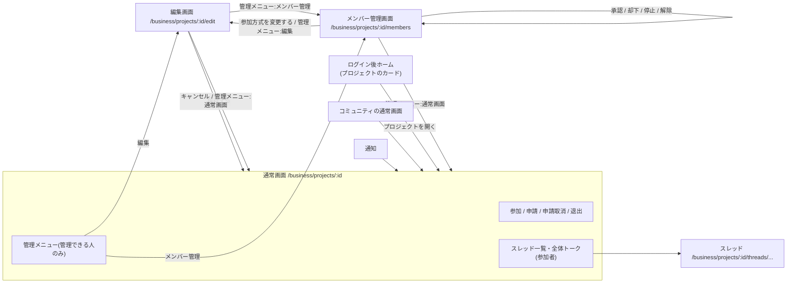

管理できない人が編集・メンバー管理の URL を直接開くと、通常画面(音楽はコミュニティ一覧)へ戻し、権限が無い旨を表示する。

## 4. 管理者と参加者の違い

| | 管理者(管理できる人) | 参加者 | 承認待ち | 非参加者 |
|---|---|---|---|---|
| 通常画面の本文 | 参加者と同じ配置 | 〇 | 名称・紹介・状態のみ(Business) | 名称・紹介と参加導線のみ(Business) |
| 管理メニュー | 〇(承認待ち件数つき) | × | × | × |
| 参加者自身の操作 | — | 退出・投稿 | 申請取消 | 参加 / 申請 |
| 編集画面・メンバー管理画面 | 〇 | 直接開いても戻される | 同左 | 同左 |
| 更新・承認・停止の直接リクエスト | 〇 | 拒否 | 拒否 | 拒否 |

**プロジェクトの作成**(Business): 作成できる人(`can_create_project_for?`)は、運営者・管理者と、Core プラン以上(またはお試し ON のコミュニティ)の参加者。
コミュニティの編集権限より広いため、作成ボタンを編集画面だけに置くと、運営者でない作成者が作成できなくなる。そこで次のようにした(権限そのものは変えていない)。

| | 運営者・管理者 | 作成できる参加者 | 作成できない参加者(Free) | 非参加者 |
|---|---|---|---|---|
| 通常画面の作成ボタン | なし | なし | なし(プランの案内の文字リンクのみ) | なし |
| 管理メニュー | 通常画面 / 編集 / メンバー管理 / プロジェクト管理 | 通常画面 / プロジェクト管理 | 出さない | 出さない |
| 編集画面の「プロジェクト管理」セクション | 〇 | (編集画面に入れない) | — | — |
| プロジェクト管理画面・作成画面・作成 | 〇 | 〇 | URL・リクエストでも不可 | 不可 |

「管理できる人」は次のとおりで、今回は変えていない。

- Business コミュニティ: オーナー、管理権限を付与された CommunityOwner、`is_owner: admin` の会員。削除はオーナーと管理者のみ。
- Business プロジェクト: コミュニティの運営者・管理者、コミュニティに参加中のプロジェクト作成者。
- 音楽コミュニティ: オーナーのみ。

**お試し設定(有料機能を無料でお試し)**: 状態の表示は編集画面に移した。変更できるのは従来どおりシステム管理者(Admin セッション)だけ。
運営者には状態だけを見せる。運営者ではないシステム管理者には、通常画面の管理メニューに「お試し設定（管理画面）」を出し、管理画面のコミュニティ詳細(`/admin/communities/:id`)へ案内する。

## 5. 今回の主な変更

- 共通の管理メニュー: `app/views/shared/_manage_bar.html.haml` / `app/helpers/manage_bar_helper.rb` / `app/assets/stylesheets/manage_bar.scss`
- Business コミュニティ
  - 通常画面から、参加申請カード(承認・拒否)とお試し設定フォームを外し、管理メニューに置き換えた。
  - 編集画面の「戻る」が一覧ではなく誤った URL を指していたのを、通常画面へ戻る「キャンセル」に直した。見出しの二重表示も直した。
- 音楽コミュニティ
  - 通常画面から Danger Zone と、重複していた「承認待ち一覧」「編集する」ボタンを外した。
  - Danger Zone は編集画面の下部へ移した。
  - **承認(`community_customers#create`)の認可を追加した。** これまではオーナー確認も申請とコミュニティの一致確認も無く、URL を送れば誰でも、別コミュニティの申請でも承認できた。
- Business プロジェクト: 編集画面の「戻る」がコミュニティへ戻っていた(渡していたキャンセル先が使われていなかった)のを、通常画面へ戻る「キャンセル」に直した。見出しの二重表示も直した。
- 375px 幅
  - 音楽コミュニティの3画面で出ていたページ全体の横はみ出しを直した(通常画面 31px、編集 122px、メンバー管理 47px → 0)。
  - Business コミュニティの通常画面で、名前が2行になるとヒーローの上下が切れていたのを直した。

## 6. タイムライン・スレッドの入力欄(書式なし)

対象はコミュニティのタイムライン(`CommunityPost`)とスレッドの投稿(`ProjectChat`)の入力欄(`business/chat/_composer`)だけ。
コミュニティ・プロジェクトの紹介文、スレッドのタイトル・説明、Business の「投稿」(`/business/posts`)の入力欄は変えていない。

- 太字・大きい文字・箇条書き・リンクのボタンと、プレビューのタブを外し、本文と改行だけを入力する textarea にした。添付(選択・取り消し・形式と容量の確認)、スタンプ、送信、スレッドの投稿の削除はそのまま。
- プレビューは書式の確認用だったため、入力欄と一緒に外した(`POST /business/chat_previews` も削除)。
- **保存形式**: 本文は従来どおりテキストのまま `body` に保存する。新しい投稿は `content_format: plain`(値 2)で保存する。カラムは整数のままなので、マイグレーションは無い。
- **表示**(`Business::ChatHelper#business_chat_body`)
  - `plain`: 本文をすべてエスケープしてから、改行を `<br>`、空行を段落にし、`http(s)://` の URL だけをリンクにする(`rel="noopener noreferrer nofollow"`)。`**`・`#` などの記号や、貼り付けた HTML(`<script>` を含む)は書いたとおりの文字で表示され、実行されない。
  - `markdown`(書式ボタンがあった時期の投稿)と `legacy`(機能追加前)は、投稿当時と同じ方式で表示する。過去データの一括変換はしていない。
- **既存投稿の編集**: タイムライン・スレッドの投稿には、もともと編集機能が無い(作成と、スレッドの投稿の削除のみ)。HTML タグが入力欄に出たり、編集で書式が外れたりすることは起きない。編集機能は追加していない。

## 7. 画面例(架空データ)

### Business コミュニティ

| 通常画面(管理者・PC) | 通常画面(管理者・スマホ) | 通常画面(参加者・スマホ) |
|---|---|---|
| 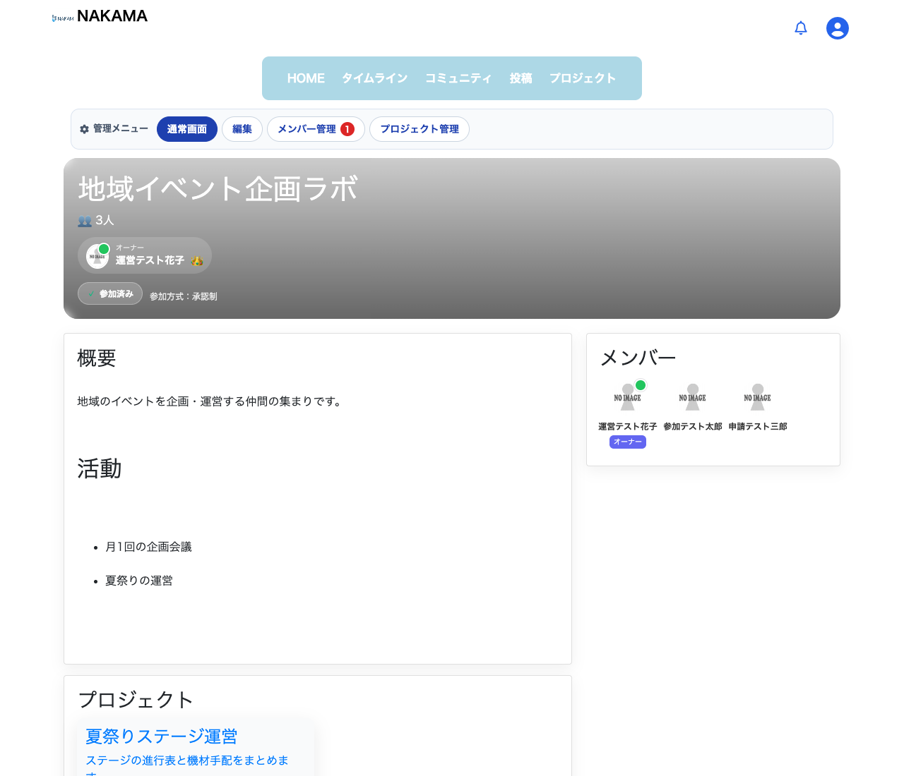 | 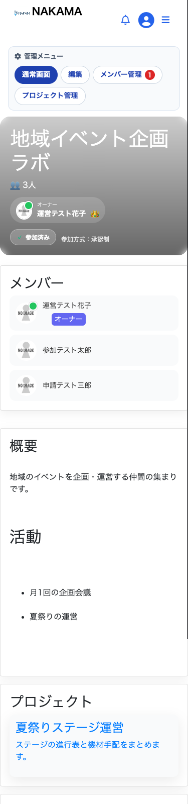 | 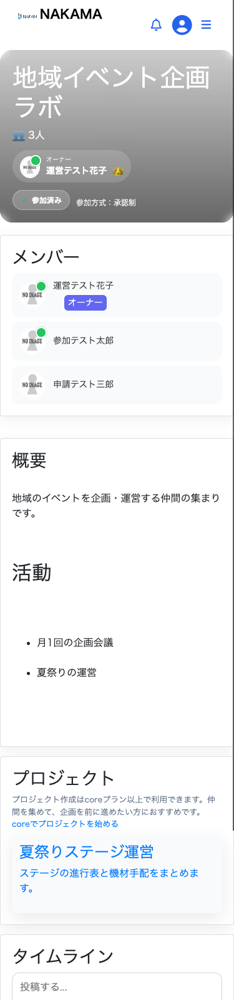 |

| 編集画面(PC) | 編集画面(スマホ) | メンバー管理画面(スマホ) |
|---|---|---|
| 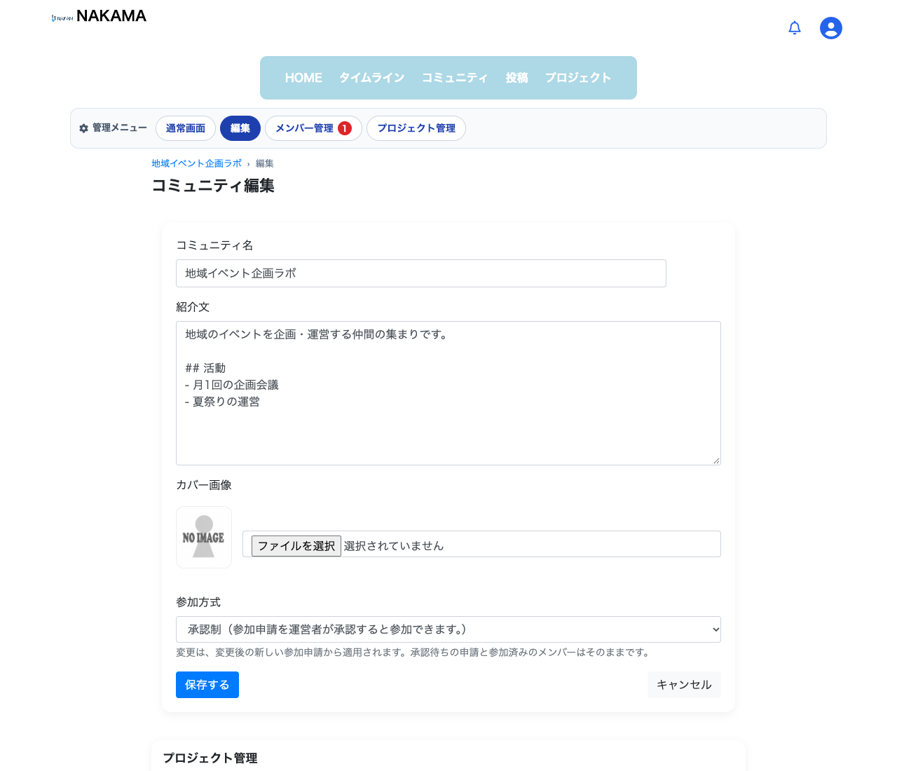 | 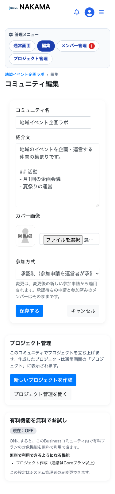 | 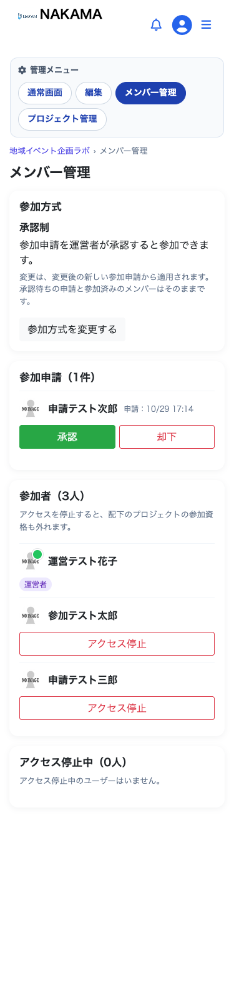 |

### プロジェクト管理・作成

| 編集画面のプロジェクト管理セクション(スマホ) | プロジェクト管理画面(PC) | プロジェクト管理画面(スマホ) | プロジェクト作成画面(スマホ) |
|---|---|---|---|
| 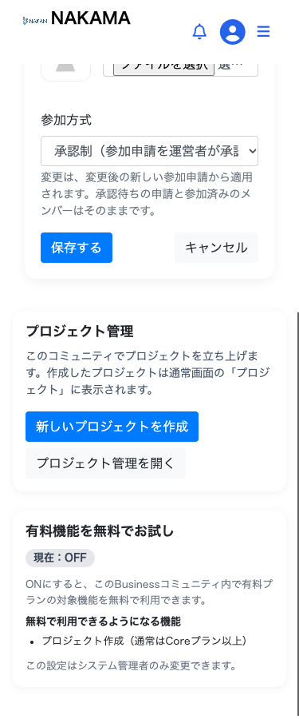 | 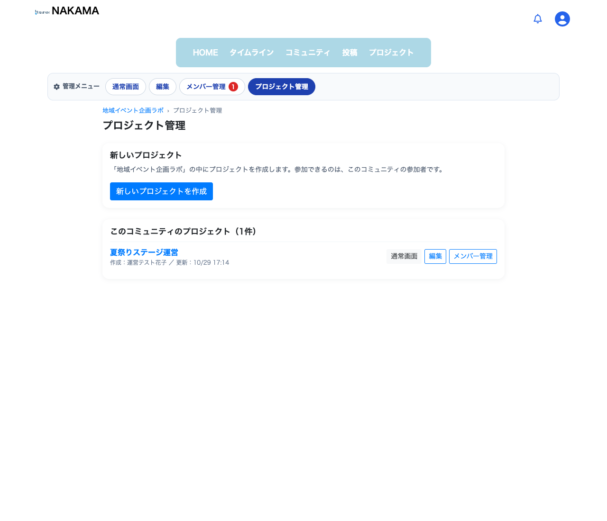 |  | 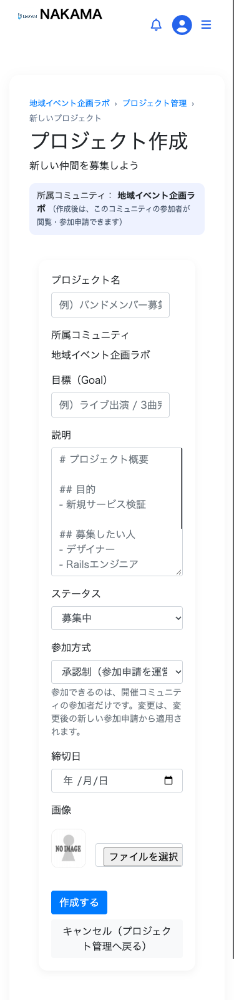 |

### Business プロジェクト

| 通常画面(管理者・PC) | 通常画面(管理者・スマホ) | 編集画面(スマホ) | メンバー管理画面(スマホ) |
|---|---|---|---|
| 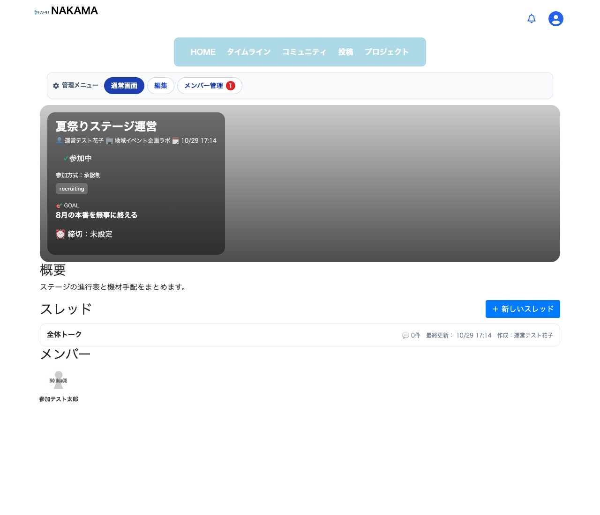 | 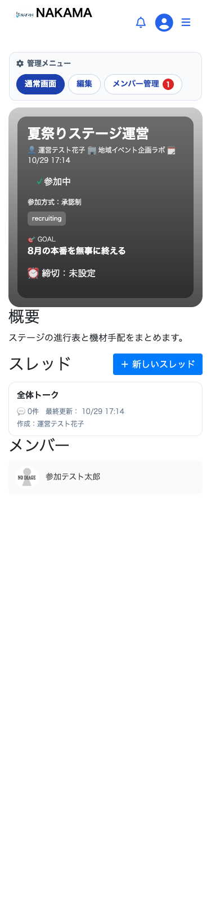 | 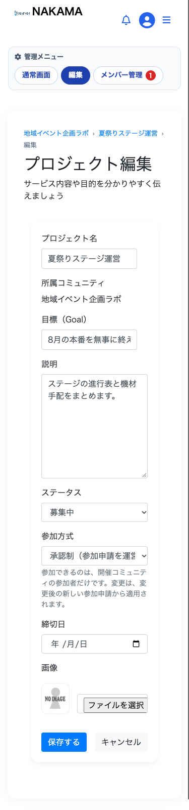 |  |

### 音楽コミュニティ

| 通常画面(オーナー・PC) | 通常画面(オーナー・スマホ) | 編集画面(スマホ) |
|---|---|---|
| 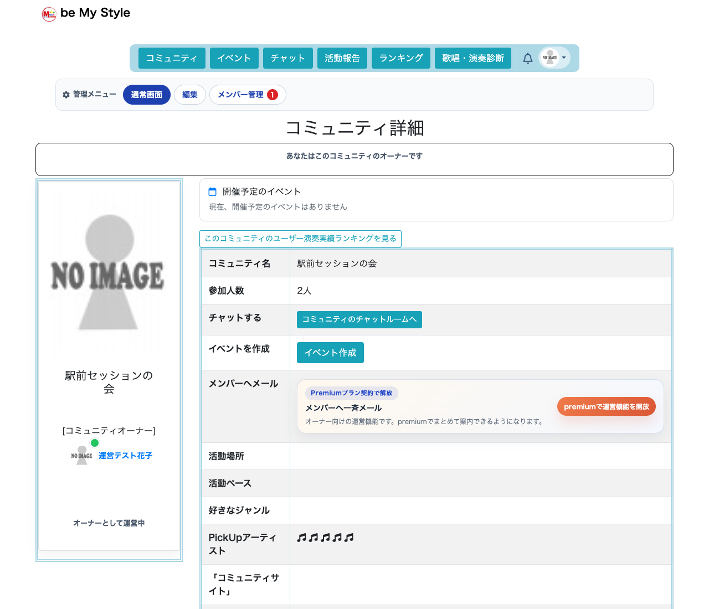 | 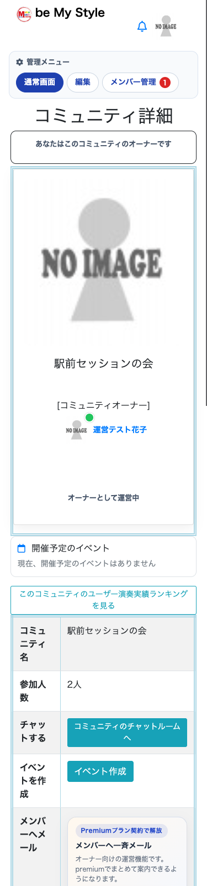 | 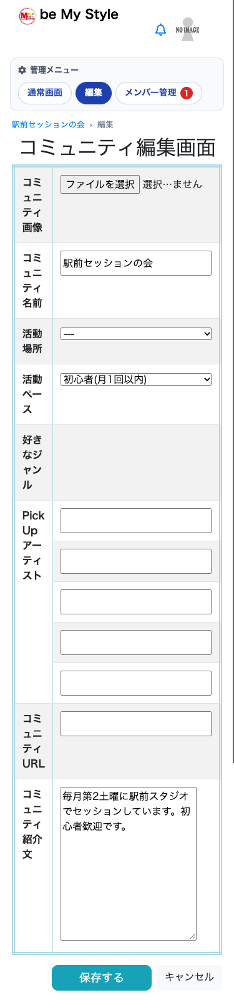 |

### タイムライン・スレッドの入力欄

| タイムライン(PC) | タイムライン(スマホ) | スレッド・送信後(PC) | スレッド・送信後(スマホ) |
|---|---|---|---|
| 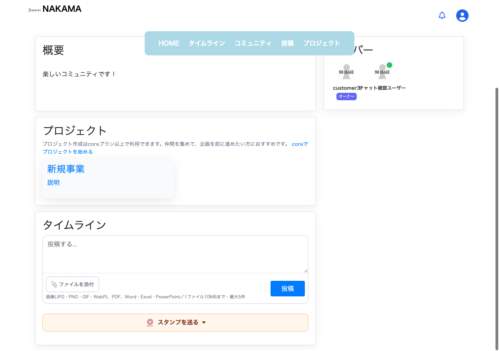 | 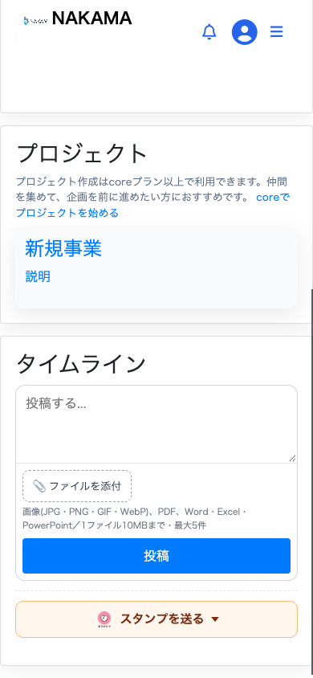 | 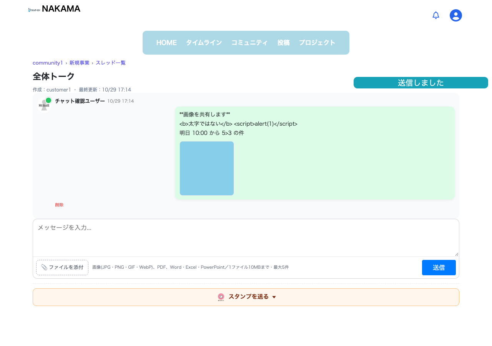 | 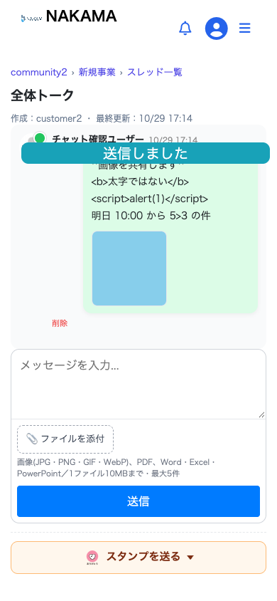 |

スレッドの画面例は、`**`・`<b>`・`<script>` を含む本文を送信した直後のもの(すべて文字のまま表示される)。

画像は `spec/system/manage_screens_spec.rb` と `spec/system/business/chat_composer_spec.rb` が `tmp/screenshots/` に保存したもの。

## 8. テスト

- `spec/requests/manage_screens_spec.rb`
  - 通常画面に設定フォーム・承認操作・Danger Zone が出ないこと。
  - 編集画面の保存・入力エラー・キャンセル導線。
  - 一般参加者・承認待ち・非参加者が、編集・メンバー管理・更新・削除・承認・停止へ直接アクセスできないこと。
  - 別プロジェクトの申請 ID を指定できないこと。許可していない項目(オーナー・ドメイン・所属コミュニティ)を変更できないこと。
- `spec/requests/public/community_customer_spec.rb`: 音楽コミュニティの承認の認可。
  - オーナーだけが承認でき、別コミュニティの申請 ID は承認できない。
  - 他コミュニティのオーナー・一般参加者・申請者本人・非参加者・未ログインでは、参加者・チャット参加者・申請のいずれも変わらない。
- `spec/requests/business/communities_spec.rb` / `community_plan_trials_spec.rb`: 通常画面とメンバー管理画面の分離、お試し設定の表示場所。
- `spec/requests/manage_screens_spec.rb`(プロジェクトの作成導線): 通常画面・参加者向け一覧に作成ボタンが無いこと、運営者は編集画面から、作成できる参加者はプロジェクト管理画面から作成できること、作成できない参加者・非参加者は URL・リクエストでも作成できないこと、所属コミュニティ ID の書き換えで作成できないこと。
- `spec/requests/business/chat_body_format_spec.rb`: 新しい投稿が `plain` で保存され、記号・HTML・`<`・`>`・日本語・改行・URL が正しく表示されること、過去の `markdown` / `legacy` 投稿の表示(スタンプを含む)が変わらないこと、入力欄に書式ボタン・プレビューが無いこと。
- `spec/system/business/chat_composer_spec.rb`: PC・スマホで、書式なしの入力欄から改行・HTML に似た文字・添付付きで送信できること、タイムラインへの投稿、スタンプ、横はみ出し。
- `spec/system/manage_screens_spec.rb`
  - 375px / 1280px で管理者の11画面(プロジェクト管理・作成画面を含む)がページ全体で横にはみ出さず、管理メニューが画面内で押せること。
  - 管理メニュー → 編集 → プロジェクト管理セクションからプロジェクトを作成できること。
  - 編集 → キャンセル(保存されない)→ 入力エラー → 保存 → 通常画面の流れ。
  - 一般参加者が編集 URL を開くと戻されること。

## 9. 残課題

- Business コミュニティの削除は、サーバー側には機能があるが画面上の導線がもともと無い。今回は追加していない。
- 音楽コミュニティのメンバー管理画面には、もともと却下・アクセス停止の機能が無い(承認のみ)。
- 音楽コミュニティの編集・削除・承認はオーナーのみ。管理権限(CommunityOwner)や管理者には開放していない(従来どおり)。
- Business プロジェクトにはモデルのバリデーションが無いため、プロジェクト編集で入力エラーになる経路は実質無い。エラー表示の枠だけ用意した。
- Turbolinks は、直前に開いた編集画面のキャッシュを一瞬表示してから最新の内容に置き換える(Business)。キャンセル時の入力が保存されることはない。
- 書式なしの投稿では、Markdown の `:smile:` などの絵文字ショートコードは変換されず、文字のまま表示される。
- プロジェクト作成画面の「説明」の入力例は Markdown のまま(紹介文は今回の対象外)。
