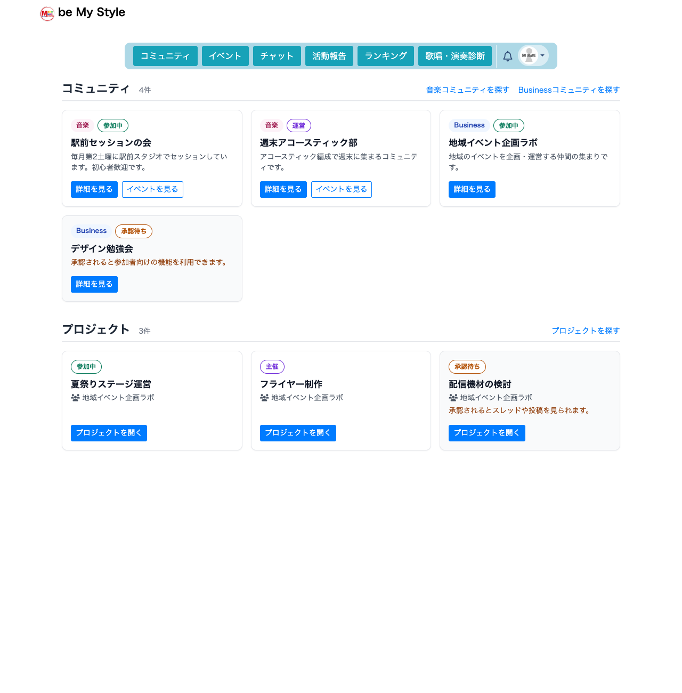
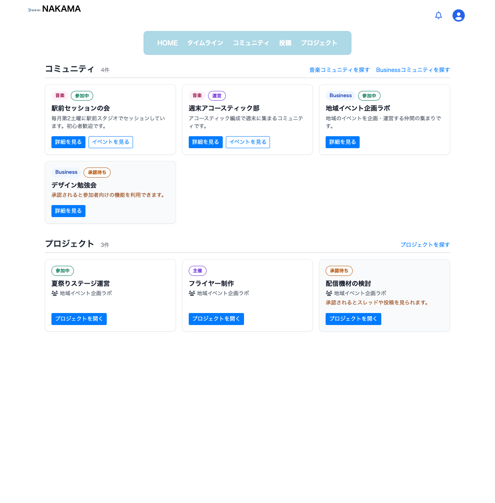
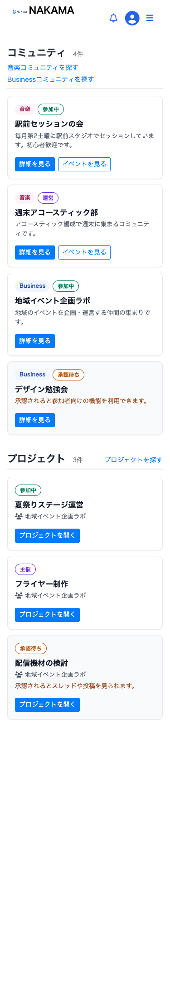
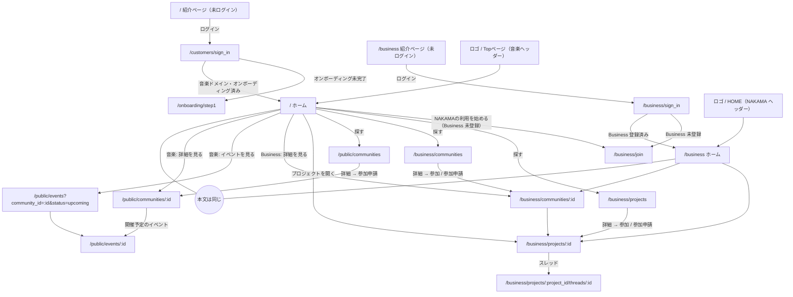
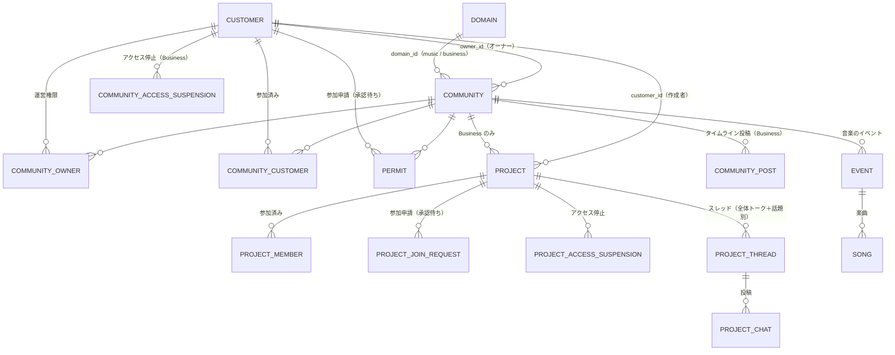
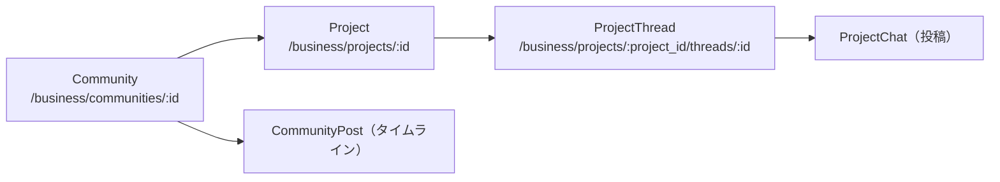
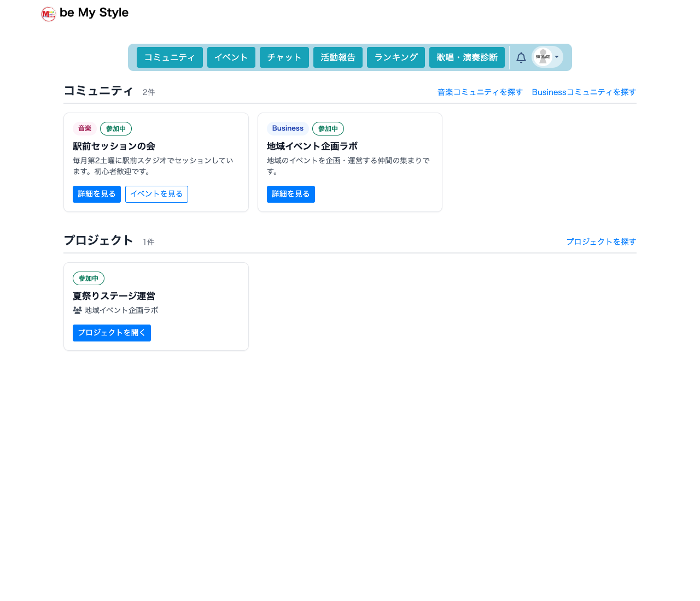
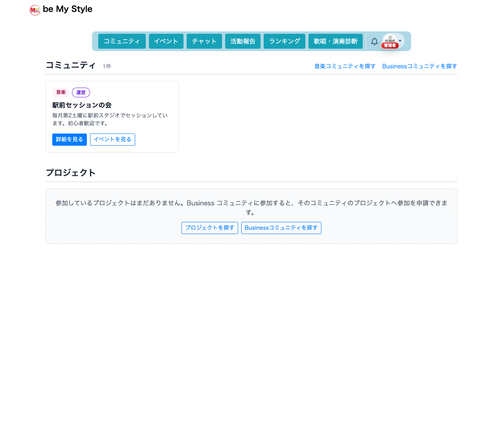

# ログイン後ホーム 設計資料

ログイン後の TOP（ホーム）を、紹介ページではなく「自分のコミュニティ・プロジェクトへすぐ移動するための作業画面」にした。
この資料では、画面の役割・構成・遷移・データの関係と権限をまとめる。

- 対象ブランチ: `feature/logged-in-home-dashboard`
- 主な実装:
  - 一覧の取得: [app/services/homes/my_communities.rb](../../app/services/homes/my_communities.rb)、[app/services/homes/my_projects.rb](../../app/services/homes/my_projects.rb)
  - 画面: [app/views/shared/_member_home.html.haml](../../app/views/shared/_member_home.html.haml)、[app/assets/stylesheets/member_home.scss](../../app/assets/stylesheets/member_home.scss)
  - コントローラ: [app/controllers/concerns/member_home.rb](../../app/controllers/concerns/member_home.rb)（`Public::HomesController#top` と `Business::HomesController#top` から使う）

---

## 1. ログイン前とログイン後の画面の役割

| URL | ログイン前 | ログイン後 |
|---|---|---|
| `/`（`/public/homes/top` も同じアクション） | 紹介ページ `guest_top`（変更なし） | **ホーム**（音楽の共通ヘッダー＋2つの一覧） |
| `/business` | NAKAMA の紹介ページ（ヒーロー・スライダー・お知らせ。変更なし） | **ホーム**（NAKAMA の共通ヘッダー＋2つの一覧） |

- ログイン後の本文は「コミュニティ」「プロジェクト」の2つの一覧だけ。紹介用のメイン画像・キャッチコピー・料金表・お知らせ・会員数・ご意見BOXカードは出さない。
- 共通ヘッダー（通知ベル・ユーザーメニュー・ログアウト・ご意見BOX）はそのまま。
- `/` と `/business` の本文は同じ内容。ヘッダーだけが各ドメインのものになる。
- `/` は、これまでどおり音楽ドメインの登録者だけが開ける。音楽ドメインの登録が無い会員は、各ドメインのホームへリダイレクトされる（`ensure_music_domain_access_for_public_routes!`）。

---

## 2. 画面構成

### PC（幅 992px 以上は 3 列、768〜991px は 2 列）

```
┌──────────────────────────────────────────────────────────┐
│ 共通ヘッダー（ロゴ / 主要メニュー / 通知 / アカウント）        │
├──────────────────────────────────────────────────────────┤
│ コミュニティ 4件            音楽コミュニティを探す  Businessコミュニティを探す │
│ ─────────────────────────────────────────────────────── │
│ ┌────────────┐ ┌────────────┐ ┌────────────┐            │
│ │[音楽][参加中]│ │[音楽][運営] │ │[Business]  │            │
│ │ 名前        │ │ 名前        │ │ 名前        │            │
│ │ 紹介(40字)  │ │ 紹介(40字)  │ │ 紹介(40字)  │            │
│ │[詳細][イベント]│ │[詳細][イベント]│ │[詳細]       │            │
│ └────────────┘ └────────────┘ └────────────┘            │
│                       « 1 2 »（6件ごと）                   │
│                                                          │
│ プロジェクト 3件                              プロジェクトを探す │
│ ─────────────────────────────────────────────────────── │
│ ┌────────────┐ ┌────────────┐ ┌────────────┐            │
│ │[参加中]     │ │[主催]       │ │[承認待ち]   │            │
│ │ 名前        │ │ 名前        │ │ 名前        │            │
│ │ 所属コミュニティ│ │ 所属コミュニティ│ │ 所属コミュニティ│            │
│ │[プロジェクトを開く]│ │[プロジェクトを開く]│ │ 承認後の案内 │            │
│ └────────────┘ └────────────┘ └────────────┘            │
└──────────────────────────────────────────────────────────┘
```





### スマホ（幅 575px 以下は 1 列）

```
┌──────────────────┐
│ ヘッダー            │
├──────────────────┤
│ コミュニティ 4件     │
│ 音楽コミュニティを探す │
│ Businessコミュニティを探す│
│ ┌──────────────┐ │
│ │ カード         │ │
│ └──────────────┘ │
│ ┌──────────────┐ │
│ │ カード         │ │
│ └──────────────┘ │
│ « 1 2 »           │
│ プロジェクト 3件     │
│ ┌──────────────┐ │
│ │ カード         │ │
│ └──────────────┘ │
└──────────────────┘
```

| `/`（375px） | `/business`（375px） |
|---|---|
|  |  |

スクリーンショットは [spec/system/member_home_spec.rb](../../spec/system/member_home_spec.rb) が作る検証用の架空データで撮影した（個人情報は含まない）。同じ spec で次を確認している。
- 375 / 768 / 1280px で、ホーム本文が画面外にはみ出さず、カード同士が重ならず、列数が 1 / 2 / 3 になること
- 375px で、ヘッダーを含むページ全体が横にはみ出さないこと（`scrollWidth - clientWidth <= 0`、かつ左右にはみ出す要素が0件）
- 375px で SP メニューを開くと、全項目が画面内に収まり押せること。音楽ヘッダーはアバター画像が SP メニューのボタン、NAKAMA は ☰

再撮影する場合は spec を実行し、`tmp/screenshots/member_home_*.png` を `docs/design/images/logged_in_home_*.png` へコピーする。

---

## 3. カードの表示内容と空状態

### コミュニティカード

| 項目 | 内容 |
|---|---|
| 種類 | `音楽` / `Business`（`communities.domain_id`） |
| 参加状態 | `運営`（オーナー・CommunityOwner）/ `参加中` / `承認待ち` |
| 名前 | コミュニティ名 |
| 紹介文 | 40 字で切る。**承認待ちでは出さず**「承認されると参加者向けの機能を利用できます。」とだけ出す |
| ボタン | `詳細を見る`：音楽 `/public/communities/:id`、Business `/business/communities/:id`<br>`イベントを見る`（音楽のみ）：`/public/events?community_id=:id&status=upcoming` |

### プロジェクトカード（Business のみ）

| 項目 | 内容 |
|---|---|
| 参加状態 | `管理`（コミュニティ運営者）/ `主催`（作成者）/ `参加中` / `承認待ち` |
| 名前 | プロジェクト名 |
| 所属コミュニティ | コミュニティ名 |
| 承認待ちの案内 | 「承認されるとスレッドや投稿を見られます。」（スレッド・投稿・メンバーは出さない） |
| ボタン | `プロジェクトを開く`：`/business/projects/:id` |

### 一覧の共通ルール

- 並び順は更新が新しい順。1ページ 6 件。
- ページ番号は一覧ごとに別のパラメータ（`community_page` / `project_page`）。片方をめくっても、もう片方のページは変わらない。
- 件数（`4件`）は、閲覧してよい対象だけを数える。
- 同じ対象は1枚だけ（参加者かつ運営者でも1件）。条件を `OR` でまとめた1本の SQL で取得するため、重複しない。
- カード全体はリンクにしない。リンクは各ボタンだけで、入れ子にしない。ボタンには「（名前）の詳細を見る」などの `aria-label` を付け、Tab キーで順に移動できる。

### 空状態

| 状態 | コミュニティ | プロジェクト |
|---|---|---|
| 0件 | 「参加しているコミュニティはまだありません。」＋ 探す導線（開ける一覧だけ） | Business 登録あり：「参加しているプロジェクトはまだありません。Business コミュニティに参加すると…」＋「プロジェクトを探す」「Businessコミュニティを探す」<br>Business 登録なし：「プロジェクトは Business（NAKAMA）のコミュニティで利用できる機能です。」＋「NAKAMAの利用を始める」 |
| 存在しないページ番号 | 「このページに表示するコミュニティはありません。」＋「最初のページへ」 | 同様 |

探す導線は、見出しの右（1件以上あるとき）か空状態の中に小さく出す。独立した紹介セクションは作らない。

- 「音楽コミュニティを探す」→ `/public/communities`（音楽ドメイン登録者・管理者のみ）
- 「Businessコミュニティを探す」→ `/business/communities`（Business ドメイン登録者・管理者のみ）
- 「プロジェクトを探す」→ `/business/projects`（Business ドメイン登録者・管理者のみ）
- 「NAKAMAの利用を始める」→ `/business/join`（Business 未登録者のみ。既存の利用開始画面）

### 未参加の対象へ参加申請するまでの導線

ホームには参加中・運営・承認待ちしか出ないため、未参加の対象へは既存の一覧から進む。どの一覧も公開範囲・認可は従来のまま（今回、新たに公開した対象は無い）。

| 対象 | 導線 | 公開範囲（従来どおり） |
|---|---|---|
| 音楽コミュニティ | 「音楽コミュニティを探す」→ `/public/communities` → 詳細 → 参加申請 | 音楽ドメイン登録者は全件の詳細を見られる |
| Business コミュニティ | 「Businessコミュニティを探す」→ `/business/communities` → 詳細 → 参加 / 参加申請 | 未参加者には名前・紹介と申請ボタンだけ。プロジェクト・タイムライン・メンバーは参加者のみ |
| Business プロジェクト | 「プロジェクトを探す」→ `/business/projects` → 詳細 → 参加 / 参加申請 | 参加中のコミュニティのプロジェクトだけ。未参加コミュニティのプロジェクトは一覧にも出ず、詳細はコミュニティ画面へ戻される |

`/business/projects` はコミュニティ未参加だと空になるため、プロジェクトの空状態には前提となる「Businessコミュニティを探す」も並べている。

---

## 4. ページ遷移



### ログイン直後の着地先（今回は変更していない）

| ログイン画面 | 着地先 |
|---|---|
| `/customers/sign_in`（音楽） | `/`（音楽ドメインでオンボーディング未完了なら `/onboarding/step1`） |
| `/business/sign_in` | `/business`（未登録なら `/business/join`、オンボーディング未完了なら `/onboarding/step1`） |
| `/singing/sign_in` / `/learning/sign_in` | 各ドメインのホーム（今回の対象外） |

> **注意:** 調査の結果、現在の `after_sign_in_path_for`（`Public::SessionsController` と `DomainScopedSession`）は Devise の `stored_location_for` を使っていない。このため、**未ログインで開こうとしたページへログイン後に戻る動作は、もともと存在しない**（例: 未ログインで `/public/events` → ログイン画面 → ログイン後は `/`）。今回はこの挙動を変えず、[spec/requests/public/sessions_spec.rb](../../spec/requests/public/sessions_spec.rb) の「ログイン後の着地先」で現行の動作を固定した。戻り先を復元するかどうかは、別途判断が必要（残課題）。

---

## 5. データの関係



コミュニティ → プロジェクト → スレッド → 投稿 の階層（Business）:



スレッドは独自の権限を持たず、所属プロジェクトの権限を引き継ぐ。プロジェクトは所属コミュニティの参加資格を前提にする。

---

## 6. 参加・承認・アクセス権との関係

判定の元は `BusinessAccess`（[app/models/concerns/business_access.rb](../../app/models/concerns/business_access.rb)）。ホームの一覧は、この判定でリンク先を開ける対象だけを出すように条件を揃えている。

### コミュニティ一覧に出る条件（`Homes::MyCommunities`）

次のいずれかに当てはまるもの。

| 条件 | テーブル | 表示 |
|---|---|---|
| オーナー | `communities.owner_id` | 運営 |
| 運営権限 | `community_owners` | 運営 |
| 参加済み | `community_customers` | 参加中 |
| 参加申請中 | `permits` | 承認待ち |

- 音楽コミュニティは、音楽ドメインの登録者（または管理者）にだけ出す。リンク先 `/public/...` は音楽ドメインの登録が必要なため。
- 音楽と Business の参加・公開ルールの違いはそのまま。ホームは状態を表示するだけで、参加・承認の処理は既存の各画面で行う。

### プロジェクト一覧に出る条件（`Homes::MyProjects`）

| 条件 | 表示 | 根拠 |
|---|---|---|
| 運営しているコミュニティのプロジェクト | 管理 | `business_project_manager?`（運営者は配下を管理できる） |
| 参加中のコミュニティで、自分が作成したもの | 主催 | `business_project_manager?`（作成者かつコミュニティ参加者） |
| 参加中のコミュニティで、`project_members` にあるもの | 参加中 | `business_project_participant?` |
| 参加中のコミュニティで、`project_join_requests` にあるもの | 承認待ち | プロジェクト詳細は概要だけ見える（`business_community_participant?`） |

- 親コミュニティの参加資格を失うと（退出・アクセス停止）、運営者でない限りどの条件にも当たらなくなり、一覧から消える。
- アクセス停止や退出では `Business::Memberships::RevokeCommunityAccess` / `RevokeProjectAccess` が参加行・申請行を削除する。このため、一覧は削除された時点で自動的に更新される。
- 退会済みの会員はログインできないため、ホームは表示されない。

### 権限の無いものが漏れないこと

- 取得は DB 側で絞り込む（`WHERE ... OR ...` とサブクエリ）。件数（`total_count`）も同じ条件で数える。
- 見えないコミュニティ・プロジェクトの名前・件数・紹介文は、HTML に一切出さない（request spec で確認）。
- 状態は表示中のページ分だけ、まとめて問い合わせる（1つの一覧につき 2 クエリ）。カードごとの追加クエリ（N+1）は無い。

---

## 7. 音楽コミュニティからイベントへ進む導線（従来どおり）

1. ホームのカード「イベントを見る」→ `/public/events?community_id=:id&status=upcoming`（コミュニティ詳細の「すべて見る」と同じ URL）
2. ホームのカード「詳細を見る」→ `/public/communities/:id` →「開催予定のイベント」→ `/public/events/:id`
3. 共通ヘッダーの「イベント」→ `/public/events`

イベント・楽曲・参加の画面と権限は変更していない。

---

## 8. 管理者と一般参加者の見え方の違い

| 対象 | 一般参加者 | コミュニティ運営者（オーナー / CommunityOwner） | 管理者（`is_owner: admin`） |
|---|---|---|---|
| コミュニティ一覧 | 参加中・承認待ち | ＋運営しているもの（`運営`） | 自分が関係するものだけ（表示は `運営`）。全コミュニティは出さない |
| プロジェクト一覧 | 主催・参加中・承認待ち | ＋運営コミュニティの全プロジェクト（`管理`） | 自分が関係するものだけ（表示は `管理`） |
| プロジェクト詳細 | 参加中はスレッドまで、承認待ちは概要だけ | 全プロジェクトの内部を閲覧・管理 | 既存の認可どおり全件閲覧可能 |

管理者は既存の認可で全コミュニティ・全プロジェクトを開けるが、ホームは「自分の参加先」を並べる画面なので、関係の無いものは出さない。

管理への導線は失われていない。
- 旧ホーム（main 時点の `/` と `/business`）には、もともと管理画面へのリンクは無かった。
- `/admin` は会員とは別の管理者アカウント（Devise の `Admin`）でログインする画面で、会員の `is_owner: admin` とは別。
- 会員側の管理操作は、各詳細画面にある。Business コミュニティの「編集」「メンバー管理」（`/business/communities/:id/permits`）、プロジェクトの「編集」「メンバー」、音楽コミュニティのオーナー向け「承認待ち一覧」「編集する」。
- 管理者には、ホームの見出し横に「音楽コミュニティを探す」「Businessコミュニティを探す」を必ず出す。関係の無いコミュニティも、そこから詳細を開いて管理できる（system spec で確認）。

### 利用者の種類ごとの画面（検証用の架空データ）

| 一般参加者（PC） | 管理者（PC） |
|---|---|
|  |  |

| 承認待ちのみ（375px） | 所属0件・Business 未登録（375px） |
|---|---|
|  |  |

- 一般参加者：参加中のものだけ。運営していないコミュニティ・参加していないプロジェクトは出ない。
- 承認待ち：状態と「承認されると…」の案内だけ。紹介文やプロジェクト名は出ない。
- 管理者：自分が参加している1件だけ（表示は `運営`）。
- 所属0件：空状態から音楽コミュニティ一覧と Business 利用開始画面へ進める。

---

## 9. 図の描画確認

この資料の Mermaid 図（ページ遷移図・関係図・階層図の3つ）は、headless Chrome と mermaid 10.9.1 で描画し、3つともエラーなく描画できることを確認した（GitHub の Markdown 表示も Mermaid に対応している）。

## 10. 変更していないもの

- ログイン前の紹介ページ（`/` の `guest_top`、`/business` のゲスト表示）
- ログイン処理・ログイン後の着地先・オンボーディング
- 各ドメインの一覧画面（`/public/communities`、`/business/communities`、`/business/projects`）と認可
- 参加・承認・アクセス停止の処理
